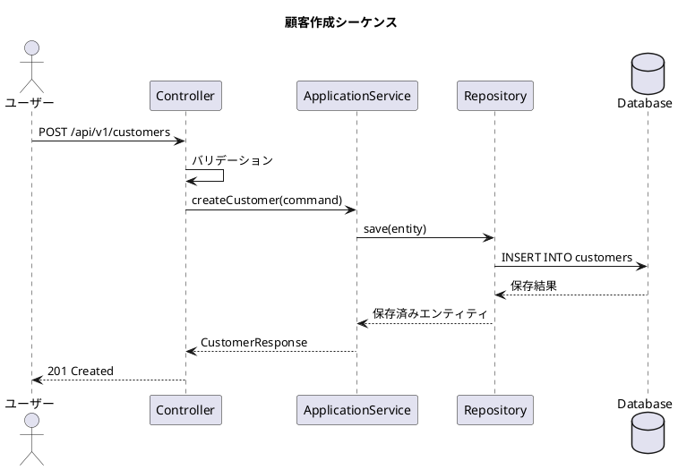

# 詳細設計ガイドライン

このドキュメントは、 **modulith-learning**
プロジェクトにおける詳細設計の実践方法を定義するガイドラインです。要件定義・基本設計から実装への橋渡しとして、各技術領域の詳細設計手順・ルール・テンプレートを記載します。

---

## 1. 詳細設計の目的と基本概念

### 1.1 詳細設計とは

詳細設計は、基本設計で定義された要件・アーキテクチャを、実装可能なレベルまで具体化する工程です。「何を（What）」から「どのように（How）」への変換を行い、開発者が迷わず実装できる情報を提供します。

### 1.2 詳細設計の目的

1. **実装の明確化**: 開発者が設計ドキュメントのみで実装可能なレベルまで詳細を定義する
2. **品質の確保**: 設計段階で技術的な課題を早期に発見・解決する
3. **知識の共有**: 設計意図を文書化し、チーム内で共有する
4. **保守性の向上**: 将来の変更・拡張時に、設計の意図を遡ることができる記録を残す

### 1.3 詳細設計の成果物

| 成果物                   | 説明                                         |
|:-------------------------|:---------------------------------------------|
| **ドメインモデル図**     | エンティティ・値オブジェクトの関係性とルール |
| **シーケンス図**         | 主要ユースケースの処理フロー                 |
| **データベース設計書**   | テーブル定義・インデックス・制約             |
| **API仕様書**            | エンドポイント・リクエスト・レスポンス定義   |
| **コンポーネント設計書** | フロントエンドのコンポーネント構成           |
| **バッチ設計書**         | ジョブ構成・Reader/Processor/Writer設計      |

---

## 2. 詳細設計の進め方

### 2.1 設計フロー

```
要件定義 → 基本設計 → ドメインモデリング → 技術設計 → 設計レビュー → 実装
```

1. **要件理解**: 機能要望・システム要件を精読し、設計対象の範囲を明確にする
2. **ドメインモデリング**: ドメインエキスパートと協力して、ドメインモデル図を作成する
3. **技術設計**: 選択した技術スタックに基づいて、詳細な技術設計を行う
4. **設計レビュー**: チームで設計を検証し、改善点を反映する
5. **実装**: 設計ドキュメントに基づいて実装を行う

### 2.2 設計ドキュメントの配置

詳細設計ドキュメントは `docs/` 配下に配置し、モジュールごとにフォルダを分割します。

```
docs/
├── 03 詳細設計/
│   ├── <モジュール名>/
│   │   ├── ドメインモデル.md
│   │   ├── データベース設計.md
│   │   ├── API設計.md
│   │   └── フロントエンド設計.md
│   └── 共有コンポーネント/
│       └── 共通設計.md
```

---

## 3. ドメインモデル詳細設計

### 3.1 設計手順

1. **ユースケースの特定**: 設計対象のユースケースをリストアップする
2. **エンティティの抽出**: ユースケースからエンティティ候補を抽出する
3. **値オブジェクトの特定**: 不変な属性のグループを、値オブジェクトとして特定する
4. **関係性の定義**: エンティティ間の関連と多重度を定義する
5. **集約境界の決定**: 強い整合性を確保する範囲を、集約として定義する
6. **ルールの記載**: 各エンティティ・値オブジェクトに適用されるビジネスルールを記載する

### 3.2 エンティティ設計テンプレート

```markdown
### エンティティ名: Customer

**識別子**: `id` (Snowflake ID / BIGINT)

**属性**:
| 属性名 | 型 | 説明 | 制約 |
|:-------|:---|:-----|:-----|
| id | Long | 顧客ID | 主キー |
| customerCode | String | 顧客コード | NOT NULL, UNIQUE, 最大20文字 |
| name | String | 顧客名 | NOT NULL, 最大100文字 |
| email | String | メールアドレス | NOT NULL, UNIQUE, 最大255文字 |
| status | CustomerStatus | 状態 | NOT NULL, デフォルト: ACTIVE |

**ビジネスルール**:
- 顧客コードは一意であること
- メールアドレスは有効な形式であること
- 削除は論理削除（deleted_at）で行う

**関連**:
- Order: 1対多（customer → orders）

**集約ルート**: はい
```

### 3.3 値オブジェクト設計テンプレート

```markdown
### 値オブジェクト名: Address

**属性**:
| 属性名 | 型 | 説明 | 制約 |
|:-------|:---|:-----|:-----|
| prefecture | String | 都道府県 | NOT NULL, 最大20文字 |
| city | String | 市区町村 | NOT NULL, 最大100文字 |
| street | String | 町名・番地 | NOT NULL, 最大255文字 |

**ビジネスルール**:
- 不変（Immutable）であること
- 全属性がnullでないこと

**使用エンティティ**: Customer, Order
```

### 3.4 ドメインサービス設計テンプレート

```markdown
### ドメインサービス名: CustomerDuplicateCheckService

**責務**: 顧客コードの重複チェック

**入力**: customerCode (String)

**出力**: boolean (true: 重複あり, false: 重複なし)

**処理内容**:
1. 顧客コードで既存顧客を検索する
2. 存在する場合はtrue、存在しない場合はfalseを返す

**使用リポジトリ**: CustomerRepository
```

### 3.5 ドメインイベント設計テンプレート

```markdown
### ドメインイベント名: CustomerCreatedEvent

**発生タイミング**: 顧客が新規作成された直後

**ペイロード**:
| 属性名 | 型 | 説明 |
|:-------|:---|:-----|
| customerId | Long | 顧客ID |
| customerCode | String | 顧客コード |
| createdAt | LocalDateTime | 作成日時 |

**リスナー**:
- 通知サービス: 新規顧客へのウェルカムメール送信
- 統計サービス: 顧客数のカウント更新
```

---

## 4. データベース詳細設計

### 4.1 設計手順

1. **スキーマの決定**: 事業領域・業務領域に基づいて、スキーマ名を決定する
2. **テーブル定義**: エンティティに基づいて、テーブル構造を定義する
3. **制約の定義**: 主キー・外部キー・ユニーク制約・チェック制約を定義する
4. **インデックス設計**: 検索条件・結合条件に基づいて、インデックスを設計する
5. **Flywayマイグレーション**: スキーマ変更スクリプトを作成する

### 4.2 テーブル設計テンプレート

```markdown
### テーブル名: customers

**スキーマ**: undecided_as

**テーブル定義**:
| カラム名 | 型 | NULL | 制約 | 説明 |
|:---------|:---|:-----|:-----|:-----|
| id | BIGINT | NOT NULL | PRIMARY KEY | 顧客ID |
| customer_code | VARCHAR(20) | NOT NULL | UNIQUE | 顧客コード |
| name | VARCHAR(100) | NOT NULL | - | 顧客名 |
| email | VARCHAR(255) | NOT NULL | UNIQUE | メールアドレス |
| status | VARCHAR(20) | NOT NULL | DEFAULT 'ACTIVE', CHECK | 状態 |
| created_at | TIMESTAMP | NOT NULL | DEFAULT CURRENT_TIMESTAMP | 作成日時 |
| updated_at | TIMESTAMP | NOT NULL | DEFAULT CURRENT_TIMESTAMP | 更新日時 |
| deleted_at | TIMESTAMP | NULL | - | 論理削除日時 |

**インデックス**:
| インデックス名 | カラム | 種類 | 説明 |
|:---------------|:-------|:-----|:-----|
| idx_customers_email | email | 単一 | メールアドレス検索 |
| idx_customers_status | status | 単一 | 状態別検索 |
| idx_customers_status_created_at | status, created_at | 複合 | 状態別・日付順検索 |

**制約**:
- 主キー: id
- ユニーク: customer_code, email
- チェック: status IN ('ACTIVE', 'INACTIVE', 'SUSPENDED')
```

### 4.3 Flywayマイグレーション設計

マイグレーションスクリプトは `src/main/resources/db/migration/<モジュール>/` に配置します。

**命名規則**: `V<バージョン>__<説明>.sql`

```sql
-- V1.0.0__create_customer_table.sql
CREATE SCHEMA IF NOT EXISTS undecided_as;

CREATE TABLE undecided_as.customers
(
    id            BIGINT PRIMARY KEY,
    customer_code VARCHAR(20)  NOT NULL UNIQUE,
    name          VARCHAR(100) NOT NULL,
    email         VARCHAR(255) NOT NULL UNIQUE,
    status        VARCHAR(20)  NOT NULL DEFAULT 'ACTIVE'
        CHECK (status IN ('ACTIVE', 'INACTIVE', 'SUSPENDED')),
    created_at    TIMESTAMP    NOT NULL DEFAULT CURRENT_TIMESTAMP,
    updated_at    TIMESTAMP    NOT NULL DEFAULT CURRENT_TIMESTAMP,
    deleted_at    TIMESTAMP    NULL
);

CREATE INDEX idx_customers_email ON undecided_as.customers (email);
CREATE INDEX idx_customers_status ON undecided_as.customers (status);
```

---

## 5. API詳細設計

### 5.1 設計手順

1. **リソースの特定**: CRUD対象のリソースを特定する
2. **エンドポイント定義**: HTTPメソッド、URLパス、ステータスコードを定義する
3. **リクエスト・レスポンス設計**: DTOの構造とバリデーションルールを定義する
4. **エラーハンドリング**: 発生しうるエラーケースとレスポンスを定義する
5. **OpenAPIドキュメント**: アノテーションまたはYAMLで、API仕様をドキュメント化する

### 5.2 エンドポイント設計テンプレート

```markdown
### エンドポイント: 顧客一覧取得

**メソッド**: GET
**パス**: `/api/v1/customers`
**ステータスコード**: 200 OK

**クエリパラメータ**:
| パラメータ | 型 | 必須 | 説明 | デフォルト |
|:-----------|:---|:-----|:-----|:-----------|
| pageSize | Integer | いいえ | ページサイズ | 20 |
| pageNumber | Integer | いいえ | ページ番号 | 0 |
| sort | String | いいえ | ソート条件 | id,ASC |
| status | String | いいえ | 状態フィルタ | - |

**レスポンス**:
```json
{
  "data": [
    {
      "id": 1,
      "customerCode": "C001",
      "name": "山田太郎",
      "email": "taro@example.com",
      "status": "ACTIVE",
      "createdAt": "2024-01-01T00:00:00Z"
    }
  ],
  "metadata": {
    "pageSize": 20,
    "pageNumber": 0,
    "totalElements": 100,
    "totalPages": 5
  }
}
```

**エラーレスポンス**:
| ステータス | エラーコード | 説明 |
|:-----------|:-------------|:-----|
| 400 | INVALID_PARAMETER | 無効なパラメータ |
| 500 | INTERNAL_ERROR | サーバーエラー |

```

### 5.3 DTO設計テンプレート

```markdown
### リクエストDTO: CreateCustomerRequest

| フィールド | 型 | 必須 | バリデーション | 説明 |
|:-----------|:---|:-----|:---------------|:-----|
| customerCode | String | はい | @NotBlank, @Size(max=20) | 顧客コード |
| name | String | はい | @NotBlank, @Size(max=100) | 顧客名 |
| email | String | はい | @NotBlank, @Email, @Size(max=255) | メールアドレス |

### レスポンスDTO: CustomerResponse

| フィールド | 型 | 説明 |
|:-----------|:---|:-----|
| id | Long | 顧客ID |
| customerCode | String | 顧客コード |
| name | String | 顧客名 |
| email | String | メールアドレス |
| status | String | 状態 |
| createdAt | LocalDateTime | 作成日時 |
```

---

## 6. シーケンス図設計

### 6.1 設計手順

1. **ユースケースの選択**: 主要なユースケースを特定する
2. **アクターの特定**: システムとやり取りするアクターを特定する
3. **メッセージフローの定義**: リクエストとレスポンスの順序を定義する
4. **エラーケースの記載**: 例外フローを別レーンで記載する

### 6.2 シーケンス図テンプレート（PlantUML）



---

## 7. バッチ処理詳細設計

### 7.1 設計手順

1. **処理対象の特定**: インポート対象のデータソースと対象テーブルを特定する
2. **Job/Step構成の設計**: 必要なステップと実行順序を定義する
3. **Reader設計**: データソースからの読み込み方法を定義する
4. **Processor設計**: 変換と検証のロジックを定義する
5. **Writer設計**: 永続化方法を定義する
6. **エラーハンドリング**: スキップとリトライのポリシーを定義する

### 7.2 バッチ設計テンプレート

```markdown
### ジョブ名: customerImportJob

**処理概要**: CSVファイルから顧客データをインポート

**Step構成**:
| 順序 | Step名 | タイプ | 説明 |
|:-----|:-------|:-------|:-----|
| 1 | truncateStep | Tasklet | 既存データの削除 |
| 2 | importStep | Chunk | CSVインポート |
| 3 | recordImportStep | Tasklet | インポート記録の保存 |

**チャンクサイズ**: 50

**Reader**:
- 入力: classpath:data/customers.csv
- 形式: CSV（ヘッダーあり）
- 文字コード: UTF-8

**Processor**:
- 必須フィールド: customerCode, name, email
- 検証ルール: メールアドレス形式チェック、重複チェック
- スキップ条件: 必須フィールドがnullまたは空

**Writer**:
- 保存方法: repository.saveAll() 一括保存

**エラーハンドリング**:
- skipLimit: 10
- retryLimit: 3
```

---

## 8. フロントエンド詳細設計

### 8.1 設計手順

1. **ページ構成の定義**: ルーティング構造とページ構成を定義する
2. **コンポーネント分割**: 再利用可能なコンポーネントを特定する
3. **ステート管理の設計**: ローカルステートとグローバルステートの境界を定義する
4. **API通信の設計**: 使用するAPIエンドポイントと通信パターンを定義する
5. **型定義の設計**: TypeScriptのインターフェースと型エイリアスを定義する

### 8.2 コンポーネント設計テンプレート

```markdown
### コンポーネント名: CustomerList

**種類**: コンテナコンポーネント

**Props**:
| プロパティ | 型 | 必須 | デフォルト | 説明 |
|:-----------|:---|:-----|:-----------|:-----|
| filterStatus | CustomerStatus \| undefined | いいえ | undefined | 状態フィルタ |

**ステート**:
| ステート名 | 型 | 管理方法 | 説明 |
|:-----------|:---|:---------|:-----|
| customers | Customer[] | useState | 顧客リスト |
| loading | boolean | useState | ローディング状態 |
| error | string \| null | useState | エラーメッセージ |
| pagination | Pagination | useState | ページネーション情報 |

**子コンポーネント**:
- CustomerTable: 顧客一覧のテーブル表示
- PaginationControls: ページネーションコントロール
- CustomerFilter: フィルタ条件入力

**API通信**:
- GET /api/v1/customers: 顧客一覧取得
- POST /api/v1/customers: 顧客作成

**イベントハンドラ**:
| イベント | 説明 |
|:---------|:-----|
| onRowClick | 顧客詳細画面への遷移 |
| onDeleteClick | 顧客削除の確認ダイアログ表示 |
```

### 8.3 型定義テンプレート

```typescript
// 顧客関連の型定義

interface Customer {
  id: number;
  customerCode: string;
  name: string;
  email: string;
  status: CustomerStatus;
  createdAt: string;
}

type CustomerStatus = 'ACTIVE' | 'INACTIVE' | 'SUSPENDED';

interface CreateCustomerRequest {
  customerCode: string;
  name: string;
  email: string;
}

interface CustomerListResponse {
  data: Customer[];
  metadata: {
    pageSize: number;
    pageNumber: number;
    totalElements: number;
    totalPages: number;
  };
}
```

---

## 9. 例外処理詳細設計

### 9.1 例外分類

| 種類           | 例外クラス                  | HTTPステータス | 説明                   |
|:---------------|:----------------------------|:---------------|:-----------------------|
| 業務エラー     | `BusinessException`         | 4xx            | ビジネスルール違反     |
| NotFound       | `NotFoundBusinessException` | 404            | リソースが見つからない |
| システムエラー | `SystemException`           | 5xx            | 予期せぬシステム障害   |

### 9.2 例外設計テンプレート

```markdown
### ユースケース: 顧客作成

**発生しうる例外**:
| 例外 | 条件 | HTTPステータス | エラーコード | メッセージ |
|:-----|:-----|:---------------|:-------------|:-----------|
| BusinessException | 顧客コードが重複 | 400 | DUPLICATE_CUSTOMER_CODE | 指定された顧客コードは既に使用されています |
| BusinessException | メールアドレスが重複 | 400 | DUPLICATE_EMAIL | 指定されたメールアドレスは既に使用されています |
| SystemException | DB接続失敗 | 500 | DATABASE_ERROR | データベース操作に失敗しました |
```

---

## 10. テスト設計

### 10.1 テストピラミッド

| レベル | テスト種別           | カバレッジ目標   | 説明                                    |
|:-------|:---------------------|:-----------------|:----------------------------------------|
| 基盤   | 単体テスト（Small）  | 80%以上          | ドメインロジック、Processor、サービス層 |
| 中間   | 統合テスト（Medium） | 主要ユースケース | リポジトリ、APIエンドポイント           |
| 頂点   | E2Eテスト（Large）   | 主要フロー       | フロントエンドとバックエンドの連携      |

### 10.2 テスト設計テンプレート

```markdown
### テスト対象: CustomerService

**単体テスト**:
| テストケース | 入力 | 期待結果 |
|:-------------|:-----|:---------|
| should_正常に顧客を作成できる | 有効なCreateCustomerCommand | CustomerResponseが返る |
| should_顧客コード重複で例外をスロー | 既存の顧客コード | BusinessException |
| should_メールアドレス重複で例外をスロー | 既存のメールアドレス | BusinessException |
| should_空の顧客コードで例外をスロー | customerCode = "" | BusinessException |

**統合テスト**:
| テストケース | 説明 |
|:-------------|:-----|
| should_顧客がDBに保存される | 作成後にDBから取得可能 |
| should_論理削除が機能する | 削除後にdeleted_atが設定される |
```

---

## 11. 設計レビューチェックリスト

設計レビュー時に以下の項目を確認してください。

### 11.1 ドメインモデル

- [ ] エンティティの識別子が明確か
- [ ] 値オブジェクトが不変（Immutable）か
- [ ] 集約の境界が適切か
- [ ] ビジネスルールが網羅されているか
- [ ] ドメインイベントの発生タイミングが明確か

### 11.2 データベース

- [ ] スキーマ命名規則が守られているか
- [ ] 標準カラム（id, created_at, updated_at, deleted_at）が含まれているか
- [ ] 制約（主キー、ユニーク、チェック）が適切に定義されているか
- [ ] インデックスが検索条件に合わせて設計されているか
- [ ] Flywayマイグレーションスクリプトが正しいか

### 11.3 API

- [ ] REST APIの命名規則が一貫しているか
- [ ] HTTPメソッドが適切に使用されているか
- [ ] ステータスコードが適切に返されているか
- [ ] エラーレスポンスの形式が一貫しているか
- [ ] バリデーションルールが明確か
- [ ] ページネーションとソートが適切に設計されているか

### 11.4 バッチ処理

- [ ] Job/Step構成が適切か
- [ ] チャンクサイズが適切に設定されているか
- [ ] エラーハンドリング（skipとretry）が設定されているか
- [ ] Readerがストリーミング方式か
- [ ] Processorで入力検証が適切に行われているか

### 11.5 フロントエンド

- [ ] コンポーネントの責務が明確か
- [ ] Propsの型定義が明確か
- [ ] ステート管理のスコープが適切か
- [ ] API通信パターンが一貫しているか
- [ ] エラーハンドリングとローディング状態が適切か

### 11.6 共通

- [ ] 層構成（Domain、useCase、Infrastructure、Presentation）が守られているか
- [ ] モジュール境界が明確か
- [ ] Null安全性が保証されているか
- [ ] テストケースが主要なパスをカバーしているか
- [ ] 命名規則が一貫しているか

---

## 12. 設計ドキュメントの保守

### 12.1 更新タイミング

詳細設計ドキュメントは以下のタイミングで更新します。

- **要件変更時**: 要件の変更が設計に影響する場合
- **設計レビュー後**: フィードバックを反映する場合
- **実装中の発見**: 実装中に設計の見直しが必要な場合
- **バグ修正後**: 根本原因が設計にある場合

### 12.2 バージョン管理

- 設計ドキュメントはGitでバージョン管理する
- 大きな変更の場合は、変更履歴をドキュメントの冒頭に記載する
- 廃止された設計は削除せず、取り消し線で残す

---

## 13. 参考リソース

### 関連ガイドライン

- **DDDガイドライン**: `.agents/guidelines/ddd/ddd.guideline.md`
- **Javaコーディングルール**: `.agents/guidelines/java/coding-standards.guidelines.md`
- **バッチ設計ガイド**: `docs/05 バッチガイド/バッチ設計ガイド.md`

### 関連スキル

- **backend-design**: バックエンドのアーキテクチャ設計
- **data-design**: データベース設計
- **api-design**: REST API設計
- **batch-design**: バッチ処理設計
- **frontend-design**: フロントエンド設計

### 書籍

- **エリック・エヴァンスのドメイン駆動設計**: DDDの原点
- **実践ドメイン駆動設計**: 実装指向のDDDガイド
- **クリーンアーキテクチャ**: アーキテクチャ設計の基本概念
