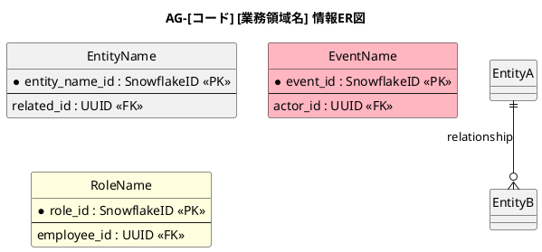

# 情報ER図作成ガイドライン (Information ER Diagram Guidelines)

本ガイドラインは、要件定義書のシステムレイヤーで情報エンティティ間の関係を表現する「情報ER図」の作成ルールを定義します。

---

## 1. 目的

情報ER図は、業務領域ごとに扱う情報エンティティ間の関係を視覚的に表現するためのER図です。詳細設計ではなく、要件定義段階での情報構造の把握を目的とします。

---

## 2. ファイル配置

情報ER図は、各業務領域の「情報一覧」ディレクトリに配置します。

```
docs/22 要件定義書/[事業領域]/03 機能要件/[業務領域]/04.システム/01.情報/情報ER図.md
```

### 命名規則

- ファイル名は `情報ER図.md` と固定
- ディレクトリ名は `01.情報`

---

## 3. 文書構造

情報ER図.mdは、以下の6つのセクションをこの順序で構成します。

| 番号 | セクション名     | 説明                                       |
|------|------------------|--------------------------------------------|
| 1    | 目的             | 業務領域名と目的を記載                     |
| 2    | PlantUML ER図    | 英語版ER図のPlantUMLコード                 |
| 3    | 日本語版 ER図    | 日本語版ER図のPlantUMLコード               |
| 4    | エンティティ一覧 | エンティティと情報名(ID)の対応表           |
| 5    | 主要な関係       | 関係線の説明リスト                         |
| 6    | 参照エンティティ | 他業務領域で定義された参照エンティティ一覧 |

### セクション1: 目的

業務領域名を明記し、本書の目的を1行で記載します。

```markdown
# 情報ER図

[業務領域の説明]業務領域で扱う情報の関係を示すER図です。

## 1. 目的

本書は、AG-[コード] [業務領域名]業務領域のシステムレイヤーで扱う情報エンティティ間の関係を示すER図です。
```

### セクション2: PlantUML ER図（英語版）

英語版のPlantUML ER図を記載します。詳細は「4. PlantUML記法ルール」を参照。

### セクション3: 日本語版 ER図

日本語版のPlantUML ER図を記載します。詳細は「8. 二言語化ルール」を参照。

### セクション4: エンティティ一覧

表形式でエンティティ一覧を記載します。

| エンティティ | 情報名 (ID)        | 説明 |
|--------------|--------------------|------|
| EntityName   | 情報名 (INF-XX-01) | 説明 |

- **エンティティ**: 英語のエンティティ名（PascalCase）
- **情報名 (ID)**: 日本語名と情報IDを併記
- **説明**: エンティティの概要

### セクション5: 主要な関係

関係線を太字の矢印表記でリストアップします。

```markdown
- **EntityA → EntityB**：関係の説明
```

### セクション6: 参照エンティティ

他業務領域で定義され、参照として使用されるエンティティを記載します。

| エンティティ | 所属業務領域  | 説明 |
|--------------|---------------|------|
| EntityName   | 共通 / AG-XXX | 説明 |

---

## 4. PlantUML記法ルール

### 4.1 基本テンプレート



### 4.2 必須設定

| 設定                  | 値        | 説明                 |
|-----------------------|-----------|----------------------|
| `hide circle`         | -         | 循環参照の円を非表示 |
| `skinparam linetype`  | `ortho`   | 直線関係線           |
| `skinparam shadowing` | `false`   | 影を非表示           |
| `BackgroundColor`     | `#F8FAFC` | エンティティ背景色   |
| `BorderColor`         | `#475569` | エンティティ枠線色   |
| `FontColor`           | `#0F172A` | エンティティ文字色   |

### 4.3 イベントエンティティの表現

**情報ER図では、イベントの情報は薄ピンク色（`#FFB6C1`）で表現します。**

- イベントエンティティは、名前に `Event` を含むエンティティ（例: `AuditEvent`, `SprintEvent`）
- 薄ピンク色は LightPink の標準色コード `#FFB6C1` を使用
- エンティティ定義の末尾に `#FFB6C1` を追加して背景色を指定

```plantuml
' イベントエンティティの例
entity "AuditEvent" as AuditEvent #FFB6C1
entity "SprintEvent" as SprintEvent #FFB6C1
```

### 4.4 ロールエンティティの表現

**情報ER図では、ロールの情報は薄い黄色（`#FFFFE0`）で表現します。**

- ロールエンティティは、名前に `Role` を含むエンティティ（例: `RoleAssignment`）
- 薄い黄色は LightYellow の標準色コード `#FFFFE0` を使用
- エンティティ定義の末尾に `#FFFFE0` を追加して背景色を指定

```plantuml
' ロールエンティティの例
entity "RoleAssignment" as RoleAssignment #FFFFE0
```

---

## 5. エンティティ定義ルール

### 5.1 主キー・外部キー記載ルール

**情報ER図ではエンティティ定義に主キー（PK）と外部キー（FK）のみを記載します。**

他の属性（title, description, statusなど）は記載せず、キー情報のみを表示します。

```plantuml
' ✅ 正しい記法（PKとFKのみ記載）
entity "BacklogItem" as BacklogItem {
  * backlog_item_id : SnowflakeID <<PK>>
  --
  project_id : UUID <<FK>>
  parent_item_id : UUID <<FK>>
}

' ❌ 他の属性は記載しない
entity "BacklogItem" as BacklogItem {
  * backlog_item_id : SnowflakeID <<PK>>
  --
  project_id : UUID <<FK>>
  title : string
  description : text
}
```

- 主キーは `*` で始まり、`<<PK>>` でマーク
- 外部キーは `<<FK>>` でマーク
- 主キーは SnowflakeID を使用（セクション6.1参照）
- 外部キーの参照先エンティティが異なる場合は、`<<FK EntityName>>` のように参照先を明記

属性の詳細は、各業務領域の「02.属性」ディレクトリ内の「情報名属性一覧.md」で確認します。

### 5.2 エンティティ命名規則

- エンティティ名は **PascalCase**（例: `BacklogItem`, `TestCase`）
- 英語版ER図では英語名を使用
- 日本語版ER図では日本語名を使用（aliasは英語名を保持）

```plantuml
' 英語版
entity "BacklogItem" as BacklogItem

' 日本語版
entity "バックログ項目" as BacklogItem
```

---

## 6. 主キー規則

### 6.1 SnowflakeIDデフォルト

**情報ER図で定義するエンティティの主キーは、特に指定がなければ `SnowflakeID` を使用します。**

- SnowflakeIDは、分散システムで一意なIDを生成するための19桁の整数型ID
- データベース層では `BIGINT` 型で格納
- 生成にはタイムスタンプ、マシンID、シーケンス番号を組み合わせた方式を使用

### 6.2 例外

以下の場合はSnowflakeIDを使用しない場合があります：

- 外部システムとの連携でUUIDが必須な場合
- 複合キーが必要な場合（業務要件による）
- 自然キーを使用することが明確な場合

例外がある場合は、情報一覧.mdの該当情報項目で明記します。

---

## 7. 関係線表記規則

### 7.1 基本記法

PlantUMLのER図関係線記法を使用します。

```
EntityA [多重度A][線種][多重度B] EntityB : ラベル
```

### 7.2 多重度記号

| 記号 | 意味                    |
|------|-------------------------|
| `    |                         |` | 1（必須） |
| `}{` | 0以上（複数可）         |
| `o{` | 0以上（0を含む）        |
| `}o` | 0以上（複数可、反対側） |

### 7.3 線種

| 記号 | 意味             |
|------|------------------|
| `--` | 破線（弱い関係） |
| `--` | 実線（強い関係） |

### 7.4 ラベル

関係線のラベルは、関係の性質を簡潔に表現します。

- 英語版：動詞または動詞句（例: `plans`, `decomposes`, `evaluates`）
- 日本語版：動詞の辞書形（例: `計画`, `分解`, `評価`）

### 7.5 コメント

関係線の前に `'` でコメントを記載します。

```plantuml
' Sprint plans SprintBacklogItems
Sprint ||--o{ SprintBacklogItem : plans
```

---

## 8. 二言語化ルール

### 8.1 必須

**情報ER図は必ず英語版と日本語版の2つのバージョンを作成します。**

### 8.2 英語版（セクション2）

- エンティティ名：英語（PascalCase）
- 関係線ラベル：英語の動詞
- コメント：英語

### 8.3 日本語版（セクション3）

- エンティティ名：日本語
- alias：英語名を保持（`as EntityName`）
- 関係線ラベル：日本語の動詞
- コメント：日本語
- title：`情報ER図（日本語版）` と明記

### 8.4 対応関係

英語版と日本語版は、エンティティの対応関係と関係線の構造が一致している必要があります。

```plantuml
' 英語版
entity "BacklogItem" as BacklogItem
BacklogItem ||--o{ Feedback : receives

' 日本語版（aliasで英語名を保持）
entity "バックログ項目" as BacklogItem
バックログ項目 ||--o{ フィードバック : 受信
```

---

## 9. 参照エンティティの扱い

### 9.1 定義

参照エンティティとは、他の業務領域で定義され、現在の業務領域のER図で参照として使用されるエンティティです。

### 9.2 共通エンティティ

以下のエンティティはどの業務領域にも属さない共通エンティティです：

| エンティティ      | 説明             |
|-------------------|------------------|
| Organization      | 組織             |
| Employee          | 従業員           |
| Workspace         | ワークスペース   |
| Project           | プロジェクト     |
| Team              | チーム           |
| ProjectMembership | プロジェクト所属 |
| TeamMembership    | チーム所属       |
| RoleAssignment    | ロール割り当て   |
| AuditEvent        | 監査イベント     |

### 9.3 参照エンティティの記載方法

- 参照エンティティはER図の関係線で参照できますが、`entity`定義は行いません
- セクション6（参照エンティティ）で一覧として記載します
- 所属業務領域を明記します

```plantuml
' 参照エンティティはentity定義せず、関係線でのみ参照
TaskAssignment }o--|| Employee : works on
```

### 9.4 業務領域間参照

他の業務領域で定義されたエンティティ（例: BacklogItem, Risk, DecisionRecord）は、参照エンティティとして扱います。

---

## 10. 作成手順

1. **情報一覧の確認**: 対象業務領域の「情報一覧.md」を確認し、エンティティと関係を把握
2. **英語版ER図作成**: PlantUMLで英語版ER図を作成
    - エンティティ定義（主キー・外部キーのみ記載）
    - 関係線定義
3. **日本語版ER図作成**: 英語版を基に日本語版を作成
    - エンティティ名を日本語化
    - 関係線ラベルを日本語化
4. **エンティティ一覧作成**: 表形式でエンティティ一覧を記載
5. **主要な関係記載**: 関係線をリスト形式で説明
6. **参照エンティティ記載**: 他領域の参照エンティティを記載
7. **検証**: 英語版と日本語版の構造が一致していることを確認

---

## 11. 品質チェックリスト

情報ER図作成後、以下の項目を確認します：

- [ ] ファイル名が `情報ER図.md` である
- [ ] ファイル配置が正しいディレクトリである
- [ ] 6つのセクションがすべて含まれている
- [ ] エンティティ定義に主キー（PK）と外部キー（FK）のみが含まれている
- [ ] 主キーが `<<PK>>` でマークされている
- [ ] 外部キーが `<<FK>>` でマークされている
- [ ] 英語版ER図と日本語版ER図の両方が含まれている
- [ ] 英語版と日本語版のエンティティ対応が一致している
- [ ] 関係線の多重度記号が正しい
- [ ] 参照エンティティが正に記載されている
- [ ] PlantUMLの必須skinparam設定が含まれている
- [ ] 主キーがSnowflakeIDであることが情報一覧で明記されている
- [ ] イベントエンティティ（名前にEventを含む）が薄ピンク色（`#FFB6C1`）で表現されている
- [ ] ロールエンティティ（名前にRoleを含む）が薄い黄色（`#FFFFE0`）で表現されている

---

## 12. 参考

- 事業領域ERD: `docs/21 要望/機能要望/AG アジルーム/agiloom-information-structure-erd.md`
- 業務領域一覧: `docs/12 業務領域/業務領域一覧.md`
- ディレクトリ命名規則: `.agents/guidelines/docs/directory-name.guidelines.md`
- 情報ER図テンプレート: `.agents/guidelines/docs/templates/情報ER図テンプレート.md`
- 属性一覧テンプレート: `.agents/guidelines/docs/templates/属性一覧テンプレート.md`
- 属性一覧テンプレート（TSV）: `.agents/guidelines/docs/templates/属性一覧テンプレート.tsv`
- 情報外部キー値対応表: 各業務領域の `04.システム/01.情報/情報外部キー値対応表.tsv`
