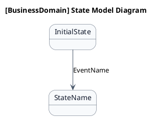

# 状態モデル図作成ガイドライン (State Model Diagram Guidelines)

本ガイドラインは、要件定義書のシステムレイヤーで情報の状態遷移を表現する「状態モデル図（ステートマシン図）」の作成ルールを定義します。

---

## 1. 目的

状態モデル図は、業務領域ごとに扱う情報の状態遷移を視覚的に表現するための状態遷移図です。詳細設計ではなく、要件定義段階での状態構造の把握を目的とします。

---

## 2. ファイル配置

状態モデル図は、各業務領域の「ステート」ディレクトリに配置します。

```
docs/22 要件定義書/[事業領域]/03 機能要件/[業務領域]/04.システム/02.ステート/ステートマシン図.md
```

### 命名規則

- ファイル名は `ステートマシン図.md` と固定
- ディレクトリ名は `02.ステート`

---

## 3. 文書構造

ステートマシン図.mdは、以下の6つのセクションをこの順序で構成します。

| 番号 | セクション名        | 説明                               |
|------|---------------------|------------------------------------|
| 1    | 目的                | 業務領域名と目的を記載             |
| 2    | PlantUML 状態遷移図 | 英語版状態遷移図のPlantUMLコード   |
| 3    | 日本語版 状態遷移図 | 日本語版状態遷移図のPlantUMLコード |
| 4    | 状態一覧            | 状態と状態IDの対応表               |
| 5    | 遷移一覧            | 遷移の説明リスト                   |
| 6    | 参照情報            | 関連するステート一覧とユースケース |

### セクション1: 目的

業務領域名を明記し、本書の目的を1行で記載します。

```markdown
# ステートマシン図

[業務領域の説明]業務領域で扱う情報の状態遷移を示す状態モデル図です。

## 1. 目的

本書は、[事業領域コード]-[業務領域コード] [業務領域名]業務領域のシステムレイヤーで扱う情報の状態遷移を示す状態モデル図（ステートマシン図）です。
```

### セクション2: PlantUML 状態遷移図（英語版）

英語版のPlantUML状態遷移図を記載します。詳細は「4. PlantUML記法ルール」を参照。

### セクション3: 日本語版 状態遷移図

日本語版のPlantUML状態遷移図を記載します。詳細を「8. 二言語化ルール」を参照。

### セクション4: 状態一覧

表形式で状態一覧を記載します。

| 状態名 (ID)       | 英語名    | 説明 |
|-------------------|-----------|------|
| 状態名 (ST-XX-01) | StateName | 説明 |

- **状態名 (ID)**: 日本語名と状態IDを併記
- **英語名**: 英語の状態名（PascalCase）
- **説明**: 状態の概要

### セクション5: 遷移一覧

表形式で遷移一覧を記載します。

| 遷移ID | 元状態       | 遷移先状態 | トリガー  | 関連ユースケース | 説明 |
|--------|--------------|------------|-----------|------------------|------|
| TR-01  | InitialState | StateName  | EventName | UC-XX-01         | 説明 |

- **遷移ID**: 遷移の識別子（TR-XX-01 形式）
- **元状態**: 遷移前の状態
- **遷移先状態**: 遷移後の状態
- **トリガー**: 状態遷移をトリガーするイベントまたはユースケース
- **関連ユースケース**: 関連するユースケースID
- **説明**: 遷移の概要

### セクション6: 参照情報

関連するファイルを記載します。

```markdown
## 6. 参照情報

- ステート一覧: `02.ステート/ステート一覧.tsv`
- 関連ユースケース: `03.システム境界/01.ユースケース/ユースケース一覧.md`
```

---

## 4. PlantUML記法ルール

### 4.1 基本テンプレート



### 4.2 必須設定

| 設定              | 値        | 説明       |
|-------------------|-----------|------------|
| `BackgroundColor` | `#F8FAFC` | 状態背景色 |
| `BorderColor`     | `#475569` | 状態枠線色 |
| `FontColor`       | `#0F172A` | 状態文字色 |
| `arrowColor`      | `#475569` | 遷移線色   |
| `shadowing`       | `false`   | 影を非表示 |

### 4.3 状態の表現

**状態モデル図では、状態はPlantUMLの `state` 記法で表現します。**

- 状態名は英語名（PascalCase）を使用
- 初期状態は `<<entry>>` でマーク
- 終了状態は `<<exit>>` でマーク

```plantuml
'[状態定義の例]
state "Pending" as Pending
state "InProgress" as InProgress
state "Completed" as Completed <<exit>>
```

### 4.4 遷移の表現

**状態間の遷移は矢印記法で表現します。**

- 単純遷移: `StateA --> StateB : EventName`
- 条件付き遷移: `StateA --> StateB : [Condition] EventName`

```plantuml
'[遷移の例]
Pending --> InProgress : StartRequest
InProgress --> Completed : CompleteRequest
InProgress --> Pending : CancelRequest
```

---

## 5. 状態定義ルール

### 5.1 状態命名規則

- 状態名は **PascalCase**（例: `Pending`, `InProgress`, `Completed`）
- 英語版状態遷移図では英語名を使用
- 日本語版状態遷移図では日本語名を使用（aliasは英語名を保持）

```plantuml
'[英語版]
state "Pending" as Pending

'[日本語版]
state "保留中" as Pending
```

### 5.2 状態ID規則

- 状態IDは `ST-[事業領域コード]-[番号]` の形式で付与
- 番号は3桁のゼロ埋め形式

---

## 6. 遷移定義ルール

### 6.1 遷移ID規則

- 遷移IDは `TR-[事業領域コード]-[番号]` の形式で付与
- 番号は3桁のゼロ埋め形式

### 6.2 トリガー命名規則

- トリガー名は **PascalCase**（例: `StartRequest`, `CompleteRequest`）
- トリガーはユースケースまたはイベントを参照

### 6.3 条件付き遷移

- 条件付き遷移は `[Condition]` 形式で記載
- 条件はビジネスルールを簡潔に表現

```plantuml
'[条件付き遷移の例]
Pending --> InProgress : [Approved] StartRequest
```

---

## 7. 複合状態の表現

### 7.1 複合状態

複合状態（Composite State）は、内部にサブ状態を持つ状態です。

```plantuml
state "Order" as Order {
  state "Pending" as Pending
  state "Processing" as Processing
  state "Shipped" as Shipped
}
```

### 7.2 並列状態

並列状態（Parallel State）は、同時に存在する複数のサブ状態です。

```plantuml
state "Order" as Order {
  state "Payment" as Payment {
    state "Pending" as PaymentPending
    state "Paid" as PaymentPaid
  }
  ||
  state "Shipping" as Shipping {
    state "Preparing" as ShippingPreparing
    state "Shipped" as ShippingShipped
  }
}
```

---

## 8. 二言語化ルール

### 8.1 必須

**状態モデル図は必ず英語版と日本語版の2つのバージョンを作成します。**

### 8.2 英語版（セクション2）

- 状態名：英語（PascalCase）
- 遷移ラベル：英語の動詞
- コメント：英語

### 8.3 日本語版（セクション3）

- 状態名：日本語
- alias：英語名を保持（`as StateName`）
- 遷移ラベル：日本語の動詞
- コメント：日本語
- title：`状態遷移図（日本語版）` と明記

### 8.4 対応関係

英語版と日本語版は、状態の対応関係と遷移の構造が一致している必要があります。

```plantuml
'[英語版]
state "Pending" as Pending
Pending --> InProgress : StartRequest

'[日本語版（aliasで英語名を保持）]
state "保留中" as Pending
Pending --> InProgress : 開始リクエスト
```

---

## 9. ステート一覧.tsv の形式

ステート一覧.tsvは、フェーズ1（Step4）で状態をリストアップし、フェーズ2（Step6）で状態モデル図作成の基盤とするためのTSVファイルです。

### 9.1 ファイル配置

```
docs/22 要件定義書/[事業領域]/03 機能要件/[業務領域]/04.システム/02.ステート/ステート一覧.tsv
```

### 9.2 列定義

| 列名             | 説明                                                 | 例                           |
|------------------|------------------------------------------------------|------------------------------|
| ステートID       | 状態の識別子（`ST-[事業領域コード]-[3桁番号]` 形式） | `ST-AG-001`                  |
| ステート名       | 日本語の状態名                                       | `未着手`                     |
| ステート英名     | 英語の状態名（PascalCase）                           | `Pending`                    |
| 対象情報         | 状態を持つ情報（エンティティ）名                     | `スプリント`                 |
| 説明             | 状態の概要説明                                       | `処理が開始されていない状態` |
| 関連ユースケース | 状態遷移をトリガーするユースケースID                 | `UC-AG-01`                   |

### 9.3 サンプル

```
ステートID	ステート名	ステート英名	対象情報	説明	関連ユースケース
ST-XX-001	未着手	Pending	[情報名]	処理が開始されていない状態	UC-XX-01
ST-XX-002	処理中	InProgress	[情報名]	処理が進行中の状態	UC-XX-02
ST-XX-003	完了	Completed	[情報名]	処理が完了した状態	UC-XX-03
ST-XX-004	キャンセル	Cancelled	[情報名]	処理がキャンセルされた状態	UC-XX-04
```

### 9.4 命名規則

- **ステートID**: `ST-[事業領域コード]-[3桁ゼロ埋め番号]` の形式（例: `ST-AG-001`）
- **ステート英名**: PascalCase（例: `Pending`, `InProgress`, `Completed`）
- **ステート名**: 日本語で簡潔に表現（例: `未着手`, `処理中`, `完了`）

---

## 10. 作成手順

1. **ステート一覧.tsv作成**: 対象業務領域の状態をリストアップし、`02.ステート/ステート一覧.tsv` に記載
2. **英語版状態遷移図作成**: PlantUMLで英語版状態遷移図を作成
    - 状態定義
    - 遷移定義
3. **日本語版状態遷移図作成**: 英語版を基に日本語版を作成
    - 状態名を日本語化
    - 遷移ラベルを日本語化
4. **状態一覧作成**: 表形式で状態一覧を記載
5. **遷移一覧記載**: 遷移をリスト形式で説明
6. **参照情報記載**: 関連ファイルを記載
7. **検証**: 英語版と日本語版の構造が一致していることを確認

---

## 11. 品質チェックリスト

状態モデル図作成後、以下の項目を確認します：

- [ ] ファイル名が `ステートマシン図.md` である
- [ ] ファイル配置が正しいディレクトリである
- [ ] 6つのセクションがすべて含まれている
- [ ] 英語版状態遷移図と日本語版状態遷移図の両方が含まれている
- [ ] 英語版と日本語版の状態対応が一致している
- [ ] 遷移のトリガーがユースケースまたはイベントを参照している
- [ ] 状態IDが `ST-[事業領域コード]-[番号]` 形式である
- [ ] 遷移IDが `TR-[事業領域コード]-[番号]` 形式である
- [ ] PlantUMLの必須skinparam設定が含まれている
- [ ] 初期状態が `<<entry>>` でマークされている
- [ ] 終了状態（あれば）が `<<exit>>` でマークされている
- [ ] ステート一覧.tsvが `02.ステート/` ディレクトリに配置されている
- [ ] ステート一覧.tsvの列定義が正しい（ステートID、ステート名、ステート英名、対象情報、説明、関連ユースケース）

---

## 12. 参考

- ステート一覧テンプレート: `.agents/skills/to-RDRA-model/templates/ステート一覧.tsv`
- ステートマシン図テンプレート: `.agents/skills/to-RDRA-model/templates/ステートマシン図.md`
- ディレクトリ命名規則: `.agents/guidelines/docs/directory-name.guidelines.md`
- RDRAモデルガイドライン: `.agents/guidelines/rdra/rdra-model.guidelines.md`
