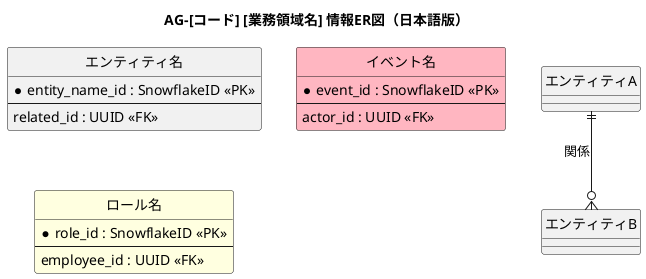
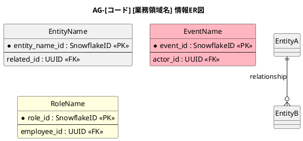

# 情報ER図

[業務領域の説明]業務領域で扱う情報の関係を示すER図です。

## 1. 目的

本書は、AG-[コード] [業務領域名]業務領域のシステムレイヤーで扱う情報エンティティ間の関係を示すER図です。

## 2. 日本語版 ER図

## 3. 情報ER図

## 4. エンティティ一覧

| エンティティ | 情報名 (ID)        | 説明 |
|--------------|--------------------|------|
| EntityName   | 情報名 (INF-XX-01) | 説明 |

## 5. 主要な関係

- **EntityA → EntityB**：関係の説明

## 6. 参照エンティティ

以下のエンティティは他の業務領域で定義され、参照として使用されます。

| エンティティ | 所属業務領域  | 説明 |
|--------------|---------------|------|
| EntityName   | 共通 / AG-XXX | 説明 |
