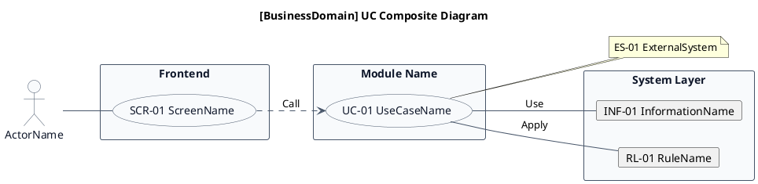

# UC複合図作成ガイドライン (UC Composite Diagram Guidelines)

本ガイドラインは、要件定義書のシステム境界レイヤーでユースケース、画面、イベント、情報、条件を関連づける「UC複合図」の作成ルールを定義します。

---

## 1. 目的

UC複合図は、業務領域ごとに扱うユースケース、画面、イベント、情報、条件を視覚的に関連づけるための図です。詳細設計ではなく、要件定義段階でのシステム構造の把握を目的とします。

---

## 2. ファイル配置

UC複合図は、各業務領域の「システム境界」ディレクトリに配置します。

```
docs/22 要件定義書/[事業領域]/03 機能要件/[業務領域]/03.システム境界/UC複合図.md
```

### 命名規則

- ファイル名は `UC複合図.md` と固定
- ディレクトリ名は `03.システム境界`

---

## 3. 文書構造

UC複合図.mdは、以下の9つのセクションをこの順序で構成します。

| 番号 | セクション名      | 説明                             |
|------|-------------------|----------------------------------|
| 1    | 目的              | 業務領域名と目的を記載           |
| 2    | PlantUML UC複合図 | 英語版UC複合図のPlantUMLコード   |
| 3    | 日本語版 UC複合図 | 日本語版UC複合図のPlantUMLコード |
| 4    | ユースケース一覧  | ユースケースとIDの対応表         |
| 5    | 画面一覧          | 画面とIDの対応表                 |
| 6    | イベント一覧      | イベントとIDの対応表             |
| 7    | 情報一覧          | 情報とIDの対応表                 |
| 8    | 条件一覧          | 条件とIDの対応表                 |
| 9    | 参照情報          | 関連するファイル一覧             |

### セクション1: 目的

業務領域名を明記し、本書の目的を1行で記載します。

```markdown
# UC複合図

[業務領域の説明]業務領域で扱うユースケース、画面、イベント、情報、条件を関連づけた図です。

## 1. 目的

本書は、[事業領域コード]-[業務領域コード] [業務領域名]
業務領域のシステム境界レイヤーで扱うユースケース、画面、イベント、情報、条件を関連づけたUC複合図です。
```

### セクション2: PlantUML UC複合図（英語版）

英語版のPlantUML UC複合図を記載します。詳細は「4. PlantUML記法ルール」を参照。

### セクション3: 日本語版 UC複合図

日本語版のPlantUML UC複合図を記載します。詳細は「8. 二言語化ルール」を参照。

### セクション4: ユースケース一覧

表形式でユースケース一覧を記載します。

| ユースケースID | ユースケース名 | 英語名      | 説明 | 関連アクター |
|----------------|----------------|-------------|------|--------------|
| UC-XX-01       | ユースケース名 | UseCaseName | 説明 | アクター名   |

- **ユースケースID**: ユースケースの識別子（UC-XX-01 形式）
- **ユースケース名**: 日本語のユースケース名
- **英語名**: 英語のユースケース名（PascalCase）
- **説明**: ユースケースの概要
- **関連アクター**: 関連するアクター名

### セクション5: 画面一覧

表形式で画面一覧を記載します。

| 画面ID    | 画面名 | 英語名     | 説明 | 関連ユースケース |
|-----------|--------|------------|------|------------------|
| SCR-XX-01 | 画面名 | ScreenName | 説明 | UC-XX-01         |

- **画面ID**: 画面の識別子（SCR-XX-01 形式）
- **画面名**: 日本語の画面名
- **英語名**: 英語の画面名（PascalCase）
- **説明**: 画面の概要
- **関連ユースケース**: 関連するユースケースID

### セクション6: イベント一覧

表形式でイベント一覧を記載します。

| イベントID | イベント名 | 英語名    | 説明 | 関連ユースケース |
|------------|------------|-----------|------|------------------|
| EVT-XX-01  | イベント名 | EventName | 説明 | UC-XX-01         |

- **イベントID**: イベントの識別子（EVT-XX-01 形式）
- **イベント名**: 日本語のイベント名
- **英語名**: 英語のイベント名（PascalCase）
- **説明**: イベントの概要
- **関連ユースケース**: 関連するユースケースID

### セクション7: 情報一覧

表形式で情報一覧を記載します。

| 情報ID    | 情報名 | 英語名          | 説明 | 関連ユースケース |
|-----------|--------|-----------------|------|------------------|
| INF-XX-01 | 情報名 | InformationName | 説明 | UC-XX-01         |

- **情報ID**: 情報の識別子（INF-XX-01 形式）
- **情報名**: 日本語の情報名
- **英語名**: 英語の情報名（PascalCase）
- **説明**: 情報の概要
- **関連ユースケース**: 関連するユースケースID

### セクション8: 条件一覧

表形式で条件一覧を記載します。

| 条件ID   | 条件名   | 英語名   | 説明 | 関連ユースケース |
|----------|----------|----------|------|------------------|
| RL-XX-01 | ルール名 | RuleName | 説明 | UC-XX-01         |

- **条件ID**: 条件の識別子（RL-XX-01 形式）
- **条件名**: 日本語の条件名
- **英語名**: 英語の条件名（PascalCase）
- **説明**: 条件の概要
- **関連ユースケース**: 関連するユースケースID

### セクション9: 参照情報

関連するファイルを記載します。

```markdown
## 9. 参照情報

- ユースケース一覧: `03.システム境界/01.ユースケース/ユースケース一覧.md`
- 画面一覧: `04.システム/04.画面/画面一覧.md`
- イベント一覧: `04.システム/03.イベント/イベント一覧.md`
- 情報一覧: `04.システム/01.情報/情報一覧.md`
```

---

## 4. PlantUML記法ルール

### 4.1 基本テンプレート



### 4.2 必須skinparam設定

UC複合図では、以下のskinparam設定を必ず含めます。

| 要素      | プロパティ      | 値      | 説明                 |
|-----------|-----------------|---------|----------------------|
| usecase   | BackgroundColor | #F8FAFC | ユースケースの背景色 |
| usecase   | BorderColor     | #475569 | ユースケースの枠線色 |
| usecase   | FontColor       | #0F172A | ユースケースの文字色 |
| actor     | BackgroundColor | #F8FAFC | アクターの背景色     |
| actor     | BorderColor     | #475569 | アクターの枠線色     |
| actor     | FontColor       | #0F172A | アクターの文字色     |
| rectangle | BackgroundColor | #F8FAFC | 矩形の背景色         |
| rectangle | BorderColor     | #475569 | 矩形の枠線色         |
| rectangle | FontColor       | #0F172A | 矩形の文字色         |
| 全体      | arrowColor      | #475569 | 矢印の色             |
| 全体      | shadowing       | false   | 影を無効化           |

### 4.3 方向設定

`left to right direction` を使用し、左から右へのフローで描画します。

### 4.4 要素の表現方法

| 要素         | 記法                             | 説明                                     |
|--------------|----------------------------------|------------------------------------------|
| アクター     | `actor "名前" as Alias`          | システム利用者                           |
| 画面         | `usecase "SCR-XX 名前" as Alias` | フロントエンド内のユースケースとして表現 |
| ユースケース | `usecase "UC-XX 名前" as Alias`  | モジュール内のユースケースとして表現     |
| 外部システム | `note "ES-XX 名前" as Alias`     | ノートとして表現                         |
| 情報         | `card "INF-XX 名前" as Alias`    | カードとして表現                         |
| 条件         | `card "RL-XX 名前" as Alias`     | カードとして表現                         |

### 4.5 関係線の表現方法

| 関係                        | 記法                            | 説明     |
|-----------------------------|---------------------------------|----------|
| アクター → 画面             | `Actor -- SCR01`                | 実線     |
| 画面 → ユースケース         | `SCR01 ..> UC01 : Call`         | 破線矢印 |
| ユースケース → 外部システム | `UC01 ..> ES01 : Data Exchange` | 破線矢印 |
| ユースケース → 情報         | `UC01 -- INF01 : Use`           | 実線     |
| ユースケース → 条件         | `UC01 -- RL01 : Apply`          | 実線     |

---

## 5. ユースケース定義ルール

### 5.1 命名規則

- **ユースケースID**: `UC-[事業領域コード]-[3桁ゼロ埋め番号]` の形式（例: `UC-AG-001`）
- **ユースケース名**: 日本語で簡潔に表現（例: `スプリント作成`）
- **英語名**: PascalCase（例: `CreateSprint`）

### 5.2 配置ルール

- ユースケースは矩形（モジュール名）内に配置する
- 1つのユースケースは1つの矩形内に配置する

---

## 6. 画面定義ルール

### 6.1 命名規則

- **画面ID**: `SCR-[事業領域コード]-[3桁ゼロ埋め番号]` の形式（例: `SCR-AG-001`）
- **画面名**: 日本語で簡潔に表現（例: `スプリント一覧画面`）
- **英語名**: PascalCase（例: `SprintListScreen`）

### 6.2 配置ルール

- 画面は「Frontend」矩形内に配置する
- 画面はユースケースと関連付ける

---

## 7. イベント定義ルール

### 7.1 命名規則

- **イベントID**: `EVT-[事業領域コード]-[3桁ゼロ埋め番号]` の形式（例: `EVT-AG-001`）
- **イベント名**: 日本語で簡潔に表現（例: `データ同期完了`）
- **英語名**: PascalCase（例: `DataSyncCompleted`）

### 7.2 配置ルール

- イベントは外部システムとの連携として表現する
- イベントはユースケースと関連付ける

---

## 8. 二言語化ルール

UC複合図は、英語版と日本語版の2言語で記載します。

### 8.1 英語版

- PlantUMLのtitleは英語で記載
- 全ての要素名は英語で記載
- 関係線のラベルは英語で記載

### 8.2 日本語版

- PlantUMLのtitleは日本語で記載（「UC複合図（日本語版）」）
- 全ての要素名は日本語で記載
- 関係線のラベルは日本語で記載

### 8.3 共通ルール

- 英語版と日本語版の構造は同一
- skinparam設定は同一
- 要素の配置順序は同一

---

## 9. 作成手順

1. **ユースケース一覧の確認**: 対象業務領域の「ユースケース一覧.md」を確認し、ユースケースを把握
2. **英語版UC複合図作成**: PlantUMLで英語版UC複合図を作成
    - アクター定義
    - 画面定義
    - ユースケース定義
    - 外部システム定義
    - 情報定義
    - 条件定義
    - 関係線定義
3. **日本語版UC複合図作成**: 英語版を日本語に翻訳
4. **一覧表作成**: ユースケース、画面、イベント、情報、条件の一覧表を作成
5. **参照情報記載**: 関連するファイルへの参照を記載
6. **整合性確認**: UC複合図と一覧表の整合性を確認

---

## 10. 品質チェックリスト

UC複合図作成後、以下の項目を確認します：

- [ ] UC複合図が `03.システム境界/` ディレクトリに配置されている
- [ ] 英語版と日本語版の両方が含まれている
- [ ] PlantUMLの必須skinparam設定が含まれている
- [ ] `left to right direction` が設定されている
- [ ] アクターが定義されている
- [ ] 画面が「Frontend」矩形内に配置されている
- [ ] ユースケースがモジュール矩形内に配置されている
- [ ] 外部システムがノートとして表現されている
- [ ] 情報がカードとして表現されている
- [ ] 条件がカードとして表現されている
- [ ] 関係線が正しく定義されている
- [ ] ユースケース一覧表が含まれている
- [ ] 画面一覧表が含まれている
- [ ] イベント一覧表が含まれている
- [ ] 情報一覧表が含まれている
- [ ] 条件一覧表が含まれている
- [ ] 参照情報が記載されている

---

## 11. 参考

- UC複合図テンプレート: `.agents/skills/to-RDRA-model/templates/UC複合図.md`
- ユースケース図テンプレート: `.agents/skills/to-RDRA-model/templates/ユースケース図.md`
- 状態モデル図ガイドライン: `.agents/guidelines/docs/state-model.guidelines.md`
- 情報ER図ガイドライン: `.agents/guidelines/docs/information-erd.guidelines.md`
- RDRA ID命名規約: `.agents/skills/to-RDRA-model/guidelines/id-naming-conventions.guidelines.md`
