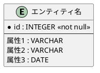

# ER（エンティティ関係）モデルの詳細解説

**目的**: ERモデルの基本概念、特徴、PlantUML記法の基本を解説する。

---

**ナビゲーション**: [概要](./rdra-overview.guidelines.md) | **[TM概要]** | [TMフェーズ1](./rdra-tm-phase1.guidelines.md) | [TMフェーズ2](./rdra-tm-phase2.guidelines.md) | [TMフェーズ3](./rdra-tm-phase3.guidelines.md) | [TMフェーズ4](./rdra-tm-phase4.guidelines.md) | [TMフェーズ5](./rdra-tm-phase5.guidelines.md)

---

## 概要

ER（エンティティ関係）モデルは、データモデリングの標準的な手法で、エンティティ（実体）とその関係を明確に表現するための手法です。PlantUMLのInformation Engineering記法を使用して、視覚的なER図を作成します。

### 特徴

- **標準的なER図記法**：エンティティを矩形、関係を線で表現
- **カラスの足記法**：関係の多重度（1対1、1対多、多対多）を視覚的に表現
- **主キーの明示**：個体指定子（主キー）を `*` マークで識別
- **拡張性**：新しいエンティティや関係を容易に追加できる

---

## ERモデルの基本構造

### 基本要素

| 要素         | 説明                             | 表記例               |
|--------------|----------------------------------|----------------------|
| エンティティ | 実体を表す要素                   | 顧客、商品、注文     |
| 関係         | エンティティ間の関連             | 注文-顧客、注文-商品 |
| 主キー       | エンティティを一意に識別する属性 | 顧客ID、商品コード   |
| 属性         | エンティティの特性               | 名前、価格、日付     |

### PlantUML ER図の構造

---

## 関連フェーズ

ERモデルの詳細なモデリング手順は、以下のフェーズ別ガイドラインで解説しています。

| フェーズ | ファイル | 内容 |
|----------|----------|------|
| フェーズ1 | [rdra-tm-phase1.guidelines.md](./rdra-tm-phase1.guidelines.md) | エンティティの識別方法、分類（E/R） |
| フェーズ2 | [rdra-tm-phase2.guidelines.md](./rdra-tm-phase2.guidelines.md) | 関係の定義、多重度の決定、制約の明確化 |
| フェーズ3 | [rdra-tm-phase3.guidelines.md](./rdra-tm-phase3.guidelines.md) | 属性の割り当て、主キーの定義、型とドメイン |
| フェーズ4 | [rdra-tm-phase4.guidelines.md](./rdra-tm-phase4.guidelines.md) | 応用例、プロジェクト管理システムのERモデル例 |
| フェーズ5 | [rdra-tm-phase5.guidelines.md](./rdra-tm-phase5.guidelines.md) | ERモデルの利点、Spring Modulithとの親和性、次のステップ |
