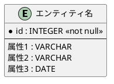

# TMフェーズ1: エンティティの識別

**目的**: ビジネスドメインからエンティティを抽出し、イベント（E）とリソース（R）に分類する。

---

**ナビゲーション**: [概要](./rdra-overview.guidelines.md) | [TM概要](./rdra-tm-overview.guidelines.md) | **[TMフェーズ1](./rdra-tm-phase1.guidelines.md)** | [TMフェーズ2](./rdra-tm-phase2.guidelines.md) | [TMフェーズ3](./rdra-tm-phase3.guidelines.md) | [TMフェーズ4](./rdra-tm-phase4.guidelines.md) | [TMフェーズ5](./rdra-tm-phase5.guidelines.md)

---

### TMフェーズ1: エンティティの識別

**目的**: ビジネスドメインからエンティティを抽出し、イベント（E）とリソース（R）に分類する。

**対応レイヤー**: システムレイヤー（情報）

フェーズ1では、ビジネスドメインから重要な概念をエンティティとして抽出し、ERモデルの基盤を構築します。

#### エンティティの識別

ビジネスドメインから重要な概念を抽出し、各エンティティの役割と責任を明確化します。

- ビジネスドメインから重要な概念を抽出する
- 各エンティティの役割と責任を明確化する
- イベント（E）とリソース（R）に分類する
  - **リソース（R）**: 持続的に存在する実体（例: 顧客、商品、プロジェクト、チーム、メンバー）
  - **イベント（E）**: 一時的に発生する出来事（例: 注文、スプリント、タスク）

#### エンティティの命名規則

- エンティティ名は名詞で表現する
- 役割や責任が分かる名前にする
- 個人名や組織名は使わない
- 同一のエンティティは一意の名前を持つ

#### PlantUML ER図の基本構造

#### 基本要素

| 要素         | 説明                             | 表記例               |
|--------------|----------------------------------|----------------------|
| エンティティ | 実体を表す要素                   | 顧客、商品、注文     |
| 関係         | エンティティ間の関連             | 注文-顧客、注文-商品 |
| 主キー       | エンティティを一意に識別する属性 | 顧客ID、商品コード   |
| 属性         | エンティティの特性               | 名前、価格、日付     |

#### ER図の特徴

- **標準的なER図記法**: エンティティを矩形、関係を線で表現
- **カラスの足記法**: 関係の多重度（1対1、1対多、多対多）を視覚的に表現
- **主キーの明示**: 個体指定子（主キー）を `*` マークで識別
- **拡張性**: 新しいエンティティや関係を容易に追加できる
