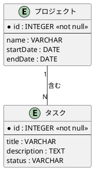

# TMフェーズ2: 関係の定義

**目的**: エンティティ間の関係を特定し、多重度と制約を明確化する。

---

**ナビゲーション**: [概要](./rdra-overview.guidelines.md) | [TM概要](./rdra-tm-overview.guidelines.md) | [TMフェーズ1](./rdra-tm-phase1.guidelines.md) | **[TMフェーズ2](./rdra-tm-phase2.guidelines.md)** | [TMフェーズ3](./rdra-tm-phase3.guidelines.md) | [TMフェーズ4](./rdra-tm-phase4.guidelines.md) | [TMフェーズ5](./rdra-tm-phase5.guidelines.md)

---

## 関係の定義

エンティティ間の関連を特定し、関係の種類と方向性を定義します。

**対応レイヤー**: システムレイヤー（情報）

フェーズ2では、フェーズ1で識別したエンティティ間の関係を定義し、ERモデルの構造を明確にします。

### 1. 関係の特定

エンティティ間の関連を特定し、ビジネス上の意味を反映した関係名を定義します。

- エンティティ間の関連を特定する
- 関係の方向性を明確化する
- 関係名は動詞句で表現する（例: "注文する"、"属する"、"担当する"）

### 関係の種類

| 種類 | 記法 | 説明 |
|------|------|------|
| 1対1 | 1 ── 1 | 一方のエンティティが他方の1つのエンティティに関連 |
| 1対多 | 1 ── * | 一方のエンティティが他方の複数のエンティティに関連 |
| 多対多 | * ── * | 双方のエンティティが複数のエンティティに関連 |

### 多重度の決定

関係の多重度（1対1、1対多、多対多）を決定します。

- **1対1 (1:1)**: 一方のエンティティが他方のエンティティと一意に対応する
  - 例: 従業員 ↔ 社員証
- **1対多 (1:N)**: 一方のエンティティが他方のエンティティの複数に対応する
  - 例: プロジェクト → タスク、チーム → メンバー
- **多対多 (M:N)**: 双方のエンティティが互いの複数に対応する
  - 例: 学生 ↔ 科目（多対多は結合テーブルで分解する）

- **必須か任意か**: 関係が必須（少なくとも1）か任意（0でも可）かを判断
- **最大数**: 1つだけか、複数あり得るかを判断
- **カラスの足記法**: 視覚的に多重度を表現

### 関係の方向性

- 関係は双方向に読むことができる
- 例: "プロジェクトは複数のタスクを持つ" = "タスクは1つのプロジェクトに属する"

### 制約の明確化

関係の制約を定義し、データの一貫性を確保します。

- **必須関係 (Mandatory)**: 関係が存在することが必須
- **任意関係 (Optional)**: 関係が存在しない場合もある
- **識別関係 (Identifying)**: 子エンティティが親エンティティに依存して識別される
- **非識別関係 (Non-identifying)**: 子エンティティが独立して識別される
- 一意性制約: 特定の関係が一意であることを保証
- 参照整合性: 関連するエンティティが存在することを保証
- ビジネスルール: 関係に適用されるビジネス上の制約

### 具体例

| 関係 | 多重度 | 説明 |
|------|--------|------|
| プロジェクト → チーム | 1対多 | 1つのプロジェクトは複数のチームを持つ |
| チーム → メンバー | 1対多 | 1つのチームは複数のメンバーを持つ |
| プロジェクト → スプリント | 1対多 | 1つのプロジェクトは複数のスプリントを持つ |
| スプリント → タスク | 1対多 | 1つのスプリントは複数のタスクを持つ |
| タスク → メンバー | 多対1 | 複数のタスクが1つのメンバーに割り当てられる |

### PlantUMLでの関係の表現

### 関係の検証チェックリスト

- [ ] 全エンティティ間の関係が特定されているか
- [ ] 多重度がビジネスルールと一致しているか
- [ ] 多対多の関係は適切に分解されているか
- [ ] 必須/任意の制約が明確か
- [ ] 循環参照がないか確認したか

---

## まとめ

関係の定義はERモデルの核心です。正しい多重度と制約を定義することで、データの一貫性と整合性を保証できます。
