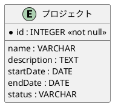

# TMフェーズ3: 属性の割り当て

**目的**: 各エンティティに必要な属性を特定し、主キーと一般属性を区別する。

---

**ナビゲーション**: [概要](./rdra-overview.guidelines.md) | [TM概要](./rdra-tm-overview.guidelines.md) | [TMフェーズ1](./rdra-tm-phase1.guidelines.md) | [TMフェーズ2](./rdra-tm-phase2.guidelines.md) | **[TMフェーズ3](./rdra-tm-phase3.guidelines.md)** | [TMフェーズ4](./rdra-tm-phase4.guidelines.md) | [TMフェーズ5](./rdra-tm-phase5.guidelines.md)

---

## 属性の割り当て

各エンティティに必要な属性を特定し、主キーと一般属性を区別します。

**対応レイヤー**: システムレイヤー（情報）

フェーズ3では、フェーズ1で識別したエンティティに属性を割り当て、データ構造の詳細を定義します。

### 1. 属性の特定

- 各エンティティに必要な属性を特定する
- ビジネス上で管理すべき情報を属性として定義する
- 属性はスカラー値（単一値）とする
- 複合属性は必要に応じて分解する

### 主キーの定義

エンティティを一意に識別する主キーを定義します。

- 主キーはエンティティを一意に識別する
- 主キーはnull許容しない（`<<not null>>`）
- 主キーは変更されない値を選ぶ
- 複合主キーは避ける（サロゲートキーを検討する）
- PlantUMLでは `*` マークで主キーを明示する

### 属性の型

| 型         | 説明                           | 例                     |
|------------|--------------------------------|------------------------|
| INTEGER    | 整数                           | ID、数量、年齢         |
| VARCHAR    | 可変長文字列                   | 名前、説明、メール     |
| TEXT       | 長文文字列                     | 備考、詳細説明         |
| DATE       | 日付                           | 作成日、更新日         |
| TIMESTAMP  | 日時                           | 登録日時               |
| BOOLEAN    | 真偽値                         | 有効フラグ             |
| DECIMAL    | 小数                           | 価格、金額             |

### 属性のドメイン

- 属性が取り得る値の範囲を定義
- 例: 状態は「未着手」「進行中」「完了」のみ

### 属性の命名規則

- 属性名は小文字始まりのキャメルケースで命名する
- 意味が明確な名前にする
- 型情報を名前に含めない（例: `name` で `nameStr` にしない）
- 外部キーは `{親エンティティ}Id` の形式で命名する

### PlantUMLでの属性定義

### 具体例

| エンティティ | 主キー | 属性 |
|--------------|--------|------|
| プロジェクト | プロジェクトID | 名称、開始日、終了日 |
| チーム | チームID | 名称、責任者 |
| メンバー | メンバーID | 氏名、役割、スキル |
| スプリント | スプリントID | 開始日、終了日、目標 |
| タスク | タスクID | 説明、見積時間、状態 |

### 属性の検証チェックリスト

- [ ] 全エンティティに主キーが定義されているか
- [ ] 主キーが一意に識別できるか
- [ ] 属性の型が適切か
- [ ] 属性の命名規則に従っているか
- [ ] 不要な属性がないか
- [ ] 欠落している属性がないか

---

## まとめ

属性の割り当てにより、エンティティの詳細な構造が明確になります。主キーの正しい定義はデータの一貫性を保証する基礎です。
