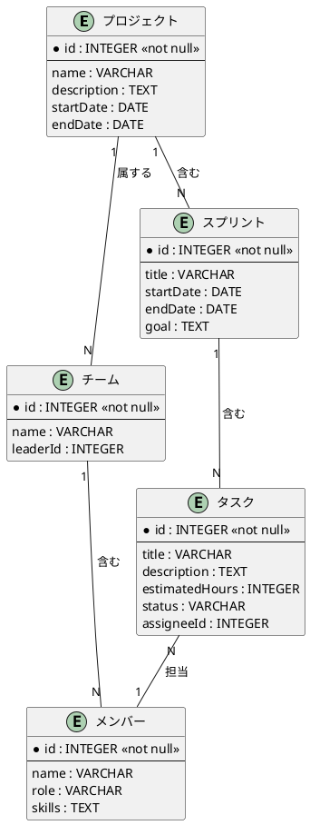

# TMフェーズ4: 応用例

**目的**: 実際のプロジェクトでERモデルを適用し、実践的なモデリング手法を習得する。

---

**ナビゲーション**: [概要](./rdra-overview.guidelines.md) | [TM概要](./rdra-tm-overview.guidelines.md) | [TMフェーズ1](./rdra-tm-phase1.guidelines.md) | [TMフェーズ2](./rdra-tm-phase2.guidelines.md) | [TMフェーズ3](./rdra-tm-phase3.guidelines.md) | **[TMフェーズ4](./rdra-tm-phase4.guidelines.md)** | [TMフェーズ5](./rdra-tm-phase5.guidelines.md)

---

## 応用例

プロジェクト管理システムの例を通じて、ERモデルの実践的な適用方法を解説します。

**対応レイヤー**: システムレイヤー（情報）

フェーズ4では、プロジェクト管理システムを例に、ERモデルの実践的な適用方法を解説します。

### プロジェクト管理システムの例

| エンティティ | 分類 | 主キー         | 主要属性             |
|--------------|------|----------------|----------------------|
| プロジェクト | R    | プロジェクトID | 名称、開始日、終了日 |
| チーム       | R    | チームID       | 名称、責任者         |
| メンバー     | R    | メンバーID     | 氏名、役割、スキル   |
| スプリント   | E    | スプリントID   | 開始日、終了日、目標 |
| タスク       | E    | タスクID       | 説明、見積時間、状態 |

### 関係の例

- プロジェクト → チーム（1対多）
- チーム → メンバー（1対多）
- プロジェクト → スプリント（1対多）
- スプリント → タスク（1対多）
- タスク → メンバー（多対1）

### 完全なER図の例

### モデリングのポイント

1. **エンティティの分類**: リソースとイベントを明確に区別
2. **関係の定義**: 多重度を正しく設定
3. **属性の割り当て**: 主キーと一般属性を区別
4. **視覚化**: PlantUMLでER図を作成

### モデリングのベストプラクティス

- **段階的な詳細化**: 概要から詳細へ段階的にモデルを構築する
- **反復的な改善**: フィードバックを反映してモデルを改善する
- **ドメインエキスパートとの連携**: 業務知識を反映するために連携する
- **正規化のバランス**: 過度な正規化は避け、実用性を優先する
- **命名の一貫性**: プロジェクト全体で命名規則を統一する

### 検証チェックリスト

- [ ] エンティティの分類（E/R）が適切か
- [ ] 関係の多重度がビジネスルールと一致しているか
- [ ] 主キーが適切に定義されているか
- [ ] 属性の型が適切か
- [ ] ER図が読みやすいか

---

## まとめ

実際のプロジェクト例を通じて、ERモデルの適用方法を理解しました。このパターンを参考に、自身のプロジェクトに合わせたERモデルを構築してください。
