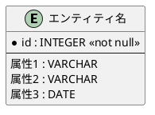

# ER（エンティティ関係）モデルの詳細解説

## 概要

ER（エンティティ関係）モデルは、データモデリングの標準的な手法で、エンティティ（実体）とその関係を明確に表現するための手法です。PlantUMLのInformation Engineering記法を使用して、視覚的なER図を作成します。

### 特徴

- **標準的なER図記法**：エンティティを矩形、関係を線で表現
- **カラスの足記法**：関係の多重度（1対1、1対多、多対多）を視覚的に表現
- **主キーの明示**：個体指定子（主キー）を `*` マークで識別
- **拡張性**：新しいエンティティや関係を容易に追加できる

---

## ERモデルの基本構造

### 基本要素

| 要素         | 説明                             | 表記例               |
|--------------|----------------------------------|----------------------|
| エンティティ | 実体を表す要素                   | 顧客、商品、注文     |
| 関係         | エンティティ間の関連             | 注文-顧客、注文-商品 |
| 主キー       | エンティティを一意に識別する属性 | 顧客ID、商品コード   |
| 属性         | エンティティの特性               | 名前、価格、日付     |

### PlantUML ER図の構造

---

## モデリングの実践

### 1. エンティティの識別

- ビジネスドメインから重要な概念を抽出
- 各エンティティの役割と責任を明確化
- イベント（E）とリソース（R）に分類

### 2. 関係の定義

- エンティティ間の関連を特定
- 関係の種類（1対1、1対多、多対多）を決定
- 関係の方向性と制約を明確化

### 3. 属性の割り当て

- 各エンティティに必要な属性を特定
- 主キーと一般属性を区別
- 属性の型とドメインを定義

---

## 応用例

### プロジェクト管理システムの例

| エンティティ | 分類 | 主キー         | 主要属性             |
|--------------|------|----------------|----------------------|
| プロジェクト | R    | プロジェクトID | 名称、開始日、終了日 |
| チーム       | R    | チームID       | 名称、責任者         |
| メンバー     | R    | メンバーID     | 氏名、役割、スキル   |
| スプリント   | E    | スプリントID   | 開始日、終了日、目標 |
| タスク       | E    | タスクID       | 説明、見積時間、状態 |

### 関係の例

- プロジェクト → チーム（1対多）
- チーム → メンバー（1対多）
- プロジェクト → スプリント（1対多）
- スプリント → タスク（1対多）
- タスク → メンバー（多対1）

---

## ERモデルの利点

### 開発プロセスにおける利点

- **要件定義の明確化**：ビジネス要件を明確に表現
- **コミュニケーションの円滑化**：技術者と非技術者間の共通言語
- **設計品質の向上**：論理的一貫性のあるデータ構造
- **保守性の向上**：変更の影響範囲が把握しやすい

### Spring Modulithとの親和性

- モジュール境界の明確化に貢献
- ドメイン駆動設計（DDD）の実践をサポート
- マイクロサービスへの移行パスを提供

---

## まとめ

ERモデルは、データ構造を視覚的かつ論理的に表現するための標準的なツールです。Spring
Modulithを使用したモジュラーモノリスアーキテクチャにおいて、モジュール間の境界と関係を明確にし、システムの全体像を把握するのに役立ちます。

### 次のステップ

- 実際のプロジェクトでER図を作成
- モデルに基づいてドメインクラスを実装
- モジュール間の関係をER図で表現
- モデルの継続的な改善とリファクタリング
