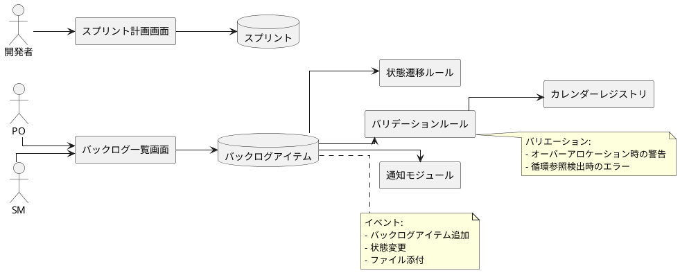

# issue

## When to Use (いつ使うべきか)

- issueを新規作成するとき

## Quick Start (処理フロー)

1. ユーザーにissueの内容を聞く
2. issue内容を把握する
3. issue内容を元にissueタイトルを作成
4. issue内容を元に`Label`を推定 (GitHubで用意されているものを使用)
5. PlantUMLでコンテキスト図を作成する
6. テンプレートmarkdownに沿うようにissueの本文をまとめる
7. ghコマンドを用いてissueをGitHubリポジトリに作成

## Guidelines (ガイドライン)

- issue新規作成時の`Assignees`にはユーザーだけを指定すること
- issueタイトルには内容に応じて以下のprefixをつけること
    - `feat`: 新規機能追加
    - `fix`: 既存機能修正 (バグ修正など)
    - `docs`: ドキュメント追加・編集
    - `style`: 空白・フォーマット・セミコロンなどの追加・修正 (静的解析反映)
    - `refactor`: 仕様に影響がないコード改善 (リファクタ)
    - `perf`: パフォーマンス向上関連
    - `test`: テストコードの追加・修正・デバッグ関連
    - `chore`: ビルド・補助ツール・ライブラリ追加や更新

## PlantUMLコンテキスト図の作成ガイドライン

issueを作成する際には、PlantUMLでコンテキスト図を描画し、システムとの関係性を視覚化すること。
コンテキスト図には以下の**7つの必須要素**を必ず含めること。

### 必須要素

1. **アクター (Actor)**: システムを利用するユーザーや役割（例：PO、SM、開発者、ステークホルダー）
2. **画面 (Screen)**: 関連するUI画面やコンポーネント（例：バックログ一覧画面、スプリント計画画面）
3. **業務ルール (Business Rule)**: 適用されるビジネスルールや制約（例：状態遷移ルール、バリデーションルール）
4. **情報 (Information)**: 処理されるデータやエンティティ（例：バックログアイテム、スプリント、ストーリーポイント）
5. **外部システム (External System)**: 連携する外部サービスやモジュール（例：カレンダーレジストリ、通知モジュール）
6. **イベント (Event)**: トリガーとなるイベントやアクション（例：バックログアイテム追加、状態変更、ファイル添付）
7. **バリエーション (Variation)**: 条件分岐やオプションの処理パス（例：オーバーアロケーション時の警告、循環参照検出時のエラー）

### 作成手順

1. issueの内容を分析し、上記7つの必須要素を特定する
2. 各要素間の関係性（データフロー、依存関係、インタラクション）を整理する
3. PlantUMLのシンタックスを使用してコンテキスト図を描画する
4. コンテキスト図をissueの`## コンテキスト図`セクションに追加する

### PlantUMLシンタックス例



### 注意事項

- コンテキスト図はissueの内容に応じて適切なレベルで描画すること
- 新規機能追加の場合は、既存システムとの関係性を明確に示すこと
- バグ修正の場合は、影響を受けるコンポーネントを特定して示すこと
- 技術用語は原文（英語）のまま使用してよい
- 7つの必須要素をすべて含めること。該当しない要素がある場合は、その旨を注記すること

## バッチ処理の起動条件ガイドライン

バッチ処理に関するissueを作成する際には、起動条件を必ず記載すること。

### 記載事項

1. **起動トリガー**: バッチがどのように起動されるか（例：cron式、手動実行、イベントトリガー）
2. **実行スケジュール**: 定期実行の場合は実行タイミング（例：毎日午前0時、毎週月曜日など）
3. **実行環境**: バッチが実行される環境（例：本番環境、ステージング環境）
4. **依存条件**: バッチ実行前に満たす必要がある条件（例：特定のデータが存在すること、他のバッチが完了していること）
5. **エラーハンドリング**: 失敗時の処理（例：リトライ、通知、ログ出力）

### 例

```
## 起動条件

- cron式: `0 0 * * *`（毎日午前0時実行）
- 実行環境: 本番環境
- 依存条件: 前日分のデータがインポートされていること
- エラーハンドリング: 失敗時はメール通知を送信し、3回リトライする
```

## 日本語として読めるようにチェックするルール

issueを作成する際、すべての内容が日本語として自然に読めることを確認します。

### チェック項目

| チェック項目           | 確認内容                                                       | 判定基準                                                                |
|:-----------------------|:---------------------------------------------------------------|:------------------------------------------------------------------------|
| **タイトルの日本語化** | issueタイトルが日本語で書かれているか                          | 前置きを除き、日本語で意味が通じるか                                    |
| **概要の日本語化**     | 概要セクションが日本語で書かれているか                         | 日本語として自然な文章か、機械翻訳のような不自然な表現がないか          |
| **詳細の日本語化**     | 詳細セクションが日本語で書かれているか                         | 箇条書きの内容が日本語として読めるか                                    |
| **環境の日本語化**     | 環境セクションが日本語で書かれているか                         | 環境説明が日本語で記載されているか                                      |
| **再現方法の日本語化** | 再現方法セクションが日本語で書かれているか                     | 手順が日本語として理解できるか                                          |
| **起動条件の日本語化** | 起動条件セクションが日本語で書かれているか（バッチ処理の場合） | 起動条件が日本語で記載されているか                                      |
| **懸念事項の日本語化** | 懸念事項セクションが日本語で書かれているか                     | 懸念内容が日本語で記載されているか                                      |
| **技術用語の扱い**     | 技術用語はそのまま使用可能か                                   | API名、クラス名、コマンドなどは原文のまま可。それ以外は日本語訳すること |

### 注意事項

- **技術用語**: API名、クラス名、メソッド名、コマンド、ファイルパスなどは原文（英語）のまま使用してよい
- **固有名詞**: プロダクト名、サービス名などは原文のまま使用してよい
- **コードブロック**: コードブロック内の内容は原文のまま
- **自然な日本語**: 機械翻訳のような不自然な表現を避け、自然な日本語で記載すること
- **漢字とひらがなのバランス**: 読みやすいバランスで表記すること

## Templates (実装テンプレート)

[issueテンプレート](./templates/issue.md)
