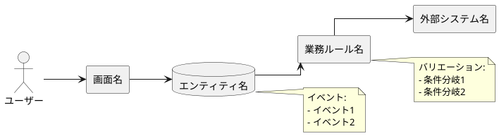

# {issue prefix}: issueタイトル

## 概要

issueの説明を7行程度にまとめる

一行ごとに区切り、改行すること

## コンテキスト図

PlantUMLでコンテキスト図を描画し、システムとの関係性を視覚化する
以下の7つの必須要素を含めること：アクター、画面、業務ルール、情報、外部システム、イベント、バリエーション

## 詳細

- issue内容を箇条書きで詳細にまとめる

## 環境

- issueのタスク対応が必要なブランチ・環境情報・APIエンドポイントやURLなどを箇条書きでまとめる

## 起動条件

- バッチ処理の場合は、起動条件を箇条書きで記載する（例：cron式、トリガー条件、手動起動など）
- バッチ処理ではない場合は、このセクションを削除すること

## 再現方法

- issue内容がバグの場合はその再現方法を詳細に記載

## 懸念事項

- ある場合はここに箇条書きで記載

## 要件定義書整合性チェックリスト

Issue作成時に要件定義書との整合性を確認するためのチェックリストです。
すべての項目を確認し、適用される項目にチェックマーク（✓）を付けること。

- [ ] **対応する業務領域を特定したか**
    - 業務領域コード（例：AG-02, JB-01）を特定する
    - 要件定義書の該当業務領域のディレクトリを確認する
- [ ] **ユースケース一覧を確認したか**
    - 対応するユースケースが要件定義書に存在するか確認する
    - ユースケースが存在しない場合は、新しいユースケースを作成する
- [ ] **条件一覧を確認したか**
    - 対応する業務領域の条件一覧ファイル（条件一覧.tsv または 条件一覧.md）を確認する
    - 関連する業務ルールが既に定義されているかチェックする
- [ ] **業務ルールが存在しない場合は、新しい条件を追加したか**
    - 新しい条件IDを割り当てる（例：COND-BL-09）
    - 条件一覧に新しい業務ルールを追加する
    - 関連するバリエーション一覧も更新する（必要に応じて）
    - UC複合図に業務ルールを反映する（必要に応じて）
- [ ] **Issueに条件IDを記載したか**
    - 関連する条件IDを本文または参考ドキュメントに記載する
- [ ] **ステート一覧を確認したか**
    - 対応する業務領域の `04.システム/02.ステート/` ディレクトリを確認する
    - ステート一覧.tsv（状態遷移定義）に関連する状態と遷移が既に定義されているかチェックする
    - ステート一覧.md（状態ID定義）に状態IDが既に割り当てられているかチェックする
    - ステートマシン図.md（PlantUML視覚化）に状態遷移が反映されているか確認する
- [ ] **状態が不足している場合は、新しい状態を追加したか**
    - ステート一覧.mdに新しい状態IDを割り当てる（例：ST-BL-20）
    - ステート一覧.tsvに新しい状態と遷移先状態、遷移UCを追加する
    - ステートマシン図.mdに新しい状態と遷移をPlantUMLで追加する
    - 関連する条件一覧（条件一覧.tsv または 条件一覧.md）に状態遷移の制約条件を追加する（必要に応じて）
    - UC複合図に新しい状態を反映する（必要に応じて）
- [ ] **Issueに状態IDを記載したか**
    - 関連する状態ID（例：ST-BL-20）を本文または参考ドキュメントに記載する
    - 状態モデル名（例：バックログ項目、ジョブ実行）を明記する

## 参考ドキュメント

- [参考1](https://www.example.com)
