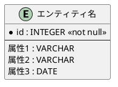

RDRAについては[RDRAガイドライン](../../../guidelines/rdra/rdra-model.guidelines.md)を参照してください。

**ガイドライン一覧**:
- [概要](../../../guidelines/rdra/rdra-overview.guidelines.md) — RDRAの基本概念、4つのレイヤー、ダイアグラム、モデル要素
- [ドキュメント配置](../../../guidelines/rdra/rdra-document-structure.guidelines.md) — 事業領域ディレクトリ構造
- [フェーズ1](../../../guidelines/rdra/rdra-phase1.guidelines.md) — 初期要望から要素を抽出する
- [フェーズ2](../../../guidelines/rdra/rdra-phase2.guidelines.md) — 要素を再整理し詳細化する
- [フェーズ3](../../../guidelines/rdra/rdra-phase3.guidelines.md) — 要素を再整理する
- [フェーズ4](../../../guidelines/rdra/rdra-phase4.guidelines.md) — 要素を関連付ける
- [フェーズ5](../../../guidelines/rdra/rdra-phase5.guidelines.md) — システム概要を定義する
- [フェーズ6](../../../guidelines/rdra/rdra-phase6.guidelines.md) — 仕様を生成する
- [フェーズ7](../../../guidelines/rdra/rdra-phase7.guidelines.md) — 画面照会を生成する
- [要件組み立て](../../../guidelines/rdra/rdra-requirement-assembly.guidelines.md) — 要素を関連付け、要件を具体化する
- [整合性確認](../../../guidelines/rdra/rdra-consistency-check.guidelines.md) — 整合性を確認し精度を高める
- [チェックリスト](../../../guidelines/rdra/rdra-checklist.guidelines.md) — 各フェーズの完了確認項目
- [設計連携](../../../guidelines/rdra/rdra-design-integration.guidelines.md) — RDRA成果物と設計プロセスとの連携
- [情報ルール](../../../guidelines/rdra/rdra-information-rules.guidelines.md) — 情報一覧の情報種類、履歴管理、実現方法

## Purpose

このSkillは、要求を整理し、

1. RDRAによる4レイヤーの要求モデル構築
2. 7フェーズの要件定義プロセスの実行
3. ダイアグラムによる可視化と整合性検証
4. DDDモデル候補の抽出
5. 要求の抜け漏れ・矛盾・重複の検証
6. サブドメイン毎にユースケース図を作成（PlantUML使用）
7. サブドメイン毎に用語辞書を作成
8. 画面定義書を作成

をまとめる。

---

### 1. いつこのスキルを使用するか (When To Use)

- 要件定義をRDRAモデルとして構造化してまとめるとき
- 既存システムの可視化をRDRAモデルで行いたいとき
- 新機能の要件をRDRAの4レイヤーで整理したいとき
- 関係者との認識合わせをRDRAダイアグラムで行いたいとき
- DDDの前段階としてドメインをRDRAで整理したいとき
- 構築したRDRAモデルをファイルに出力してチームで共有するとき

---

### 2. RDRA の基本概念

RDRAの基本概念については[RDRA概要ガイドライン](../../../guidelines/rdra/rdra-overview.guidelines.md)を参照してください。

#### RDRAのモデル要素

RDRAでは、システムを構成する要素を以下のモデルで定義します。

| モデル             | 説明                                                                                         |
|--------------------|----------------------------------------------------------------------------------------------|
| **アクター**       | システムに関わる人の役割を表す                                                               |
| **アクター群**     | 同じような役割を持つ「アクター」をまとめ、組織の役割を示す                                   |
| **外部システム**   | システムと連携する外部のシステムを表す                                                       |
| **外部システム群** | 同じような関係を持つ「外部システム」をまとめる                                               |
| **コンテキスト**   | システムを表すモデル「情報」「状態モデル」「条件」「バリエーション」をまとめる               |
| **情報**           | システムが扱うビジネス上の情報を表す。ビジネス上管理されているID単位に存在する               |
| **状態**           | 情報の変化を状態として扱い、ビジネス上管理する対象となる。状態を遷移させながらビジネスが進む |
| **業務**           | 最上位の会社の機能（マーケティング、販売や在庫管理など）。BUCを構成要素に持つ                |
| **BUC**            | 業務の価値を実現する単位で、業務フローの単位になる                                           |
| **アクティビティ** | 意味をもったまとまった一つの作業                                                             |
| **UC**             | システムを使ってまとまった一つの意味をもつ作業                                               |
| **画面**           | アクターとシステムとのインターフェースになる                                                 |
| **イベント**       | 外部システムとのインターフェースになる                                                       |
| **タイマー**       | ビジネス上の時間的な区切りを表す（例: 25日締め、月末）                                       |

#### モデル間のつながりの規則

- **業務**は複数の **BUC**を配下にもつ
- **BUC**は複数の **アクティビティ**を配下にもつ
- **アクティビティ**を行う **アクター**がつながる
- **アクティビティ**でシステムを使う場合は **UC**につながる
- **UC**は **情報**を操作する
- **アクター**は **画面**を使って **UC**を操作する
- **外部システム**は **イベント**で **UC**と連携する
- **UC**が定時に活動する場合に **タイマー**につながる
- **情報**は **情報**につながることで構造化する
- **状態モデル**は複数の **状態**を持つ
- **UC**が **状態**を遷移させる
- **コンテキスト**は **情報**、 **状態モデル**、 **条件**、 **バリエーション**を配下に複数持つ
- **条件**は **バリエーション**と **状態モデル**の組合せで出来ている

#### RDRASheetの構造

RDRASheetは表形式で要件定義を行うための形式です。各ファイルの列構造は以下の通りです。

**「アクター」ファイル**: アクター群 / アクター / 説明 **「外部システム」ファイル**: 外部システム群 /
外部システム / 説明 **「BUC」ファイル**: 業務 / BUC / 先 / アクティビティ / 次 / UC / 関連モデル1 /
関連オブジェクト1 / 関連モデル2 / 関連オブジェクト2 / 説明 **「情報」ファイル**: コンテキスト / 情報 /
属性 / 関連情報 / 状態モデル / バリエーション / 説明 **「状態」ファイル**: コンテキスト / 状態モデル /
状態 / 遷移UC / 遷移先状態 / 状態モデル・状態の説明 **「条件」ファイル**: コンテキスト / 条件 /
条件の説明 / バリエーション / 状態モデル **「バリエーション」ファイル**: コンテキスト /
バリエーション / 値 / 説明

#### RDRAGraphの変換ルール

RDRAGraphは、表形式のRDRASheetからグラフ形式の関連データへ変換して視覚的に表示するための形式です。

| 関係タイプ  | 意味              |
|-------------|-------------------|
| #child      | 階層関係（親→子） |
| #edge       | 関連関係          |
| #arrow      | 遷移関係          |
| #comment    | コメント          |
| #stereotype | ステレオタイプ    |
| #attribute  | 属性              |

---

### 3. RDRA ワークフロー (Overall Workflow)

RDRAによる要件定義は、「7つのフェーズ」で計画的に進めます。一度で完璧を目指すのではなく、何度も見直して精度を上げていくのがポイントです。

```text
┌─────────────────────────────────────────────────────────────┐
│              フェーズ1: 初期要望から要素を抽出する              │
│                   (RDRAモデルの基盤構築)                     │
│                                                             │
│  ・初期要望分析                                              │
│  ・要求の抽出 (機能/非機能)                                  │
│  ・アクターの抽出                                            │
│  ・外部システムの抽出                                        │
│  ・業務の抽出 (業務とBUC)                                    │
│  ・情報の抽出                                                │
│  ・状態の抽出                                                │
│  ・ビジネスパラメータの抽出                                  │
│  ・ビジネスポリシーの抽出                                    │
└─────────────────────────────────────────────────────────────┘
                              │
                              ▼
┌─────────────────────────────────────────────────────────────┐
│            フェーズ2: 要素を再整理し詳細化する                  │
│                   (業務・情報・状態の詳細化)                 │
│                                                             │
│  ・業務の詳細化 (アクティビティ/UCへのブレークダウン)         │
│  ・情報の詳細化 (属性と関連の定義)                           │
│  ・状態の詳細化 (状態遷移への分解)                           │
│  ・条件の派生 (ビジネスポリシーから)                         │
│  ・バリエーションの派生 (ビジネスパラメータから)              │
└─────────────────────────────────────────────────────────────┘
                              │
                              ▼
┌─────────────────────────────────────────────────────────────┐
│              フェーズ3: 要素を再整理する                       │
│                   (BUC・アクター・情報の再整理)              │
│                                                             │
│  ・BUCの再整理 (UC・情報・条件・外部システムとの紐付け)       │
│  ・アクターの再整理 (業務からアクター追加・主担当設定)        │
│  ・情報の再整理 (コンテキスト分類・状態モデル関連付け)        │
└─────────────────────────────────────────────────────────────┘
                              │
                              ▼
┌─────────────────────────────────────────────────────────────┐
│              フェーズ4: 要素を関連付ける                       │
│                   (RDRA Sheet形式変換)                      │
│                                                             │
│  ・BUCの関連モデル形式への変換                               │
│  ・バリエーションのコンテキスト紐付け                        │
│  ・条件のコンテキスト・バリエーション・状態モデル紐付け      │
│  ・状態のコンテキスト・遷移UC紐付け                          │
└─────────────────────────────────────────────────────────────┘
                              │
                              ▼
┌─────────────────────────────────────────────────────────────┐
│              フェーズ5: システム概要を定義する                 │
│                   (システム名と概要の抽出)                   │
│                                                             │
│  ・システム名の抽出                                          │
│  ・システム概要の生成                                        │
│  ・JSON形式での出力                                          │
└─────────────────────────────────────────────────────────────┘
                              │
                              ▼
┌─────────────────────────────────────────────────────────────┐
│              フェーズ6: 仕様を生成する                       │
│                   (論理データ・ビジネスルール・画面)         │
│                                                             │
│  ・論理データ生成 (ER図)                                    │
│  ・ビジネスルール生成 (テーブル形式)                         │
│  ・画面一覧生成 (JSON)                                      │
│  ・BUC画面生成                                              │
│  ・アクター画面生成                                         │
└─────────────────────────────────────────────────────────────┘
                              │
                              ▼
┌─────────────────────────────────────────────────────────────┐
│              フェーズ7: 画面照会を生成する                    │
│                   (画面と論理データの関連付け)               │
│                                                             │
│  ・画面照会生成 (data_access追記)                           │
│  ・BUC画面・アクター画面・画面一覧の統合                     │
│  ・出力: 2_RDRASpec/画面照会.json                           │
└─────────────────────────────────────────────────────────────┘
                              │
                              ▼
┌─────────────────────────────────────────────────────────────┐
│              要件組み立てフェーズ                              │
│                   (要素の関連付けと具体化)                   │
│                                                             │
│  ・ユースケースの導出                                        │
│  ・要素の関連付け (情報・状態・アクター・外部システム)        │
│  ・整合性確認                                                │
└─────────────────────────────────────────────────────────────┘
```

---

### 4. 各フェーズの詳細手順 (Detailed Steps)

#### 4.1 フェーズ1: 初期要望から要素を抽出する

**実行単位**: 事業領域

**目的**: 初期要望からRDRAモデルの全要素を抽出し、要件定義の基盤を構築する。

**初期要望分析**

- 初期要望の内容を分析し構造を把握する
- RDRA構造と対比し、具体的に書かれていることと書かれていないことを分析する
- 初期要望に書かれていることをそのまま出力せず、抽象的な分類として「～について記述されている」形式で出力する

**要求の抽出**

- 初期要望から機能要求と非機能要求を洗い出す
- 要求は「～したい」「～すること」「～できる」などで表現される
- **機能要求**: 具体的なビジネス、システムの機能に対する要求
- **非機能要求**: 使いやすさやレスポンス時間など、具体的な機能ではない要求

**アクターの抽出**

- 初期要望からシステムに関わる人の役割（アクター）を洗い出す
- アクターは役割として命名し、個人名や組織名は使わない
- アクターは顧客（社外の価値受益者）と提供者（価値を提供するアクター）に分かれる
- アクター群はアクターを分類する組織単位

**外部システムの抽出**

- 初期要望から連携が必要な外部システムを洗い出す
- 外部システムは役割に応じて分類する
- 外部システム名は役割が分かる名前にする

**業務の抽出**

- 初期要望から業務とビジネスユースケース (BUC)を洗い出す
- 業務は「販売管理」「在庫管理」などのように企業の中の大きな管理単位
- BUCは業務フローの単位となり、価値受益アクターに価値を提供する
- BUCには必ず一人の価値を得るアクターがいる
- 業務は1つ以上のBUCを含み、階層構造になる

**情報の抽出**

- 初期要望からビジネスとして管理すべき情報を洗い出す
- 情報は必ずユニークなIDを持ち、一意に識別できる
- ビジネスは情報に状態を保持する

**状態の抽出**

- 初期要望から状態モデルを洗い出す
- 状態モデルは状態が遷移する状態の集合
- 状態モデルは必ず複数の状態を持つ
- ビジネスは状態を使って今の状況を把握し、次の状態に遷移させる

**ビジネスパラメータの抽出**

- 初期要望からビジネス上必要になる区分、分類、種別などのパラメータを洗い出す
- システムの仕組み上の区分、分類、種別は含めない
- 記述されていない場合は、記述されていることから必要となるビジネスパラメータを類推する

**ビジネスポリシーの抽出**

- 初期要望からビジネスに関するポリシー（方針）を洗い出す
- ビジネスとシステムを深堀りする時の様々な判断基準とするポリシー
- 記述されていない場合は、記述されていることから必要となるビジネスポリシーを類推する

##### チェックリスト

詳細な確認項目は [requirement.md](../../../guidelines/rdra/checklists/requirement.md) を参照してください。

**チェックエラー時の処理**: [チェックエラー時の処理](#チェックエラー時の処理)を参照してください。

#### 4.2 フェーズ2: 要素を再整理し詳細化する

**実行単位**: 業務領域

**目的**: フェーズ1で抽出した要素を再整理し、業務はアクティビティ/UCにブレークダウンし、情報は属性と関連を定義し、状態は状態遷移に分解する。

**業務の詳細化**

- フェーズ1の業務をベースに業務/BUCをアクティビティとUCに分解する
- 要求に関わるアクティビティとUCを洗い出す
- 初期要望に業務フローの要素があればアクティビティとして追記する
- 初期要望にシステムの機能について記述があればUCとして追記する
- 状態モデル内の状態遷移はUCによって遷移される
- 状態モデルに関わるBUCを識別し、状態を遷移させるUCは業務内のUCに対応する
- 価値受益アクターと価値提供アクターをアクティビティ/UC毎に分割する
- UCは価値受益アクターか価値提供アクターのどちらかのアクターと結びつく

**情報の詳細化**

- フェーズ1の情報をベースに情報を再整理する
- 機能要求/非機能要求を実現するために必要な情報を洗い出す
- BUCの中で利用する情報を洗い出す
- フェーズ1に存在しない情報は追加する
- 情報が持つべき属性を洗い出す
- 情報同士の関連を関連情報として洗い出す
- 初期要望にデータの属性に関わる記述があれば属性として追記する
- 初期要望にデータ同士の関連に関わる記述があれば関連情報として追記する

**状態の詳細化**

- フェーズ1の状態モデルをベースに状態を状態遷移に分解する
- 機能要求/非機能要求を実現するために必要な状態モデルと状態、遷移先状態を洗い出す
- フェーズ1の情報に対応する状態モデルの有無を調べ、足りていない場合は追加する
- フェーズ1の業務/BUCで行うことに対応する状態モデルの有無を調べ、足りていない場合は追加する
- フェーズ1のビジネスポリシーから行わなければならない対応する状態モデルの有無を調べ、足りていない場合は追加する
- 状態モデルの複数の状態を状態と遷移先状態に分解する
- 状態遷移に分解する時は遷移の数分だけ複数行として出力する
- 最初の状態は「状態：start、遷移先状態：最初の状態」で表現する
- 最後の状態は「状態：最後の状態、遷移先状態：end」で表現する

**条件の派生**

- フェーズ1で抽出したビジネスポリシーから条件（ビジネスルール）を派生させる
- ビジネスルールを条件として洗い出す
- 必要なルールを条件の説明として定義する
- ビジネスルールが必要な場面と理由を利用場面として定義する

**バリエーションの派生**

- フェーズ1で抽出したビジネスパラメータからバリエーションを派生させる
- バリエーションはビジネス上の区分や種類を表す
- バリエーション内の取り得る複数の値を定義する

##### チェックリスト

詳細な確認項目は [requirement-assembly.md](../../../guidelines/rdra/checklists/requirement-assembly.md)
を参照してください。

**チェックエラー時の処理**: [チェックエラー時の処理](#チェックエラー時の処理)を参照してください。

#### 4.3 フェーズ3: 要素を再整理する

**実行単位**: 業務領域

**目的**:
フェーズ2で詳細化した要素を再整理し、BUCはUC・情報・条件・外部システムと紐付け、アクターは業務から再整理し、情報はコンテキストで分類して状態モデルとバリエーションと関連付ける。

**BUCの再整理**

- フェーズ2の業務.tsvをベースに同じレコード件数のBUC.tsvを出力する
- フェーズ2の業務.tsvとBUC.tsvで同じ項目の場合はそのまま出力する
- フェーズ2の業務の説明を参考にUCにつながる情報、条件、外部システムを追記する
    - アクティビティが行う仕事をシステムで行う場合はユースケース（UC）に情報、条件、外部システム、アクターとの連携で記述する
    - UCで行うことをシステムで整合させるために情報とつなげる
    - システムが外部のシステムと連携する場合に外部システムをUCにつなげる
        - 外部システムはフェーズ1で定義された外部システムだけを使う
            - 外部システム.tsvに記述されていない外部システムを生成しない
    - システムがビジネスルールに従うときに条件とつなげる
    - 初期要望分析にUCとつながる情報、条件（ビジネスルール）、外部システムの関係の記述があれば、それを含める
    - 以下の関連モデルと関連オブジェクトの成約に従う
        - 関連モデル1:「情報」、関連オブジェクト1:「情報.tsv」で定義された情報を設定する。新たに情報を生成しない
        - 関連モデル1:「条件」、関連オブジェクト1:「条件.tsv」で定義された条件を設定する。新たに条件を生成しない
        - 関連モデル2:「外部システム」、関連オブジェクト2:「外部システム.tsv」で定義された外部システムを設定する。新たに外部システムを生成しない

**アクターの再整理**

- フェーズ2の業務を読込、「価値受益アクター」と「価値提供アクター」をフェーズ1のアクターにないものをフェーズ3のアクターに追加して出力する
- フェーズ1のアクターから初期要望にアクターの記述がなく、フェーズ1の業務の「価値受益アクター」と「価値提供アクター」に該当するものがないアクターは出力しない
- 業務の「価値受益アクター」に対応するアクターには、主担当業務として設定する
- アクターはアクター群としてグループ化する

**情報の再整理**

- フェーズ2の情報.tsvをベースにコンテキストで分類し、状態モデル、バリエーションと紐付けて出力する
- 情報を役割に応じてコンテキストとして分類する
- コンテキストは情報を中心とした管理単位となる
- コンテキストはドメインのグループとして活用する
- フェーズ2の情報.tsvを順次読込以下のことを行う
    - 情報に関係する状態モデルを関連付ける
    - 情報はユニークなIDを持ち、状態モデルもユニークなIDの状態遷移を表す
    - 同じIDをもつものを関連付ける
    - 情報に従属するバリエーションを関連付ける
        - 例：会員ランク（バリエーション）は会員（情報）に従属する
    - 初期要望分析にUCと情報、条件（ビジネスルール）、外部システムの関係の記述があれば、それを含める
    - 情報のIDと同じIDをもつ「状態.tsv」の状態モデルは、状態モデルカラムに設定する
    - バリエーションが情報に従属する場合はバリエーションに設定する
- 状態モデルカラムに設定する名前は「状態.tsv」に定義されている状態モデルを設定、新たに状態モデルを生成しない
- バリエーションカラムは「バリエーション.tsv」に定義されているバリエーションを設定、新たにバリエーションを生成しない

##### チェックリスト

詳細な確認項目は [requirement-assembly.md](../../../guidelines/rdra/checklists/requirement-assembly.md)
を参照してください。

**チェックエラー時の処理**: [チェックエラー時の処理](#チェックエラー時の処理)を参照してください。

#### 4.4 フェーズ4: 要素を関連付ける

**実行単位**: 業務領域

**目的**: フェーズ3で再整理した要素を最終的なRDRA
Sheet形式に変換し、BUCは関連モデル形式へ展開し、バリエーション・条件・状態にコンテキストを紐付ける。

**BUCの関連モデル形式への変換**

- フェーズ3の業務.tsvをベースにBUC.tsvを出力する
- フェーズ3の業務.tsvとBUC.tsvで同じ項目の場合はそのまま出力する
- フェーズ3の業務の説明を参考にUCにつながる情報、条件、外部システムを追記する
    - アクティビティが行う仕事をシステムで行う場合はユースケース（UC）に情報、条件、外部システム、アクターとの連携で記述する
    - UCで行うことをシステムで整合させるために情報とつなげる
    - システムが外部のシステムと連携する場合に外部システムをUCにつなげる
        - 外部システムはフェーズ1で定義された外部システムだけを使う
            - 外部システム.tsvに記述されていない外部システムを生成しない
    - システムがビジネスルールに従うときに条件とつなげる
    - 初期要望分析にUCとつながる情報、条件（ビジネスルール）、外部システムの関係の記述があれば、それを含める
- カラム内の値に「、」か「,」がある場合は値を分割し、分割した数に応じて複数行で出力する
- 関連モデルと関連オブジェクトの変換ルール:
    - 「情報」は関連モデル1を「情報」にし、関連オブジェクト1に情報名をセット
    - 「条件」は関連モデル1を「条件」にし、関連オブジェクト1に条件名をセット
    - 「アクター」は関連モデル1を「画面」にし、関連オブジェクト1に画面名をセット、関連モデル2を「アクター」にし、関連オブジェクト2にアクター名をセット
    - 「外部システム」は関連モデル1を「イベント」にし、関連オブジェクト1にイベント名をセット、関連モデル2を「外部システム」にし、関連オブジェクト2に外部システム名をセット
- 画面名はUCが提供する画面として適切な名前にし、UCとアクターをつなげた単純な名前にはしない
- イベント名はUCと外部システムとの連携として適切な名前にし、UCと外部システムをつなげた単純な名前にはしない

**バリエーションのコンテキスト紐付け**

- フェーズ2のバリエーション.tsvをベースにコンテキストを追記して出力する
- フェーズ3の情報.tsvのバリエーションに対応するバリエーションがあれば、その情報のコンテキストをバリエーションのコンテキストとする
- 情報に対応するバリエーションがない場合はバリエーションの役割を分類する名前をコンテキストとする

**条件のコンテキスト・バリエーション・状態モデル紐付け**

- フェーズ2の条件.tsvをベースにコンテキスト、バリエーション、状態モデルを追記して出力する
- 条件は計算式や判断条件に名前を付けたものか、表形式の縦横の組合せ形式のものに分かれる
- 条件が表形式の場合にバリエーションと状態モデルに関わる場合がある
    - 表形式の条件の縦軸か横軸に当てはまるものを設定する
        - 状態モデルが当てはまる場合は、条件の状態モデルに対応する名前を設定する
        - バリエーションが当てはまる場合は、条件のバリエーションに対応する名前を設定する
- 条件のコンテキストは条件に関わる情報のコンテキストを使う

**状態のコンテキスト・遷移UC紐付け**

- フェーズ2の状態.tsvをベースにコンテキストと遷移UCを追記し出力する
- フェーズ3の情報.tsvの状態モデルに対応する状態モデルがあれば、その情報のコンテキストを状態モデルのコンテキストとする
- 状態はUCが遷移させる
    - 遷移UCカラムは状態から遷移先状態への遷移を行うUCをフェーズ3のBUC.tsvのUCから設定する
    - 設定するUCはフェーズ3のBUC.tsvのUCからだけ設定し、新たに生成しない

##### チェックリスト

詳細な確認項目は [requirement-assembly.md](../../../guidelines/rdra/checklists/requirement-assembly.md)
を参照してください。

**チェックエラー時の処理**: [チェックエラー時の処理](#チェックエラー時の処理)を参照してください。

#### 4.5 フェーズ5: システム概要を定義する

**実行単位**: 事業領域

**目的**: 初期要望からシステム名とシステム概要を抽出し、システム全体の概要を定義する。

**システム名の抽出**

- 「初期要望.txt」の内容から自然な日本語のシステム名を1つ抽出・決定する
- システムの目的や対象業務を反映した適切な名前とする

**システム概要の生成**

- 「初期要望.txt」の内容を要約し、システム概要を生成する
- 具体性を保ちつつ簡潔にまとめる（長すぎない文章量）
- システムが解決する課題や提供する価値を明確にする

**出力形式**

- 出力先: `1_RDRA/システム概要.json`
- 形式: `{"system_name":"システム名","system_overview":"システム概要"}`
- JSONのみを出力し、既存ファイルがある場合は上書きする

##### チェックリスト

詳細な確認項目は [requirement-assembly.md](../../../rdra/checklists/requirement-assembly.md)
を参照してください。

**チェックエラー時の処理**: [チェックエラー時の処理](#チェックエラー時の処理)を参照してください。

#### 4.6 フェーズ6: 仕様を生成する

**実行単位**: 事業領域

**目的**: RDRA定義から具体的な仕様を生成し、論理データモデル、ビジネスルール、画面一覧を作成する。

フェーズ6では、フェーズ1~5で定義したRDRA要素を基に、具体的な仕様を生成します。

**論理データ生成**

- RDRAの「情報」から論理データモデル (ER図)を生成する
- 情報の属性で構造を持っているものは別論理データとして抜き出す
- 親子関係がある情報は親と子の論理データに分割する
- データはユニークな主キーを必ず持ち、項目名は「データ名＋"_ID"」とする
- 項目がバリエーションの場合は「enum」タイプにする
- 論理データを元にER図をMermaid Diagramで作成する
- 出力ファイル: 「2_RDRASpec/論理データモデル.md」

**ビジネスルール生成**

- RDRAの「条件」をビジネスルールとしてMarkdownのテーブル形式で出力する
- 名前の付いた計算式: 条件名と計算式のペアで表現
- 2次元のマトリックス: 縦横の組合せで規定される
- 状態モデルが関係する場合は縦軸または横軸に設定する
- バリエーションが関係する場合は縦軸または横軸に設定する
- 出力ファイル: 「2_RDRASpec/ビジネスルール.md」

**画面一覧生成**

- RDRA定義から画面一覧 (JSON)を生成する
- 画面項目 (fields)、画面データ (screen_datas)、機能 (operation)を定義する
- 画面毎に3件のダミーデータを生成する
- 出力ファイル: 「2_RDRASpec/Phase1/画面一覧.json」

**BUC画面生成**

- 画面と業務/BUC、アクターとの関係をJSON形式で定義する
- 画面は「画面一覧.json」で定義されているものを使用する
- 出力ファイル: 「2_RDRASpec/phase1/BUC画面.json」

**アクター画面生成**

- 画面とアクターの関係をJSON形式で定義する
- 画面は「画面一覧.json」で定義されているものを使用する
- 出力ファイル: 「2_RDRASpec/phase1/アクター画面.json」

**チェックエラー時の処理**: [チェックエラー時の処理](#チェックエラー時の処理)を参照してください。

#### 4.7 フェーズ7: 画面照会を生成する

**実行単位**: 事業領域

**目的**: 画面一覧.jsonにデータアクセス情報を追記し、BUC画面.jsonとアクター画面.jsonとまとめて画面照会.jsonを生成する。

フェーズ7では、フェーズ6で生成した画面一覧.json、BUC画面.json、アクター画面.jsonを統合し、画面が操作する論理データへのアクセス情報を追記して画面照会.jsonを作成します。

**画面照会生成**

- 画面一覧.jsonの「screens」に「data_access」を追記する
- BUC画面.jsonの「businesses」をそのまま出力する
- アクター画面.jsonの「actorGroups」をそのまま出力する
- 3つを一つにまとめて「画面照会.json」として出力する

**データアクセス（data_access）**

- 画面の機能に必要なentityを「論理データモデル.md」から洗い出す
- 画面に必要な項目を満たす論理データ (entity)から関係を洗い出す
- 画面とEntityの関係は「画面 → UC → 情報」の関係を頼りに類推する
- 関係するentityとの関係をC,R,U,Dで示す（複数設定可能）
- isMain: true (主として操作するEntity) / false (主Entityから参照されるEntity)
- 一つの画面に主となるEntityは一つ

**出力ルール**

- 出力ファイル: 「2_RDRASpec/画面照会.json」
- 関連データ.txtの「画面-アクター」定義を全て網羅する
- 同一画面に複数アクターがいる場合、全てのアクターを出力する

**チェックエラー時の処理**: [チェックエラー時の処理](#チェックエラー時の処理)を参照してください。

#### 4.8 要件組み立てフェーズ: 要素を関連付け、要件を具体化する

**実行単位**: 業務領域

**目的**: 抽出した要素同士を関連付け、ユースケースを中心に要件を具体化する。

**ユースケースの導出**

- 業務からユースケース (UC)を導き出し、システム化する部分を整理する
- 画面（人と関わる入出力）とイベント（外部システムとの連携）を特定する
- **BUC分析**: 各BUCに対してBUC記述を作成し、BUCを構成するアクティビティや関連情報を明確にする
- **BUC記述作成**:
  各BUCに対してBUC記述ファイルを作成し、UC導出の基盤とする（[BUC記述.md](../../guidelines/rdra/templates/BUC記述.md)
  テンプレートを使用）

**要素の関連付け**

- 洗い出した情報や状態とユースケースを関連づける
- 情報をハブとして他のユースケースと繋ぐ
- ユースケースによる情報の変化を状態として表すことでユースケースの妥当性を評価
- アクター、外部システムをユースケースに関連付ける

**状態モデル図の作成**

- ステート一覧.tsvで整理した状態に基づき、PlantUMLで状態遷移図（ステートマシン図）を作成する
- 状態モデル図は `04.システム/02.ステート/ステートマシン図.md` に配置する
- 各状態間の遷移と、その遷移をトリガーするユースケースを明記する

状態モデル図の作成手順は [状態モデル図作成ガイドライン](../../../guidelines/docs/state-model.guidelines.md)
を参照

**UC複合図の作成**

- 洗い出したユースケース、画面、イベント、情報、条件をPlantUMLで関連づけたUC複合図を作成する
- UC複合図は `03.システム境界/UC複合図.md` に配置する
- アクター、外部システム、ユースケース、画面、イベント、情報、条件の関係性を視覚的に表現する

UC複合図の作成手順は [UC複合図作成ガイドライン](../../../guidelines/docs/uc-composite.guidelines.md)
を参照

**業務ルールの種類**

業務ルール（条件）を定義する際には、以下の5つの種類を意識して分類します。

| 業務ルールの種類   | 英語表記        | 説明                                                                             |
|--------------------|-----------------|----------------------------------------------------------------------------------|
| **意思決定支援**   | DecisionSupport | 判断や意思決定を支援するルール。推奨事項や評価基準を提供し、担当者の判断を助ける |
| **ポリシー**       | Policy          | 組織やシステムが遵守すべき規範や方針。違反が許されない強制力のあるルール         |
| **コミットメント** | Commitment      | システムや組織が約束する行動や保証。SLAやサービスレベルの約束など                |
| **オペレーション** | Operation       | 日常的な業務手順や運用ルール。標準的な処理フローや操作方法を規定する             |
| **ポテンシャル**   | Potential       | 将来の拡張や改善の可能性を示すルール。オプション機能や拡張ポイントを定義する     |

業務ルールをこれらの種類に分類することで、ルールの性質や優先度を明確にし、要件定義の精度を高めることができます。

**ID命名規約**: [guidelines/id-naming-conventions.guidelines.md](guidelines/id-naming-conventions.guidelines.md)
を参照する

- ビジネスユースケースとビジネスアクターの関連付けは必須
- ユースケースとビジネスユースケースの関連付けは必須
- ユースケースとアクターの関連付けは必須
- ユースケースと外部システムの関連付けは必須
- ユースケースと画面の関連付けはオプション
- 外部システム定義ファイルの配置は必須（01.外部システム定義ディレクトリ）
- 画面定義ファイルの配置は必須（03.画面定義ディレクトリ）
- ファイル命名規則：「ID 名前.md」形式（例：ES-01 データベース.md）

**整合性確認**

- RDRAモデル全体の整合性を確認
    - 不整合の検出: 要素間の参照関係の誤りや未使用要素を発見
    - 全体俯瞰: ユースケースを軸に、アクター・外部システム・情報などの要素との関係を俯瞰的に確認

**要件組み立てフェーズ実行時の準備作業：情報属性一覧の作成**

要件組み立てフェーズの実行を指示された際には、事前に各情報（エンティティ）毎に「情報属性一覧」ファイルを作成します。ER（エンティティ関係）モデルに基づき、各情報の主キーと属性を詳細に定義することで、実装レベルの仕様化を支援します。

ERモデルの詳細は [tm.md](../../guidelines/rdra/tm.md) を参照してください。

**ERモデルに基づく情報属性一覧の構造**:

ERモデルでは、エンティティを矩形で表現し、主キー（個体指定子）と属性を定義します。PlantUMLのInformation Engineering記法を使用します。



ERモデルでは、エンティティを以下の2つに分類します：

| 分類 | 記号 | 説明 |
|------|------|------|
| イベント (Event) | E | システム内で発生する出来事を表す情報。タイムスタンプを持つ。 |
| リソース (Resource) | R | 独立したエンティティとして存在する主要なデータ。主キーを持ち、他の情報が参照する対象。 |

**情報属性一覧の作成手順**:

1. フェーズ1でリストアップした情報（情報一覧.tsv）を基に、各情報毎にファイルを作成する
2. ERモデルの構造に従い、主キー（個体指定子）と属性を定義する
   - 主キー：エンティティを一意に識別する属性。属性一覧で「個体指定子」列に「✓」をマークする
   - 属性：エンティティの特性を表す一般属性
3. ERモデルの分類（イベントE / リソースR）に従い、情報を分類する
4. エンティティ命名規則と3大要素（単一性・同一性・カテゴリ）を適用する
5. 各属性の型（String, Integer, Long, Double, Boolean, Date, DateTime, Enum）と必須/任意を定義する
6. 情報間の関連関係を明記する

**ファイル配置規則**:

- Markdownファイル: `04.システム/01.情報/02.属性/[情報ID] 情報名_情報属性一覧.md`
- TSVファイル: `04.システム/01.情報/02.属性/[情報ID] 情報名_情報属性一覧.tsv`
-
テンプレート: [情報属性一覧.md](../../guidelines/rdra/templates/情報属性一覧.md), [情報属性一覧.tsv](../../guidelines/rdra/templates/情報属性一覧.tsv)

**エンティティ命名規則**:

- エンティティ名は短く意味を的確に表現するものとする
- 「情報」「データ」「処理」「〜物」「マスタ」「記録」「管理」「履歴」などの不要な語は付けない
- 英名は名詞（または動名詞）を複数形として利用する
- 短縮名を発音可能で視認性の高いものとする

**エンティティの3大要素**:

各情報属性一覧では、以下の3点を定義する：

1. **単一性 (Oneness)**: 「何が1つのものであるか？」
2. **同一性 (Sameness)**: 「2つのものが同じであると、どういうときに言えるのか？」
3. **カテゴリ (Category)**: 「それは何であるか？どんな分類で識別されるか？」

**要件組み立てフェーズ実行時の準備作業：ER図の作成**

要件組み立てフェーズの実行を指示された際には、事前に業務領域毎に「ER図」ファイルを作成します。情報一覧でリストアップした情報（エンティティ）間の関係をPlantUMLのER図（Information
Engineering記法）で視覚化し、データモデルの全体像を明確にします。

**ER図の作成手順**:

1. フェーズ1でリストアップした情報（情報一覧.tsv）を基に、業務領域毎にER図ファイルを作成する
2. 各情報（エンティティ）をPlantUMLのentity記法で定義する
3. 情報間の関係（1対1、1対多、多対多）をカラスの足記法で表現する
4. 属性は情報属性一覧で定義した個体指定子と主要属性を記載する
5. 英語版と日本語版の両方のPlantUML図を作成する
6. 情報一覧と関係一覧をテーブルで明記する

**ファイル配置規則**:

- Markdownファイル: `04.システム/01.情報/ER図.md`
- テンプレート: [ER図.md](../../guidelines/rdra/templates/ER図.md)

**PlantUML ER図記法**:

- PlantUMLのInformation Engineering記法（カラスの足記法）を使用する
- エンティティは `entity` キーワードで定義し、属性を中括弧で囲む
- 個体指定子（主キー）は `*` でマークし、`<<not null>>` 制約を付与する
- 関係は `||--o{`（1対多）、`||--||`（1対1）、`}o--o{`（多対多）などの記号で表現する
- 英語版と日本語版の両方の図を作成し、チームでの共有を容易にする

**要件組み立てフェーズ実行時の準備作業：画面属性一覧の作成**

要件組み立てフェーズの実行を指示された際には、事前に各画面毎に「画面属性一覧」ファイルを作成します。フェーズ2で特定した画面（人と関わる入出力）の詳細を定義し、画面項目、レイアウト、操作、制約事項を整理することで、実装レベルの仕様化を支援します。

**画面属性一覧の作成手順**:

1. フェーズ2で特定した画面（画面一覧.tsv）を基に、各画面毎にファイルを作成する
2. 画面に表示・入力される項目をリストアップし、項目タイプ（表示・入力・選択・チェックボックス・ボタン・リンク）を定義する
3. 各項目の型（String, Integer, Long, Double, Boolean, Date, DateTime, Enum, File）と必須/任意を定義する
4. 画面の領域構成（レイアウト）を定義する
5. 画面で実行可能な操作と遷移先画面を明記する
6. 制約事項とバリデーションルールを定義する
7. 画面で参照・更新する関連情報をリストアップする
8. 画面アクセスに必要な権限要件を定義する

**ファイル配置規則**:

- Markdownファイル: `04.システム/04.画面/[画面ID] 画面名_画面属性一覧.md`
- TSVファイル: `04.システム/04.画面/[画面ID] 画面名_画面属性一覧.tsv`
-
テンプレート: [画面属性一覧.md](../../guidelines/rdra/templates/画面属性一覧.md), [画面属性一覧.tsv](../../guidelines/rdra/templates/画面属性一覧.tsv)

**要件組み立てフェーズ実行時の準備作業：画面ER図の作成**

要件組み立てフェーズの実行を指示された際には、事前に各画面毎に「画面ER図」ファイルを作成します。画面が参照・更新する情報（エンティティ）間の関係をPlantUMLのER図（Information
Engineering記法）で視覚化し、画面のデータ構造を明確にします。

**画面ER図の作成手順**:

1. フェーズ2で特定した画面（画面一覧.tsv）を基に、各画面毎にER図ファイルを作成する
2. 画面が参照・更新する情報（エンティティ）をPlantUMLのentity記法で定義する
3. 情報間の関係（1対1、1対多、多対多）をカラスの足記法で表現する
4. 属性は情報属性一覧で定義した個体指定子と主要属性を記載する
5. 英語版と日本語版の両方のPlantUML図を作成する
6. 画面が参照・更新する情報一覧をテーブルで明記する

**ファイル配置規則**:

- Markdownファイル: `04.システム/04.画面/[画面ID] 画面名_画面ER図.md`
- テンプレート: [画面ER図.md](../../guidelines/rdra/templates/画面ER図.md)

**画面項目の定義**:

各画面属性一覧では、以下の要素を定義する：

1. **画面概要**: 画面ID、画面名、説明、関連ユースケース
2. **画面項目一覧**: 項目名、項目タイプ、型、必須/任意、初期値、制約
3. **画面レイアウト**: 領域名、説明、含まれる項目
4. **画面操作**: 操作名、トリガー、説明、遷移先画面
5. **制約事項**: 制約名、対象項目、制約内容
6. **バリデーションルール**: ルール名、対象項目、条件、エラーメッセージ
7. **関連情報**: 情報ID、情報名、操作種類（参照/更新/削除）
8. **権限要件**: 権限名、説明

**要件組み立てフェーズ実行時の準備作業：イベント属性一覧の作成**

要件組み立てフェーズの実行を指示された際には、事前に各イベント毎に「イベント属性一覧」ファイルを作成します。フェーズ2で特定したイベント（外部システムとの連携）の詳細を定義し、イベント属性、トリガー、ペイロード、処理フローを整理することで、実装レベルの仕様化を支援します。

**イベント属性一覧の作成手順**:

1. フェーズ2で特定したイベント（イベント一覧.tsv）を基に、各イベント毎にファイルを作成する
2. イベントが持つデータ属性をリストアップし、型（String, Integer, Long, Double, Boolean, Date,
   DateTime, Enum）と必須/任意を定義する
3. イベントが発生するトリガー条件とトリガー種類（外部システム・タイマー・手動・システム内部）を定義する
4. イベント発生時に送信されるペイロードのデータ構造を定義する
5. イベント発生後の処理フローと関連ユースケースを明記する
6. 制約事項とバリデーションルールを定義する
7. イベントで参照・更新する関連情報をリストアップする
8. 関連イベントとの関係を明記する

**ファイル配置規則**:

- Markdownファイル: `04.システム/03.イベント/[イベントID] イベント名_イベント属性一覧.md`
- TSVファイル: `04.システム/03.イベント/[イベントID] イベント名_イベント属性一覧.tsv`
-
テンプレート: [イベント属性一覧.md](../../guidelines/rdra/templates/イベント属性一覧.md), [イベント属性一覧.tsv](../../guidelines/rdra/templates/イベント属性一覧.tsv)

**要件組み立てフェーズ実行時の準備作業：イベントER図の作成**

要件組み立てフェーズの実行を指示された際には、事前に各イベント毎に「イベントER図」ファイルを作成します。イベントが参照・更新する情報（エンティティ）間の関係をPlantUMLのER図（Information
Engineering記法）で視覚化し、イベントのデータ構造を明確にします。

**イベントER図の作成手順**:

1. フェーズ2で特定したイベント（イベント一覧.tsv）を基に、各イベント毎にER図ファイルを作成する
2. イベントが参照・更新する情報（エンティティ）をPlantUMLのentity記法で定義する
3. 情報間の関係（1対1、1対多、多対多）をカラスの足記法で表現する
4. 属性は情報属性一覧で定義した個体指定子と主要属性を記載する
5. 英語版と日本語版の両方のPlantUML図を作成する
6. イベントが参照・更新する情報一覧をテーブルで明記する

**ファイル配置規則**:

- Markdownファイル: `04.システム/03.イベント/[イベントID] イベント名_イベントER図.md`
- テンプレート: [イベントER図.md](../../guidelines/rdra/templates/イベントER図.md)

**イベント属性の定義**:

各イベント属性一覧では、以下の要素を定義する：

1. **イベント概要**: イベントID、イベント名、説明、関連ユースケース、発生元
2. **イベント属性一覧**: 属性名、型、必須/任意、初期値、制約
3. **イベントトリガー**: トリガー名、トリガー種類、条件
4. **イベントペイロード**: フィールド名、型、必須/任意
5. **イベント処理フロー**: 処理ステップ、処理内容、関連ユースケース
6. **制約事項**: 制約名、対象属性、制約内容
7. **バリデーションルール**: ルール名、対象属性、条件、エラーメッセージ
8. **関連情報**: 情報ID、情報名、操作種類（参照/更新/削除）
9. **関連イベント**: 関連イベントID、関連イベント名、関係の種類
10. **権限要件**: 権限名、説明

##### チェックリスト

詳細な確認項目は [issue-creation.md](../../../guidelines/rdra/checklists/issue-creation.md) を参照してください。

**チェックエラー時の処理**: [チェックエラー時の処理](#チェックエラー時の処理)を参照してください。

#### 4.9 RDRA モデルの出力と完了

**ユーザー確認**:

- 構築したRDRAモデル（4レイヤー、ダイアグラム）をユーザーに提示する
- モデルの内容について質問・修正を促し、最終確認を得る

**ファイルへの出力**:

- 確認済みのRDRAモデルを `docs/22 要件定義書` ディレクトリにMarkdownとして出力する
- 入力元は `docs/21 要望` ディレクトリ内のファイルを使用する
- 要件の階層構造、トレーサビリティ、ダイアグラムを整理して記録する
- 元の要件ドキュメントは変更せず、新しいRDRAモデルファイルを出力する

**出力ディレクトリ構造**:

出力ディレクトリは以下の階層構造に従います：

[ドキュメント格納先ディレクトリ命名規則 (Document Directory Naming Guidelines)](../../../guidelines/docs/directory-name.guidelines.md)
を参照してください。

**完了報告**:

- 出力したファイルパスをユーザーに報告する
- 実装順序の推奨と次のステップ（必要に応じてIssue作成）を提案する
- **GitHub Issuesはこのスキルでは作成しない**。Issue作成はユーザーの判断に委ねる

##### チェックエラー時の処理

チェックリストでエラーが発見された場合は、以下の手順に従ってください：

1. エラー内容を `check-error.tsv`
   に記録する（テンプレート: [templates/check-error.tsv](../../guidelines/rdra/templates/check-error.tsv)）
2. `check-error.tsv` を適切なディレクトリに配置する
    - フェーズ1: `docs/22 要件定義書/[事業領域名]/check-error.tsv`
    - フェーズ2/3: `docs/22 要件定義書/[事業領域名]/[業務領域名]/check-error.tsv`
3. 要件定義を中断し、次のフェーズに進まない
4. ユーザーにエラー内容を報告する
5. エラー修正後に再チェックを行い、合格してから次のフェーズに進む

> **注意**: チェックエラー時は、出力されたファイルの削除は自動的に行いません。ユーザーの確認後に手動で削除してください。

---

#### 4.10 情報一覧の情報種類

「03 機能要件」のシステム層における情報一覧では、各情報を以下の4つの情報種類に分類します：

| 情報種類     | 説明                                         | 例                                           |
|--------------|----------------------------------------------|----------------------------------------------|
| **イベント** | システムで発生するイベント情報               | パーティ登録完了、組織登録完了               |
| **リソース** | エンティティや主要なデータリソース           | パーティ、個人、法人、組織、ユーザー         |
| **対応表**   | 2つの情報間の対応関係（N:1, 1:N, N:M）       | ロール割り当て、住所、銀行口座、パーティ関係 |
| **対照表**   | コードと名称などの対照関係（マスターデータ） | 都道府県、金融機関、祝日                     |

##### 分類ガイドライン

1. **リソース**: 独立したエンティティとして存在する主要なデータ。主キーを持ち、他の情報が参照する対象。
2. **対応表**: 2つ以上のリソース間の関係性を表す情報。結合キーや外部キーを持つ。
3. **対照表**: コードと名称の対応など、マスターデータとして参照される情報。lookupテーブル的な役割。
4. **イベント**: システム内で発生する出来事を表す情報。タイムスタンプを持つ。

---

#### 4.11 情報一覧の履歴管理要列

情報一覧には「履歴管理要」列を追加し、履歴管理が必要なリソースに「Y」、不要なリソースに「N」を出力します。

| 値    | 意味                                                 | 例                                                                                                           |
|-------|------------------------------------------------------|--------------------------------------------------------------------------------------------------------------|
| **Y** | 状態が変化するビジネスエンティティ。履歴の追跡が必要 | パーティ、個人、法人、組織、部署、従業員、ロール、ロール割り当て、住所、銀行口座、パーティ関係、ユーザー     |
| **N** | マスターデータや構造情報。履歴の追跡が不要           | 都道府県、市区町村、町字、金融機関、支店、祝日、データベース、スキーマ、テーブル、View、カラム、インデックス |

##### 判定ガイドライン

1. **Y（履歴管理要）**:
   ビジネスプロセスにおいて状態が変化し、その変化の履歴を追跡する必要があるリソース。有効期間（validFrom/validTo）を持つエンティティや、ロール割り当てなどの関係情報。
2. **N（履歴管理不要）**: 参照用のマスターデータやシステム構造情報。変更頻度が低く、履歴追跡の必要性がない情報。

---

#### 4.13 情報一覧の実現方法

各情報をシステム上でどのように実現するかを記載します。

| 実現方法        | 説明                                 |
|-----------------|--------------------------------------|
| **DB**          | データベーステーブルとして管理       |
| **enum**        | Java enum として管理                 |
| **DB and enum** | データベースと enum の両方として管理 |
| **File**        | ファイルとして管理                   |

---

### 4. 重要ルール (Important Rules)

1. **RDRAはモデルベースの要件定義手法**:
    - RDRAは「Relationship Driven Requirement Analysis」の略称で、読み方は「ラドラ」
    - システムを構成する要素同士の関係（Relationship）を定義することで、システム全体の構造を明確に捉える
    - 要件を個別の項目として管理するのではなく、要素同士の関係性を軸にシステム全体を一つの構造として捉える

2. **4つのレイヤーを厳格に区別する**:
    - システム価値レイヤー: 要求、アクター、外部システム
    - システム外部環境レイヤー: 業務、BUC、アクティビティ
    - システム境界レイヤー: ユースケース、アクター、画面、イベント、タイマー
    - システムレイヤー: 情報、状態、条件、バリエーション
    - 各レイヤーは「Why」の依存関係を持ち、下位から上位に向かって「なぜ？」と問いかける

3. **ダイアグラム単位で要件定義する**:
    - 要件定義はダイアグラム単位で作成する
    - プロジェクトの状況に応じてダイアグラムを使い分ける
    - ダイアグラムはドキュメントとして保持するものではなく、コミュニケーションツール

4. **ドキュメントは読み取りと出力先**:
    - ドキュメントは要件の読み取り元であり、構築したRDRAモデルの出力先でもある
    - 元の要件ドキュメントは変更せず、新しいRDRAモデルファイルを出力する

5. **Issue は作成しない**:
    - このスキルはRDRAモデルをフェイルにまとめることに特化している
    - GitHub Issues の作成は行わず、ユーザーの判断に委ねる

6. **ユーザーの確認が必要**:
    - RDRAモデルをファイルに出力前に、必ずユーザーの確認を得る
    - AIは「候補の生成」「質問」「整理」「検証」を行い、最終的な要求の確定はユーザーが行う

7. **粒度は要件レベルで統一する**:
    - UC（ユースケース）: それを実行することで実行した人に何かうれしいことがある（何かが実現できる）
    - 情報モデル: エンティティレベル以上
    - 粒度を統一するとメンテナンスしやすい

---

### 5. 付属テンプレートとチェックリスト (Resources)

- **ガイドライン**:
    - [id-naming-conventions.guidelines.md](guidelines/id-naming-conventions.guidelines.md): RDRA
      ID命名規約
- **テンプレート**:
    - [事業領域一覧.md](../../guidelines/rdra/templates/事業領域一覧.md): 事業領域一覧のMarkdownテンプレート（
      **参照のみ。要件分析では作成しない。**）
    - [事業領域一覧.tsv](../../guidelines/rdra/templates/事業領域一覧.tsv): 事業領域一覧のTSVテンプレート（
      **参照のみ。要件分析では作成しない。**）
    - [業務領域一覧.md](../../guidelines/rdra/templates/業務領域一覧.md): 業務領域一覧のMarkdownテンプレート
    - [業務領域一覧.tsv](../../guidelines/rdra/templates/業務領域一覧.tsv): 業務領域一覧のTSVテンプレート
        - [非機能要件項目一覧.md](../../guidelines/rdra/templates/非機能要件項目一覧.md):
          非機能要件項目一覧のMarkdownテンプレート (**参照のみ。要件分析では作成しない。**）
        - [非機能要件項目一覧.tsv](../../guidelines/rdra/templates/非機能要件項目一覧.tsv):
          非機能要件項目一覧のTSVテンプレート (**参照のみ。要件分析では作成しない。**）
    - [非機能要件一覧.md](../../guidelines/rdra/templates/非機能要件一覧.md): 非機能要件一覧のMarkdownテンプレート
    - [非機能要件一覧.tsv](../../guidelines/rdra/templates/非機能要件一覧.tsv): 非機能要件一覧のTSVテンプレート
        - [0verview.md](../../guidelines/rdra/templates/0verview.md): 機能要件概要のMarkdownテンプレート
        - [システム価値.md](../../guidelines/rdra/templates/システム価値.md): システム価値のMarkdownテンプレート
        - [業務領域一覧.md](../../guidelines/rdra/templates/業務領域一覧.md): 業務領域一覧のMarkdownテンプレート
            - [業務.md](../../guidelines/rdra/templates/業務.md): 業務詳細のMarkdownテンプレート
            - [BUC一覧.md](../../guidelines/rdra/templates/BUC一覧.md): BUC一覧のMarkdownテンプレート
            - [BUC一覧.tsv](../../guidelines/rdra/templates/BUC一覧.tsv): BUC一覧のTSVテンプレート
            - [BUC記述.md](../../guidelines/rdra/templates/BUC記述.md): BUC記述のMarkdownテンプレート
                - [外部システム一覧.md](../../guidelines/rdra/templates/外部システム一覧.md):
                  外部システム一覧のMarkdownテンプレート
                - [外部システム一覧.tsv](../../guidelines/rdra/templates/外部システム一覧.tsv):
                  外部システム一覧のTSVテンプレート
                - [外部システム定義.md](../../guidelines/rdra/templates/外部システム定義.md):
                  外部システム定義のMarkdownテンプレート
                - [アクター一覧.md](../../guidelines/rdra/templates/アクター一覧.md):
                  アクター一覧のMarkdownテンプレート
                - [アクター一覧.tsv](../../guidelines/rdra/templates/アクター一覧.tsv):
                  アクター一覧のTSVテンプレート
                - [ユースケース一覧.md](../../guidelines/rdra/templates/ユースケース一覧.md):
                  ユースケース一覧のMarkdownテンプレート
                - [ユースケース一覧.tsv](../../guidelines/rdra/templates/ユースケース一覧.tsv):
                  ユースケース一覧のTSVテンプレート
    - [ユースケース図.md](../../guidelines/rdra/templates/ユースケース図.md): ユースケース図のMarkdownテンプレート
    - [UC複合図.md](../../guidelines/rdra/templates/UC複合図.md): UC複合図のMarkdownテンプレート（PlantUML使用）
        - [情報一覧.md](../../guidelines/rdra/templates/情報一覧.md): 情報一覧のMarkdownテンプレート
        - [情報一覧.tsv](../../guidelines/rdra/templates/情報一覧.tsv): 情報一覧のTSVテンプレート
        - [情報属性一覧.md](../../guidelines/rdra/templates/情報属性一覧.md):
          情報属性一覧のMarkdownテンプレート（TMモデルベース）
        - [情報属性一覧.tsv](../../guidelines/rdra/templates/情報属性一覧.tsv):
          情報属性一覧のTSVテンプレート（TMモデルベース）
        - [ER図.md](../../guidelines/rdra/templates/ER図.md): ER図のMarkdownテンプレート（PlantUML
          Information Engineering記法）
        - [画面ER図.md](../../guidelines/rdra/templates/画面ER図.md): 画面ER図のMarkdownテンプレート（PlantUML
          Information Engineering記法）
        - [イベントER図.md](../../guidelines/rdra/templates/イベントER図.md):
          イベントER図のMarkdownテンプレート（PlantUML Information Engineering記法）
        - [ステート一覧.tsv](../../guidelines/rdra/templates/ステート一覧.tsv): ステート一覧のTSVテンプレート
        - [ステートマシン図.md](../../guidelines/rdra/templates/ステートマシン図.md):
          ステートマシン図のMarkdownテンプレート（PlantUML状態遷移図）
        - [イベント一覧.md](../../guidelines/rdra/templates/イベント一覧.md): イベント一覧のMarkdownテンプレート
        - [イベント一覧.tsv](../../guidelines/rdra/templates/イベント一覧.tsv): イベント一覧のTSVテンプレート
        - [イベント定義.md](../../guidelines/rdra/templates/イベント定義.md): イベント定義のMarkdownテンプレート
        - [イベント属性一覧.md](../../guidelines/rdra/templates/イベント属性一覧.md):
          イベント属性一覧のMarkdownテンプレート
        - [イベント属性一覧.tsv](../../guidelines/rdra/templates/イベント属性一覧.tsv):
          イベント属性一覧のTSVテンプレート
        - [画面一覧.md](../../guidelines/rdra/templates/画面一覧.md): 画面一覧のMarkdownテンプレート
        - [画面一覧.tsv](../../guidelines/rdra/templates/画面一覧.tsv): 画面一覧のTSVテンプレート
        - [画面定義.md](../../guidelines/rdra/templates/画面定義.md): 画面定義のMarkdownテンプレート
        - [画面属性一覧.md](../../guidelines/rdra/templates/画面属性一覧.md): 画面属性一覧のMarkdownテンプレート
        - [画面属性一覧.tsv](../../guidelines/rdra/templates/画面属性一覧.tsv): 画面属性一覧のTSVテンプレート
        - [用語集.md](../../guidelines/rdra/templates/用語集.md): 用語集のMarkdownテンプレート
        - [用語集.tsv](../../guidelines/rdra/templates/用語集.tsv): 用語集のTSVテンプレート
        - [用語分類一覧.tsv](../../guidelines/rdra/templates/用語分類一覧.tsv): 用語分類一覧のTSVテンプレート
        - [check-error.tsv](../../guidelines/rdra/templates/check-error.tsv): チェックエラー記録用TSVテンプレート

- **RDRAダイアグラム例** (テンプレートとして使用):
    - [RDRAダイアグラム例 README](../../guidelines/rdra/templates/RDRAダイアグラム例/README.md):
      図書館システムを題材にしたRDRAダイアグラム例の概要
    - [01.利用シーン図](../../guidelines/rdra/templates/RDRAダイアグラム例/01.利用シーン図.md):
      ユースケース図の例（システム外部環境レイヤー）
    - [02.バリエーション条件図](../../guidelines/rdra/templates/RDRAダイアグラム例/02.バリエーション条件図.md):
      バリエーションと条件の表形式定義例（システムレイヤー）
    - [03.ユースケース複合図](../../guidelines/rdra/templates/RDRAダイアグラム例/03.ユースケース複合図.md):
      UC複合図の例（システム境界レイヤー・システムレイヤー）
    - [04.ステートマシン図](../../guidelines/rdra/templates/RDRAダイアグラム例/04.ステートマシン図.md):
      状態遷移図の例（システムレイヤー）
    - [05.用語集](../../guidelines/rdra/templates/RDRAダイアグラム例/05.用語集.md): 用語集の例（4レイヤー全体）

- **チェックリスト**:
    - [requirement.md](../../../guidelines/rdra/checklists/requirement.md): 要件分析時の確認項目
    - [requirement-assembly.md](../../../guidelines/rdra/checklists/requirement-assembly.md): 要件組み立て時の確認項目
    - [issue-creation.md](../../../guidelines/rdra/checklists/issue-creation.md): Issue 作成時の確認項目
