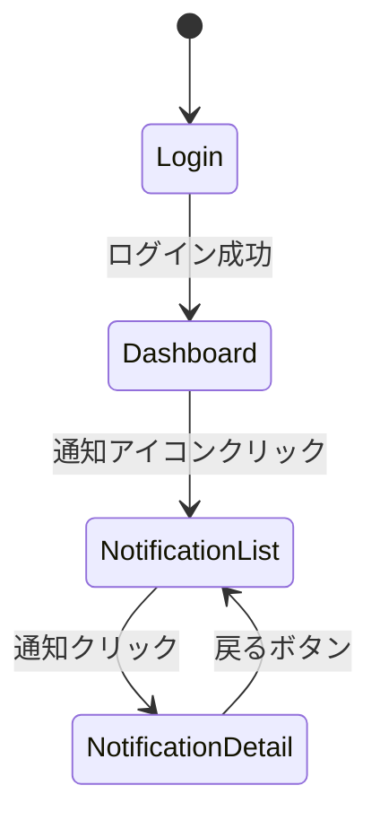
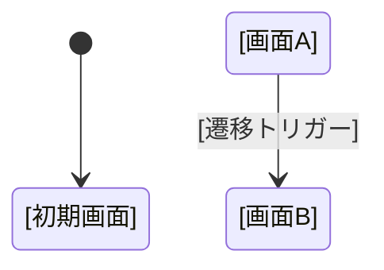

# フェーズ4: フロントエンド設計 チェックリスト

**目的**: 要件定義の画面属性からフロントエンド詳細設計を導出する。

**参照スキル**: [frontend-design](../frontend-design/SKILL.md)

---

## 1. 出力ディレクトリの準備

- [ ] 出力先ディレクトリを特定する
  - `docs/23 詳細設計書/[事業領域コード]_[事業領域名]/frontend/`
- [ ] `index.md` を作成する
  - 事業領域の概要を記載
  - 参照する事業領域一覧・業務領域一覧へのリンクを含める

---

## 2. 要件定義書の画面情報読み込み

- [ ] 画面一覧 (`画面一覧.json`) を読み込む
  - 画面ID・画面名・操作タイプを把握
  - 画面項目（fields）の型とツールチップを確認
  - 画面データ（screen_datas）の表示名とダミーデータを把握
- [ ] 各画面属性詳細 (`SCR-[ID]_画面属性一覧.md`) を読み込む
  - 画面概要（画面ID・画面名・説明・関連ユースケース）を確認
  - 画面項目一覧（序号・項目名・項目タイプ・型・必須/任意・初期値・制約）を確認
  - 画面レイアウト（領域名・説明・含まれる項目）を確認
  - 画面操作（操作名・トリガー・説明・遷移先画面）を確認
  - 制約事項・バリデーションルールを確認
  - 関連情報（情報ID・情報名・操作種類）を確認
  - 権限要件を確認
- [ ] BUC画面 (`BUC画面.json`) を読み込む
  - BUCと画面の関連関係を把握
- [ ] アクター画面 (`アクター画面.json`) を読み込む
  - アクターと画面の関連関係を把握

---

## 3. ページコンポーネント設計

**React Router v6 によるルーティング設計**

- [ ] 画面一覧からページコンポーネントを導出する
  - 各画面を `src/pages/[domain]/[ScreenName].tsx` に対応付け
- [ ] ルーティング構造を定義する
  - 宣言的ルーティング: `<Routes>` と `<Route>` で定義
  - ネストされたルート: 親子関係のあるページはネストで表現
  - 動的ルート: パスパラメータで動的なリソースにアクセス
  - 404ハンドリング: NotFoundページを定義
- [ ] クエリパラメータを定義する
  - 検索条件やページネーションはクエリパラメータで管理
  - 例: `?page=1&size=20&status=unread`

---

## 4. 画面レイアウト設計

**MUI v5 によるレイアウト構成**

- [ ] 画面レイアウト領域からコンポーネント構成を導出する
  - 画面属性一覧の「画面レイアウト」セクションを基に領域を定義
  - 例: 通知一覧領域 → `NotificationList` コンポーネント
  - 例: 通知詳細領域 → `NotificationDetail` コンポーネント
- [ ] レイアウトコンポーネントを定義する
  - MUIの `Container`, `Grid`, `Box`, `Paper` などを活用
  - レスポンシブ設計: デバイスやブラウザの制約を考慮
- [ ] デジタル庁デザインシステム基準を適用する
  - 文字サイズ: 原則 16px 以上
  - カラーコントラスト: 4.5:1 以上を確保
  - 行間とブロック幅: 読みやすさを考慮

---

## 5. UIコンポーネント設計

**画面項目からMUIコンポーネントを導出**

- [ ] 画面項目一覧からUIコンポーネントをマッピングする

| 項目タイプ | 型 | MUIコンポーネント | 備考 |
|-----------|-----|------------------|------|
| 表示 | string | `Typography` | テキスト表示 |
| 表示 | datetime | `Typography` | 日付フォーマット適用 |
| 表示 | boolean | `Chip` / `IconButton` | 状態表示 |
| 表示 | enum | `Chip` | バリエーション値の表示 |
| 入力 | string | `TextField` | テキスト入力 |
| 入力 | number | `TextField` (type=number) | 数値入力 |
| 選択 | enum | `Select` + `MenuItem` | ドロップダウン |
| 選択 | boolean | `Switch` / `Checkbox` | トグル |
| 日付 | datetime | `DatePicker` | 日付選択 |
| 一覧 | array | `Table` / `List` | データ一覧 |

- [ ] プレゼンテーションコンポーネントを定義する
  - UI表示に特化、Propsでデータを受け取り、状態を持たない
  - 例: `NotificationListItem`, `NotificationDetailPanel`
- [ ] コンテナコンポーネントを定義する
  - データ取得やステート管理を担当
  - 例: `NotificationListContainer`
- [ ] カスタムフックを定義する
  - 複雑なロジックを抽出して再利用可能なフックとして提供
  - 例: `useNotifications`, `useNotificationReadStatus`
- [ ] バリエーションの値から選択肢を定義する
  - バリエーション一覧 (`バリエーション一覧.md`) を参照
  - enum型の選択肢をインターフェースとして定義
- [ ] 状態の値から表示制御を定義する
  - ステート一覧 (`ステート一覧.tsv`) を参照
  - 状態に応じたUIの表示/非表示・無効化を定義

---

## 6. 型定義設計

**TypeScript strictモードによる型安全性確保**

- [ ] 画面項目の型インターフェースを定義する
  - 例: `interface Notification { id: number; title: string; ... }`
- [ ] APIリクエスト・レスポンスの型を定義する
  - 例: `interface NotificationListResponse { items: Notification[]; total: number; }`
- [ ] バリエーションの型を定義する
  - 例: `type NotificationType = 'MENTION' | 'ASSIGNEE_CHANGE' | ...`
- [ ] 状態の型を定義する
  - 例: `type NotificationStatus = 'unread' | 'read'`
- [ ] `any`型を使用しない
  - 型が不明な場合は `unknown`型を使用し、型ガードで安全に処理

---

## 7. ステート管理設計

- [ ] ローカルステートを定義する
  - `useState`: コンポーネント内の一時的な状態（例: 選択中の通知ID）
  - `useReducer`: 複数の状態が連動する複雑なロジック（例: 検索条件の管理）
- [ ] グローバルステートを定義する（必要に応じて）
  - Context API: 認証情報、テーマ、グローバル設定
- [ ] サーバー状態を定義する
  - axios + カスタムフック: APIデータ取得・キャッシュ
  - ローディング状態・エラー状態・データ状態を管理

---

## 8. API通信設計

**画面操作からAPIエンドポイントを導出**

- [ ] 画面操作一覧からAPI連携ポイントを導出する
  - 画面属性一覧の「画面操作」セクションを基にAPIを特定
  - 例: 「通知一覧取得」→ `GET /api/notifications`
  - 例: 「既読マーク」→ `PATCH /api/notifications/{id}/read`
- [ ] サービス層を定義する
  - ドメイン別サービスファイルを配置: `src/services/notificationService.ts`
  - 型安全なAPI呼び出しを定義
- [ ] ローディング・エラー状態の管理を定義する
  - ローディング表示: データ取得中はローディングインジケーターを表示
  - エラー表示: エラー発生時は明確なエラーメッセージを表示
  - リトライ機能: 一時的なネットワークエラー時はリトライオプションを提供
- [ ] エラーハンドリングパターンを定義する
  - `unknown`型と型ガードを使用した安全なエラー処理

---

## 9. 画面操作設計

**画面操作からインタラクションを導出**

- [ ] 画面操作一覧からインタラクションを定義する
  - 操作名・トリガー・説明・遷移先画面を基に実装パターンを定義
- [ ] ボタン操作を定義する
  - MUIの `Button`, `IconButton` を使用
  - 無効化条件を定義（例: 選択なし時はボタンを無効化）
- [ ] フォーム操作を定義する（入力画面の場合）
  - 送信前のバリデーションを定義
  - エラーメッセージの表示パターンを定義
- [ ] 一覧操作を定義する
  - ソート・フィルタ・ページネーションの操作を定義
  - 選択状態の管理を定義

---

## 10. 画面イメージ

**ASCII アートによるワイヤーフレーム描画**

- [ ] 画面レイアウト領域を基に ASCII アートでワイヤーフレームを描画する
  - 画面属性一覧の「画面レイアウト」セクションの領域名を枠として表現
  - 各領域に含まれる項目を配置位置とともに表示
  - 例:

```
┌─────────────────────────────────────────────────────┐
│  [画面名]                                          │
├─────────────────────────────────────────────────────┤
│  ┌─────────────────────────────────────────────┐   │
│  │  [検索・フィルタ領域]                        │   │
│  │  [検索ボックス]  [フィルタ]  [検索ボタン]    │   │
│  ├─────────────────────────────────────────────┤   │
│  │  [一覧領域]                                  │   │
│  │  ┌─────────────────────────────────────┐    │   │
│  │  │ ヘッダー1 │ ヘッダー2 │ ヘッダー3   │    │   │
│  │  ├─────────────────────────────────────┤    │   │
│  │  │  項目1   │   項目2   │   項目3     │    │   │
│  │  │  項目1   │   項目2   │   項目3     │    │   │
│  │  └─────────────────────────────────────┘    │   │
│  │  [ページネーション]                          │   │
│  └─────────────────────────────────────────────┘   │
└─────────────────────────────────────────────────────┘
```

- [ ] 入力画面の場合は入力フィールドの配置を描画する
- [ ] 詳細画面の場合はマスター・詳細構造を描画する
- [ ] モーダルやダイアログがある場合は別枠で描画する

---

## 11. 画面遷移設計

**Mermaid 形式による画面遷移図**

- [ ] 画面間の遷移関係を整理する
  - 画面操作の「遷移先画面」列を基に遷移図を作成
- [ ] Mermaid の stateDiagram-v2 で画面遷移図を描画する
  - 各画面をノードとして表現
  - 遷移トリガーをエッジのラベルとして表現
  - 例:



- [ ] 遷移トリガーを定義する
  - ボタンクリック・リンククリック・条件付き遷移など
- [ ] 遷移時のデータ受け渡しを定義する
  - パスパラメータ: `useParams` で取得
  - クエリパラメータ: `useSearchParams` で取得
  - ステート: `navigate({ state: ... })` で渡す
- [ ] ナビゲーションの一貫性を確保する
  - サイドメニューやタブナビゲーションでルーティングを一元管理

---

## 12. アクセシビリティ設計

**デジタル庁デザインシステム基準に基づく設計**

- [ ] カラーコントラスト比が 4.5:1 以上（標準テキスト）、3:1 以上（大きなテキスト）を満たすか確認する
- [ ] 文字サイズが 16px 以上であるか確認する
- [ ] 色だけに依存しない情報伝達が行われているか確認する
  - 色覚多様性対応: アイコン・テキスト・パターンを併用
- [ ] すべてのインタラクティブ要素がキーボード操作可能か確認する
  - タブフォーカス・フォーカス順序・フォーカスインジケーター
- [ ] ARIA属性が適切に使用されているか確認する
  - `aria-label`, `aria-labelledby`, `aria-describedby`, `aria-live`
- [ ] フォームコントロールにラベルが関連付けられているか確認する
- [ ] 動的コンテンツの更新がスクリーンリーダーに通知されるか確認する
  - `aria-live` 属性の使用
- [ ] 画像やアイコンに適切な代替テキストが設定されているか確認する

---

## 12. 権限・表示制御設計

- [ ] 権限要件を確認する
  - 画面属性一覧の「権限要件」セクションを参照
- [ ] 権限ベースの表示制御を定義する
  - ユーザーの権限に基づいてUI要素の表示・非表示を制御
  - 例: 編集権限がない場合は編集ボタンを非表示
- [ ] 認証トークン管理を定義する
  - トークン期限切れ時の再認証フローを設計

---

## 13. 画面設計書の出力

- [ ] 各画面の設計書を `frontend/[画面ID]_画面設計.md` に出力する
- [ ] 以下の項目を含める:

### 画面設計書のテンプレート

```markdown
# [画面ID] 画面設計

## 1. 画面概要
| 項目 | 値 |
|------|-----|
| 画面ID | [画面ID] |
| 画面名 | [画面名] |
| 説明 | [説明] |
| 関連ユースケース | [UC一覧] |
| 対応ページコンポーネント | `src/pages/[domain]/[ScreenName].tsx` |

## 2. ルーティング
| 項目 | 値 |
|------|-----|
| パス | /[path] |
| クエリパラメータ | [パラメータ一覧] |

## 3. 画面イメージ
```
┌─────────────────────────────────────────────────────┐
│  [画面名]                                          │
├─────────────────────────────────────────────────────┤
│  [各レイアウト領域を ASCII アートで描画]            │
└─────────────────────────────────────────────────────┘
```

## 4. 画面レイアウト
| 領域名 | 説明 | 含まれる項目 | 対応コンポーネント |
|--------|------|-------------|-------------------|
| ... | ... | ... | ... |

## 5. UIコンポーネント一覧
| コンポーネント名 | 種類 | 説明 | MUIコンポーネント |
|-----------------|------|------|------------------|
| ... | プレゼンテーション/コンテナ | ... | ... |

## 6. 画面項目一覧
| 序号 | 項目名 | 項目タイプ | 型 | MUIコンポーネント | 制約 |
|------|--------|-----------|-----|------------------|------|
| ... | ... | ... | ... | ... | ... |

## 7. 画面操作一覧
| 操作名 | トリガー | 説明 | APIエンドポイント | 遷移先画面 |
|--------|---------|------|------------------|-----------|
| ... | ... | ... | ... | ... |

## 8. 型定義
```typescript
interface [ScreenName] {
  // 画面項目の型定義
}
```

## 9. ステート管理
| ステート名 | 種類 | 初期値 | 更新トリガー |
|-----------|------|--------|-------------|
| ... | useState/useReducer/Context | ... | ... |

## 10. API連携ポイント
| 操作名 | HTTPメソッド | エンドポイント | リクエスト型 | レスポンス型 |
|--------|-------------|---------------|-------------|-------------|
| ... | ... | ... | ... | ... |

## 11. 画面遷移

### 画面遷移図



### 画面遷移一覧

| 遷移元 | トリガー | 遷移先 | データ受け渡し |
|--------|---------|--------|---------------|
| ... | ... | ... | ... |

## 12. アクセシビリティ対応
| 項目 | 対応内容 |
|------|---------|
| カラーコントラスト | 4.5:1 以上を確保 |
| キーボード操作 | 全インタラクティブ要素に対応 |
| スクリーンリーダー | ARIA属性を適切に設定 |
```

---

## 14. 出力チェック

- [ ] 全画面が設計書として定義されているか確認する
- [ ] UIコンポーネントが適切に定義されているか確認する
- [ ] 型定義が明確で `any`型を使用していないか確認する
- [ ] API連携ポイントが定義されているか確認する
- [ ] 画面遷移が定義されているか確認する
- [ ] ステート管理のスコープが適切か確認する
- [ ] アクセシビリティ基準を満たしているか確認する
- [ ] `frontend-design` スキルのガイドラインに従っているか確認する
- [ ] デジタル庁デザインシステム基準を参照しているか確認する
