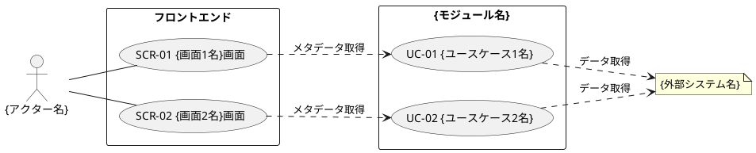

# ユースケース作成ガイドライン (Use Case Creation Guidelines)

本ガイドラインは、RDRA（Relationship Driven Requirement Analysis）モデルにおけるユースケースの作成手順と品質基準を定義します。Ivar
JacobsonのUse Case 3.0実践に基づいています。

---

## 1. ユースケース一覧の作成

ユースケース一覧は、TSV形式でモジュールごとに作成します。

### 1.1 ファイル配置

- `06 機能要件/{カテゴリ}/{モジュール名}/03.システム境界/03.ユースケース/01.ユースケース一覧.tsv`

### 1.2 ファイル形式

```tsv
# ユースケース一覧
ユースケースID	ユースケース名	説明	アクター	優先度	ビジネスユースケース	外部システム	画面
UC-01	データベース一覧を取得する	接続可能なデータベースの一覧を取得する	AC-01	高	BUC-01	ES-01	SCR-01
```

### 1.3 列定義

| 列名                 | 説明                                      | 例                                     |
|----------------------|-------------------------------------------|----------------------------------------|
| ユースケースID       | ユースケースの一意な識別子                | UC-01, UC-02                           |
| ユースケース名       | ユースケースを簡潔に表す名前（動詞+名詞） | データベース一覧を取得する             |
| 説明                 | ユースケースの詳細な説明                  | 接続可能なデータベースの一覧を取得する |
| アクター             | 主要アクターのID                          | AC-01                                  |
| 優先度               | 実装の優先度（高/中/低）                  | 高                                     |
| ビジネスユースケース | 関連するBUCのID                           | BUC-01                                 |
| 外部システム         | 連携する外部システムのID                  | ES-01                                  |
| 画面                 | 関連する画面のID                          | SCR-01                                 |

---

## 2. ユースケース図の作成

ユースケース図は、PlantUMLを使用してサブドメイン毎に作成します。ユースケース図は、アクター、画面（SCR）、ユースケース（UC）、外部システム間の関係を可視化します。

### 2.1 構成要素

ユースケース図は以下の構成要素で構成されます：

| 構成要素               | 説明                           | PlantUML記法                               |
|------------------------|--------------------------------|--------------------------------------------|
| **アクター**           | システムを利用する役割         | `actor "{アクター名}" as actor`            |
| **フロントエンド領域** | 画面（SCR）をグループ化        | `rectangle "フロントエンド" { }`           |
| **画面（SCR）**        | ユーザーが操作する画面         | `usecase "SCR-01 {画面名}画面" as SCR01`   |
| **ドメイン領域**       | ユースケース（UC）をグループ化 | `rectangle "{モジュール名}" { }`           |
| **ユースケース（UC）** | システムが提供する機能         | `usecase "UC-01 {ユースケース名}" as UC01` |
| **外部システム**       | 連携する外部システム           | `note "{外部システム名}" as external`      |

### 2.2 関係線の記法

ユースケース図では、以下の関係線を使用します：

| 関係                           | 記法                              | 説明                                 |
|--------------------------------|-----------------------------------|--------------------------------------|
| **アクターと画面**             | `actor -- SCR01`                  | アクターが画面にアクセス             |
| **画面とユースケース**         | `SCR01 ..> UC01 : メタデータ取得` | 画面がユースケースを呼び出す         |
| **ユースケースと外部システム** | `UC01 ..> external : データ取得`  | ユースケースが外部システムにアクセス |

### 2.3 PlantUMLテンプレート



### 2.4 ファイル配置規則

- ユースケース図は `06 機能要件/{カテゴリ}/{モジュール名}/03.システム境界/03.ユースケース/03.ユースケース図.md`
  に配置する
- ファイル名は固定で `03.ユースケース図.md`
- 各サブドメイン（モジュール）毎に1つのユースケース図を作成する

### 2.5 関連情報セクション

ユースケース図の末尾には、以下の関連情報を記載します：

```markdown
## 関連情報

- アクター: {アクター名}
- 外部システム: {外部システム名}
- ユースケース数: {数}
```

---

## 3. BUC分析

フェーズ2（Step5）では、業務からユースケースを導き出す前に、BUC（ビジネスユースケース）を分析します。

### 3.1 BUC分析の手順

1. **BUC一覧の確認**: 対象業務領域のBUC一覧を確認し、各BUCの概要を把握する
2. **BUC記述の作成**: 各BUCに対してBUC記述ファイルを作成する
3. **アクティビティの特定**: 各BUCを構成するアクティビティを洗い出す
4. **関連情報の特定**: BUCで扱う情報や状態を特定する
5. **関連外部システムの特定**: BUCで連携する外部システムを特定する

### 3.2 BUC分析の目的

- BUCをUCに分解する際の基準を明確にする
- BUCとUCのトレーサビリティを確保する
- 業務の流れとシステム機能の対応関係を明確にする

---

## 4. BUC記述の作成

各BUCに対してBUC記述ファイルを作成します。BUC記述は、BUCの詳細を定義し、UC導出の基盤となります。

### 4.1 ファイル配置

BUC記述ファイルは、各業務領域のBUCディレクトリに配置します。

```
docs/22 要件定義書/[事業領域]/03 機能要件/[業務領域]/02.システム外部環境/02.BUC/[BUC ID] [BUC名].md
```

### 4.2 命名規則

- ファイル名は `[BUC ID] [BUC名].md` 形式（例: `BUC-01 データベース管理.md`）
- ディレクトリ名は `02.BUC`

### 4.3 文書構造

BUC記述は、[BUC記述.md](../templates/BUC記述.md) テンプレートを参照して作成します。

必須セクションは以下の通りです：

| セクション名         | 説明                                   |
|----------------------|----------------------------------------|
| 概要                 | BUC ID、BUC名、説明、関連業務などを記載 |
| ビジネスアクター     | BUCに関連するビジネスアクターを記載     |
| アクティビティ       | BUCを構成するアクティビティを記載       |
| 関連情報             | BUCで扱う情報を記載                    |
| 関連状態             | BUCで扱う状態を記載                    |
| 関連外部システム     | BUCで連携する外部システムを記載         |
| 関連ユースケース     | BUCから導出されるユースケースを記載     |
| 制約事項             | BUCの制約事項を記載                    |

### 4.4 必須ルール

1. **ビジネスアクターの関連付けは必須**: 各BUCに対応するビジネスアクターを必ず指定する
2. **関連ユースケースの関連付けは必須**: 各BUCから導出されるユースケースを必ず指定する
3. **アクティビティの記載は必須**: BUCを構成するアクティビティを必ず記載する

---

## 5. 重要ルール

1. **粒度は要件レベルで統一する**:
    - UC（ユースケース）: それを実行することで実行した人に何かうれしいことがある（何かが実現できる）
    - 情報モデル: エンティティレベル以上
    - 粒度を統一するとメンテナンスしやすい

2. **ユーザーの確認が必要**:
    - RDRAモデルをWikiに出力前に、必ずユーザーの確認を得る
    - AIは要求を一方的に決定してはならない
    - AIは「候補の生成」「質問」「整理」「検証」を行い、最終的な要求の確定はユーザーが行う

3. **関連付けは必須**:
    - ビジネスユースケースとビジネスアクターの関連付けは必須
    - ユースケースとビジネスユースケースの関連付けは必須
    - ユースケースとアクターの関連付けは必須
    - ユースケースと外部システムの関連付けは必須
    - ユースケースと画面の関連付けはオプション

4. **ID命名規約**: [id-naming-conventions.guidelines.md](id-naming-conventions.guidelines.md) を参照する
