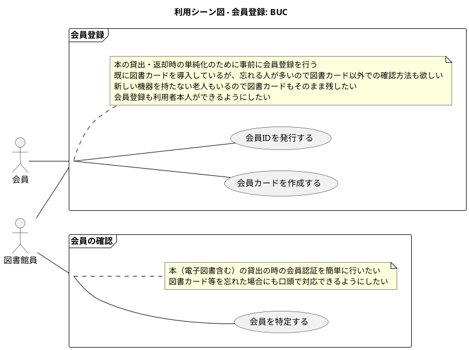
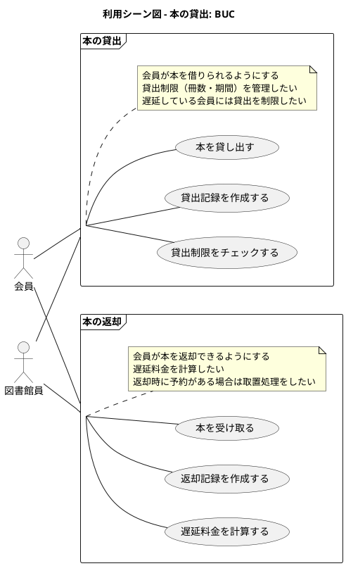

# 利用シーン図（ユースケース図） - 図書館システム例

本ファイルは、Qiita記事「PlantUML で始めるリレーションシップ駆動要件分析 (RDRA)」を参考にした、
RDRAのダイアグラム例です。

題材は「図書館システム」で、会員登録・本の貸出・返却・予約などのユースケースを例にしています。

## 1. 利用シーン図 - 会員登録

本の貸出・返却時の単純化のために事前に会員登録を行うユースケース図です。

## 2. 利用シーン図 - 本の貸出

本の貸出に関するユースケース図です。

## 3. 関連情報

- **アクター**: 会員、図書館員
- **ビジネスユースケース (BUC)**: 会員登録、会員の確認、本の貸出、本の返却
- **ユースケース**:
  会員IDを発行する、会員カードを作成する、会員を特定する、本を貸し出す、貸出記録を作成する、貸出制限をチェックする、本を受け取る、返却記録を作成する、遅延料金を計算する

## 4. 補足

利用シーン図は、RDRAの「システム外部環境レイヤー」で使用するダイアグラムです。
業務フローをユースケースとして可視化し、誰がどの業務に参加するかを明確にします。

Qiita記事: https://qiita.com/nkenbou/items/86d5718b63f610dfd67f
