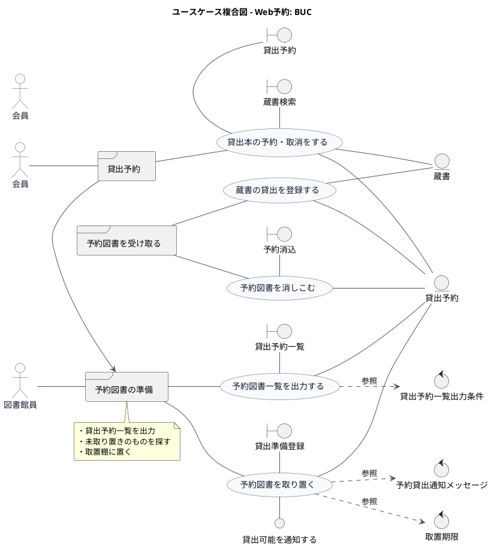

# ユースケース複合図 - 図書館システム例

本ファイルは、Qiita記事「PlantUML で始めるリレーションシップ駆動要件分析 (RDRA)」を参考にした、
RDRAのユースケース複合図の例です。

ユースケース複合図は、ユースケース、画面（boundary）、イベント、情報（entity）、条件（control）を関連づけて表現します。

## 1. ユースケース複合図 - Web予約

## 2. 要素一覧

### アクター

| アクターID | アクター名 | 説明                 |
|------------|------------|----------------------|
| ACT-01     | 会員       | 図書館を利用する会員 |
| ACT-02     | 図書館員   | 図書館の職員         |

### ユースケース

| ユースケースID | ユースケース名           | 説明                       |
|----------------|--------------------------|----------------------------|
| UC-01          | 貸出本の予約・取消をする | 会員が本の予約や取消を行う |
| UC-02          | 予約図書一覧を出力する   | 予約図書のリストを表示     |
| UC-03          | 予約図書を取り置く       | 予約図書を棚に置く         |
| UC-04          | 予約図書を消しこむ       | 受け取った予約図書を処理   |
| UC-05          | 蔵書の貸出を登録する     | 貸出記録を作成             |

### Boundary（画面）

| Boundary ID | 名前         | 説明                   |
|-------------|--------------|------------------------|
| SCR-01      | 蔵書検索     | 蔵書を検索する画面     |
| SCR-02      | 貸出予約     | 予約を行う画面         |
| SCR-03      | 貸出予約一覧 | 予約一覧を表示する画面 |
| SCR-04      | 貸出準備登録 | 取置処理を登録する画面 |
| SCR-05      | 予約消込     | 予約を消しこむ画面     |

### Entity（情報）

| Entity ID | 名前     | 説明           |
|-----------|----------|----------------|
| INF-01    | 貸出予約 | 予約情報を管理 |
| INF-02    | 蔵書     | 蔵書情報を管理 |

### Control（条件）

| Control ID | 名前                   | 説明                         |
|------------|------------------------|------------------------------|
| RL-01      | 貸出予約一覧出力条件   | 予約一覧の出力条件           |
| RL-02      | 取置期限               | 取置期限の計算ルール         |
| RL-03      | 予約貸出通知メッセージ | 通知メッセージのテンプレート |

### Interface

| Interface ID | 名前               | 説明                                           |
|--------------|--------------------|------------------------------------------------|
| IF-01        | 貸出可能を通知する | 貸出可能になったことを通知するインターフェース |

## 3. 補足

ユースケース複合図は、RDRAの「システム境界レイヤー」と「システムレイヤー」をまたいで表現するダイアグラムです。

- **actor**: システムを利用するアクター
- **usecase**: システムが提供するユースケース
- **boundary**: 画面や外部システムとの境界（人と関わる入出力）
- **entity**: システムが管理する情報
- **control**: ビジネスルールや条件
- **interface**: システム間のインターフェース

Qiita記事: https://qiita.com/nkenbou/items/86d5718b63f610dfd67f
