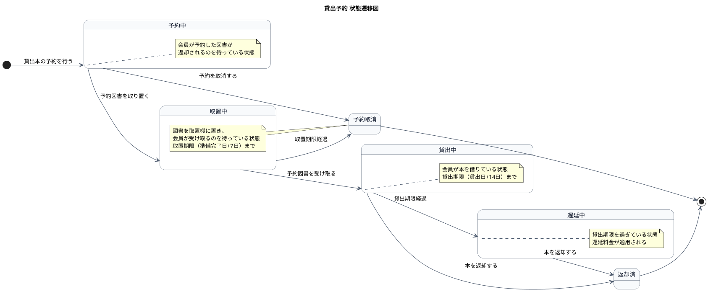
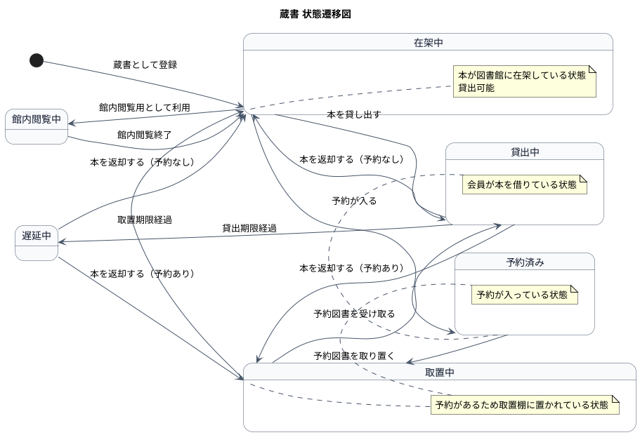

# ステートマシン図（状態遷移図） - 図書館システム例

本ファイルは、Qiita記事「PlantUML で始めるリレーションシップ駆動要件分析 (RDRA)」を参考にした、
RDRAのステートマシン図の例です。

ステートマシン図は、情報の状態遷移を可視化するダイアグラムです。
各状態間の遷移と、その遷移をトリガーするユースケースを明記します。

## 1. 貸出予約の状態遷移図

## 2. 蔵書の状態遷移図

## 3. 状態一覧

### 貸出予約の状態

| 状態ID | 状態名   | 英語名    | 説明                                                 |
|--------|----------|-----------|------------------------------------------------------|
| ST-01  | 予約中   | Reserved  | 会員が予約した図書が返却されるのを待っている状態     |
| ST-02  | 取置中   | Held      | 図書を取置棚に置き、会員が受け取るのを待っている状態 |
| ST-03  | 貸出中   | LentOut   | 会員が本を借りている状態                             |
| ST-04  | 遅延中   | Overdue   | 貸出期限を過ぎている状態                             |
| ST-05  | 返却済   | Returned  | 本が返却された状態                                   |
| ST-06  | 予約取消 | Cancelled | 予約が取消された状態                                 |

### 蔵書の状態

| 状態ID | 状態名     | 英語名       | 説明                                   |
|--------|------------|--------------|----------------------------------------|
| ST-10  | 在架中     | OnShelf      | 本が図書館に在架している状態           |
| ST-11  | 貸出中     | LentOut      | 会員が本を借りている状態               |
| ST-12  | 取置中     | Held         | 予約があるため取置棚に置かれている状態 |
| ST-13  | 予約済み   | Reserved     | 予約が入っている状態                   |
| ST-14  | 館内閲覧中 | InLibraryUse | 館内閲覧用として利用中の状態           |
| ST-15  | 遅延中     | Overdue      | 貸出期限を過ぎている状態               |

## 4. 遷移一覧

| 遷移ID | 元状態 | 遷移先状態 | トリガー | 関連ユースケース         | 説明                 |
|--------|--------|------------|----------|--------------------------|----------------------|
| TR-01  | [*]    | 予約中     | 予約登録 | 貸出本の予約・取消をする | 会員が予約を行う     |
| TR-02  | 予約中 | 取置中     | 取置処理 | 予約図書を取り置く       | 図書を取置棚に置く   |
| TR-03  | 予約中 | 予約取消   | 取消     | 貸出本の予約・取消をする | 会員が予約を取消     |
| TR-04  | 取置中 | 貸出中     | 受け取り | 予約図書を消しこむ       | 会員が図書を受け取る |
| TR-05  | 取置中 | 予約取消   | 期限経過 | タイマー                 | 取置期限が経過       |
| TR-06  | 貸出中 | 返却済     | 返却     | 本を受け取る             | 会員が本を返却       |
| TR-07  | 貸出中 | 遅延中     | 期限経過 | タイマー                 | 貸出期限が経過       |
| TR-08  | 遅延中 | 返却済     | 返却     | 本を受け取る             | 遅延後に返却         |

## 5. 補足

- ステートマシン図は、RDRAの「システムレイヤー」で使用するダイアグラムです。
- 状態の遷移はユースケースが実現すべき情報の変化を表します。
- 状態モデル図は `04.システム/02.ステート/ステートマシン図.md` に配置します。

Qiita記事: https://qiita.com/nkenbou/items/86d5718b63f610dfd67f
