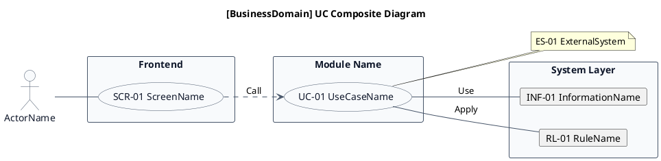
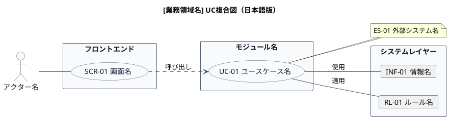

# UC複合図

[業務領域の説明]業務領域で扱うユースケース、画面、イベント、情報、条件を関連づけた図です。

## 1. 目的

本書は、[事業領域コード]-[業務領域コード] [業務領域名]
業務領域のシステム境界レイヤーで扱うユースケース、画面、イベント、情報、条件を関連づけたUC複合図です。

## 2. PlantUML UC複合図（英語版）

## 3. 日本語版 UC複合図

## 4. ユースケース一覧

| ユースケースID | ユースケース名 | 英語名      | 説明 | 関連アクター |
|----------------|----------------|-------------|------|--------------|
| UC-XX-01       | ユースケース名 | UseCaseName | 説明 | アクター名   |

## 5. 画面一覧

| 画面ID    | 画面名 | 英語名     | 説明 | 関連ユースケース |
|-----------|--------|------------|------|------------------|
| SCR-XX-01 | 画面名 | ScreenName | 説明 | UC-XX-01         |

## 6. イベント一覧

| イベントID | イベント名 | 英語名    | 説明 | 関連ユースケース |
|------------|------------|-----------|------|------------------|
| EVT-XX-01  | イベント名 | EventName | 説明 | UC-XX-01         |

## 7. 情報一覧

| 情報ID    | 情報名 | 英語名          | 説明 | 関連ユースケース |
|-----------|--------|-----------------|------|------------------|
| INF-XX-01 | 情報名 | InformationName | 説明 | UC-XX-01         |

## 8. 条件一覧

| 条件ID   | 条件名   | 英語名   | 説明 | 関連ユースケース |
|----------|----------|----------|------|------------------|
| RL-XX-01 | ルール名 | RuleName | 説明 | UC-XX-01         |

## 9. 参照情報

- ユースケース一覧: `03.システム境界/01.ユースケース/ユースケース一覧.md`
- 画面一覧: `04.システム/04.画面/画面一覧.md`
- イベント一覧: `04.システム/03.イベント/イベント一覧.md`
- 情報一覧: `04.システム/01.情報/情報一覧.md`
