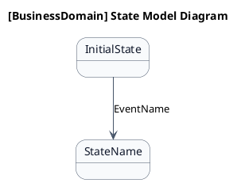
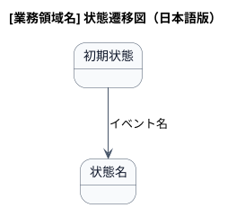

# ステートマシン図

[業務領域の説明]業務領域で扱う情報の状態遷移を示す状態モデル図です。

## 1. 目的

本書は、[事業領域コード]-[業務領域コード] [業務領域名]業務領域のシステムレイヤーで扱う情報の状態遷移を示す状態モデル図（ステートマシン図）です。

## 2. PlantUML 状態遷移図（英語版）

## 3. 日本語版 状態遷移図

## 4. 状態一覧

| 状態名 (ID)       | 英語名    | 説明 |
|-------------------|-----------|------|
| 状態名 (ST-XX-01) | StateName | 説明 |

## 5. 遷移一覧

| 遷移ID | 元状態       | 遷移先状態 | トリガー  | 関連ユースケース | 説明 |
|--------|--------------|------------|-----------|------------------|------|
| TR-01  | InitialState | StateName  | EventName | UC-XX-01         | 説明 |

## 6. 参照情報

- ステート一覧: `02.ステート/ステート一覧.tsv`
- 関連ユースケース: `03.システム境界/01.ユースケース/ユースケース一覧.md`
