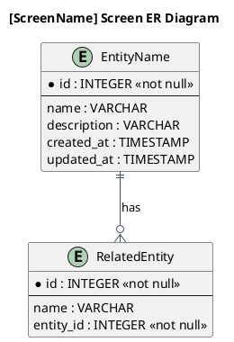
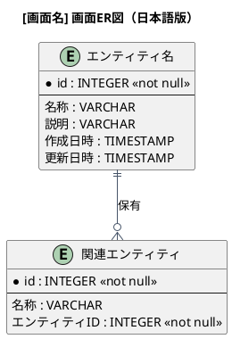

# 画面ER図

[画面名]画面で参照・更新する情報（エンティティ）間の関係を示すER図です。

## 1. 目的

本書は、[事業領域コード]-[業務領域コード] [業務領域名]
業務領域の[画面ID] [画面名]画面で扱う情報（エンティティ）間の関係を示すER図（エンティティ関係図）です。

画面が参照・更新する情報に焦点を当て、画面のデータ構造を視覚的に明確にします。

## 2. 画面概要

| 項目             | 内容 |
|------------------|------|
| 画面ID           |      |
| 画面名           |      |
| 説明             |      |
| 関連ユースケース |      |

## 3. PlantUML ER図（英語版）

## 4. 日本語版 ER図

## 5. 画面が参照・更新する情報一覧

| 情報ID    | 情報名 | 英語名          | 操作種類 | 説明 |
|-----------|--------|-----------------|----------|------|
| INF-XX-01 | 情報名 | EntityName      | 参照     | 説明 |
| INF-XX-02 | 関連情報名 | RelatedEntity | 更新     | 説明 |

## 6. 情報（エンティティ）一覧

| 情報ID    | 情報名 | 英語名          | 説明 | 情報種類 |
|-----------|--------|-----------------|------|----------|
| INF-XX-01 | 情報名 | EntityName      | 説明 | リソース |

## 7. 関係一覧

| 関係ID | 元情報ID | 元情報名 | 先情報ID | 先情報名 | 関係の種類 | 説明 |
|--------|----------|----------|----------|----------|------------|------|
| REL-01 | INF-XX-01 | 情報名   | INF-XX-02 | 関連情報名 | 1対多 | 説明 |

## 8. 関係の種類

関係の種類は以下の記号で表現します：

| 記号 | 意味 | 説明 |
|------|------|------|
| `||--o{` | 1対多 (1:N) | 左側の1つが右側の0個以上に関連 |
| `||--||` | 1対1 (1:1) | 左側の1つが右側の1つに関連 |
| `}o--o{` | 多対多 (N:M) | 左側の0個以上が右側の0個以上に関連 |
| `||--o|` | 1対1以上 (1:1+) | 左側の1つが右側の1個以上に関連 |

## 9. 参照情報

- 画面定義: `04.システム/04.画面/[画面ID] 画面名_画面属性一覧.md`
- 情報一覧: `04.システム/01.情報/情報一覧.md`
- 情報属性一覧: `04.システム/03.情報属性/`
- UC複合図: `03.システム境界/UC複合図.md`
