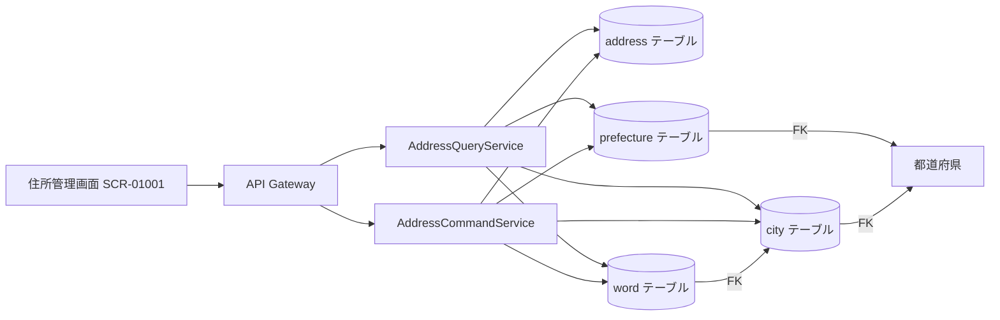

# Requirements

### Overview & Goals

AD住所レジストリの要件定義書（`docs/22 要件定義書/AD 住所レジストリ/`）を基に、詳細設計書（`docs/23 詳細設計書/AD_住所レジストリ/`）を作成します。

住所レジストリは「汎用」事業領域に分類され、住所情報の一元管理を支援し、業務効率を向上させることを目的としています。

### Scope

**In Scope:**
- データベース設計（テーブル定義、カラム定義、外部キー、インデックス）
- API設計（CQRSベースのCommand Service / Query Service）
- フロントエンド設計（画面コンポーネント、型定義、ステート管理）
- 整合性確認

**Out of Scope:**
- バッチ設計（外部システム経由のUCなし）
- 実装コードの作成

### User Stories

- As a システム管理者, I want 住所情報を登録・更新・削除できる画面 so that 住所マスターを一元管理できる
- As a 従業員, I want 郵便番号から住所を検索できる機能 so that 住所入力を効率化できる

### Functional Requirements

| ID | 要求名 | 概要 | 優先度 |
|----|--------|------|--------|
| FR-AD-01-01 | 住所管理 | 住所を管理 | MVP |
| FR-AD-01-02 | 郵便番号検索 | 郵便番号から住所を検索 | MVP |

### Non-Functional Requirements

| ID | 要求名 | 概要 |
|----|--------|------|
| NFR-AD-01-01 | 検索性能 | 住所を迅速に検索 |

### Key Actors

| アクター | 役割 |
|---------|------|
| システム管理者 | 住所の登録・更新・削除 |
| 従業員 | 住所の参照・検索 |

### Information Model

| 情報ID | 情報名 | エンティティ | 説明 |
|--------|--------|-------------|------|
| INF-AD-01-01 | 住所 | ADDRESS | 都道府県・市・字の関連付け情報 |
| INF-AD-01-02 | 都道府県 | PREFECTURE | 都道府県マスター情報 |
| INF-AD-01-03 | 市 | CITY | 市マスター情報 |
| INF-AD-01-04 | 字 | WORD | 字マスター情報 |

### Use Cases

| UC ID | 説明 | 関連アクター | 関連情報 |
|-------|------|-------------|---------|
| UC-AD-001 | 住所の登録 | システム管理者, 従業員 | 住所 |
| UC-AD-002 | 住所の更新 | システム管理者, 従業員 | 住所 |
| UC-AD-003 | 住所の参照 | システム管理者, 従業員 | 住所 |
| UC-AD-004 | 住所の削除 | システム管理者, 従業員 | 住所 |

### Screen

| 画面ID | 画面名 | 説明 |
|--------|--------|------|
| SCR-01001 | 住所管理画面 | 住所のCRUD操作 |

### State Model

| 状態モデル | 状態 | 遷移 |
|-----------|------|------|
| 住所 | 有効, 無効 | 有効→無効（無効化） |

# Technical Design

### Current Implementation

AD住所レジストリは要件定義が完了しており、以下のRDRAモデルが定義されています：

- **情報**: 都道府県(PREFECTURE)、市(CITY)、字(WORD)、住所(ADDRESS) の4つの情報
- **UC**: UC-AD-001〜004（登録・更新・参照・削除）
- **画面**: SCR-01001（住所管理画面）
- **ステート**: 有効/無効の2状態
- **関連**: 都道府県→市（1対多）、市→字（1対多）の階層構造

既存の詳細設計書（AS_関連付け）を参照し、同様の構造で詳細設計書を作成します。

### Key Decisions

1. **スキーマ名**: `undecided_ad`（汎用事業領域のため事業領域コードを使用）
2. **CQRSパターン**: Command Service（書き込み）とQuery Service（読み込み）を分離
3. **テーブル構造**: 情報を4つのテーブルに分割（prefecture, city, word, address）
4. **外部キー**: 都道府県→市→字の階層関係を外部キーで表現
5. **標準カラム**: `id`, `created_at`, `updated_at`, `deleted_at` を全テーブルに適用
6. **MUI v5**: フロントエンドはMUI v5コンポーネントを使用
7. **TypeScript strictモード**: `any`型を使用せず、型安全性を確保

### Proposed Changes

#### データベース設計

4つのテーブルを定義：

1. **prefecture** - 都道府県マスター
   - カラム: prefecture_id(PK), prefecture_name, prefecture_code, country, 標準カラム
   - インデックス: prefecture_code（一意）

2. **city** - 市マスター
   - カラム: city_id(PK), city_name, city_code, prefecture_id(FK), 標準カラム
   - インデックス: city_code（一意）, prefecture_id

3. **word** - 字マスター
   - カラム: word_id(PK), word_name, word_code, city_id(FK), 標準カラム
   - インデックス: word_code（一意）, city_id

4. **address** - 住所
   - カラム: address_id(PK), country, prefecture, city, block, building, postal_code, customer_barcode, state, 標準カラム
   - インデックス: postal_code（一意）

#### API設計

CQRSパターンに基づき、以下のAPIを定義：

**Query Service（GET）:**
- `GET /api/v1/addresses` - 住所一覧取得（ページネーション対応）
- `GET /api/v1/addresses/{id}` - 住所単一取得
- `GET /api/v1/addresses/search/postal-code/{code}` - 郵便番号検索
- `GET /api/v1/prefectures` - 都道府県一覧
- `GET /api/v1/cities` - 市一覧（都道府県IDでフィルタ）
- `GET /api/v1/words` - 字一覧（市IDでフィルタ）

**Command Service（POST/PUT/PATCH/DELETE）:**
- `POST /api/v1/addresses` - 住所登録
- `PUT /api/v1/addresses/{id}` - 住所全体更新
- `PATCH /api/v1/addresses/{id}` - 住所部分更新
- `DELETE /api/v1/addresses/{id}` - 住所削除
- `POST /api/v1/prefectures` - 都道府県登録
- `PUT /api/v1/prefectures/{id}` - 都道府県更新
- `DELETE /api/v1/prefectures/{id}` - 都道府県削除
- `POST /api/v1/cities` - 市登録
- `PUT /api/v1/cities/{id}` - 市更新
- `DELETE /api/v1/cities/{id}` - 市削除
- `POST /api/v1/words` - 字登録
- `PUT /api/v1/words/{id}` - 字更新
- `DELETE /api/v1/words/{id}` - 字削除

#### フロントエンド設計

- **ページ**: `AddressManagement.tsx`（住所管理画面）
- **コンポーネント**: AddressList, AddressForm, AddressDetail, PostalCodeSearch
- **型定義**: Address, Prefecture, City, Word, AddressState
- **ステート管理**: useState（ローカル）, カスタムフック（API通信）
- **画面遷移**: 一覧→詳細→編集 のフロー

### File Structure

```
docs/23 詳細設計書/AD_住所レジストリ/
├── index.md                            # 目次
├── 01 データベース設計/
│   ├── index.md                        # データベース設計概要
│   ├── 01 table一覧.md                 # テーブル一覧
│   ├── 01 table一覧.tsv                # テーブル一覧(TSV)
│   ├── 02 テーブルカラム定義/
│   │   ├── index.md                    # カラム定義概要
│   │   ├── prefecture.md               # 都道府県カラム定義
│   │   ├── city.md                     # 市カラム定義
│   │   ├── word.md                     # 字カラム定義
│   │   └── address.md                  # 住所カラム定義
│   └── 03 viewカラム定義/
│       └── index.md                    # View定義
├── frontend/
│   ├── 画面コンポーネント構成.md        # 画面コンポーネント構成
│   ├── ステート管理設計.md              # ステート管理設計
│   └── API連携設計.md                  # API連携設計
└── backend/
    ├── api/
    │   ├── index.md                    # API設計概要
    │   ├── addresses.md                # 住所API設計
    │   ├── prefectures.md              # 都道府県API設計
    │   ├── cities.md                   # 市API設計
    │   └── words.md                    # 字API設計
    └── batch/
        └── index.md                    # バッチ設計（なし）
```

### Architecture Diagram



### Risks

- **郵便番号の一意性**: 同一郵便番号に複数の住所が存在する可能性があるため、検索結果は複数件返す設計
- **カスタマバーコード値の制約**: 23桁の厳密な制約（スタートコード1 + 郵便番号7 + 住所表示番号13 + チェックデジット1 + ストップコード1）をバリデーションで確保
- **住所の階層整合性**: 都道府県→市→字の階層関係が壊れないよう、外部キー制約とトランザクションで保護

# Testing

### Validation Approach

要件定義と詳細設計の整合性を確認し、すべてのUC・情報・画面が詳細設計としてカバーされていることを検証します。

### Key Scenarios

1. **データベース設計の整合性**
   - 全4つの情報（都道府県、市、字、住所）がテーブルとして定義されている
   - 全属性がカラムとして定義されている
   - 外部キー関係が正しく定義されている（都道府県→市→字）
   - 標準カラムが全テーブルに含まれている

2. **API設計の整合性**
   - 全UC（登録・更新・参照・削除）がAPIとして定義されている
   - Command ServiceとQuery Serviceが適切に分離されている
   - 郵便番号検索APIが定義されている
   - ページネーション・ソートが適切に定義されている

3. **フロントエンド設計の整合性**
   - SCR-01001が画面設計として定義されている
   - UIコンポーネントが適切に定義されている
   - 型定義が明確で`any`型を使用していない
   - API連携ポイントが定義されている

### Edge Cases

- 郵便番号検索で結果が0件の場合
- 都道府県・市・字の階層が不完全な住所の登録
- カスタマバーコード値の形式が不正な場合
- 同一住所の重複登録

### Test Changes

- 詳細設計書の整合性チェックリストを確認
- 要件定義の全UC・情報・画面がカバーされていることを確認

# Delivery Steps

###   Step 1: フェーズ0: 要件定義書の読み込み
AD住所レジストリの要件定義書を読み込み、RDRAモデルの全体像を把握します。

- システム価値（アクター、外部システム、要求）を確認
- BUC（住所登録・更新）を確認
- UC一覧（UC-AD-001〜004）を確認
- 情報一覧（都道府県、市、字、住所）と各情報属性を確認
- 画面属性（SCR-01001）を確認
- ステートマシン図（有効/無効）を確認

###   Step 2: フェーズ1: データベース設計
要件定義のRDRAモデルからデータベース設計を導出します。

- テーブル一覧（preecture, city, word, address）を作成
- 各テーブルのカラム定義を作成（標準カラム含む）
- 外部キー関係を定義（都道府県→市→字の階層）
- インデックスを定義
- Flywayマイグレーションスクリプトを作成
- 出力: `docs/23 詳細設計書/AD_住所レジストリ/01 データベース設計/`

###   Step 3: フェーズ2: API設計
UCと画面からREST API設計を導出します（CQRSベース）。

- Command Service（住所のCRUD）を設計
- Query Service（住所の一覧・検索・単一取得）を設計
- APIエンドポイントを定義（/api/v1/addresses, /api/v1/prefectures, /api/v1/cities, /api/v1/words）
- リクエスト・レスポンスDTOを定義
- バリデーションルールを定義
- エラーレスポンスを定義
- 出力: `docs/23 詳細設計書/AD_住所レジストリ/backend/api/`

###   Step 4: フェーズ4: フロントエンド設計
画面属性からフロントエンド詳細設計を導出します。

- ページコンポーネント設計（住所管理画面）
- 画面レイアウト設計（MUI v5）
- UIコンポーネント設計（入力・表示・一覧）
- TypeScript型定義
- ステート管理設計
- API連携ポイント
- 画面イメージ（ASCII ワイヤーフレーム）
- 画面遷移図（Mermaid）
- アクセシビリティ設計
- 出力: `docs/23 詳細設計書/AD_住所レジストリ/frontend/`

###   Step 5: フェーズ5: 整合性確認
要件定義と詳細設計の整合性を確認します。

- 全UCがAPIとしてカバーされているか確認
- 全情報がテーブルとして定義されているか確認
- 全画面がフロントエンド設計として定義されているか確認
- 詳細設計書の目次（index.md）を作成
- 詳細設計書index（docs/23 詳細設計書/index.md）を更新