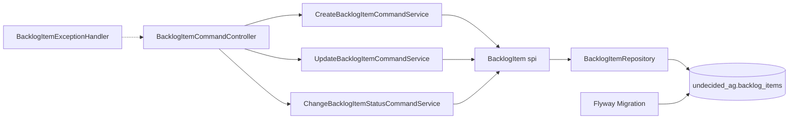

# Requirements

### Overview & Goals
BacklogItem に `value`（Value）フィールドを追加し、0〜100 の範囲制限を適用する。更新時と ACCEPTED 状態遷移時に範囲チェックを行い、違反時は HTTP 400 を返す。DB 側でも CHECK 制約を追加し、一貫性を担保する。

### Scope
**In Scope:**
- `BacklogItem` エンティティに `value` フィールド（Integer, nullable）を追加
- 範囲定数（0, 100）を ADR-002 に従いエンティティに定義
- `update()` 呼び出し時に value の範囲チェック
- `changeStatus()` で ACCEPTED 遷移時に value の範囲チェック（null は通過）
- Flyway マイグレーションで `value` カラム追加と CHECK 制約
- Command/Request/Response への value フィールド追加
- 境界値テスト（0, 100, -1, 101, null）

**Out of Scope:**
- value の必須チェック（#489 の範囲で対象外。null は通過する）
- SprintBacklogItem への value 追加
- 項目辞書への value 項目の反映

### User Stories
- As a スクラムチームメンバー, I want to set a value (0-100) for a backlog item so that I can quantify the business value.
- As a システム, I want to reject values outside 0-100 so that data integrity is maintained.
- As a システム, I want to validate value when transitioning to ACCEPTED so that accepted items have valid values.

### Functional Requirements
1. `value` は Integer 型で、0〜100 の範囲を許容する（null も可）
2. 更新時（`update()`）に value が指定された場合、範囲外なら `IllegalArgumentException` をスロー
3. ACCEPTED 遷移時（`changeStatus()`）に value が null 以外の場合、範囲外なら `IllegalArgumentException` をスロー
4. value が null の場合は ACCEPTED 遷移も通過する（必須チェックは対象外）
5. DB には `value INTEGER` カラムと `CHECK (value IS NULL OR (value >= 0 AND value <= 100))` 制約を追加
6. 範囲違反は `BacklogItemExceptionHandler` により HTTP 400 として返される

### Non-Functional Requirements
- 範囲定数は ADR-002 に従い `BacklogItem` エンティティの `public static final` として定義
- 型は `Integer`（#577 で決定）
- 境界値テストは `@Tag("small")` で単体テストとして実装
- マイグレーションテストは `@Tag("medium")` で統合テストとして実装
- 既存の `BacklogItemExceptionHandler` が `IllegalArgumentException` → HTTP 400 をハンドリングするため、新しいハンドラーは不要


# Technical Design

### Current Implementation
- `BacklogItem`（`spi/BacklogItem.java`）は `title`, `description`, `priority`, `status` などのフィールドを持つ。`update()` メソッドで title/description/priority/sprintId を更新可能。`changeStatus()` で SUGGESTED → ACCEPTED/REJECTED の遷移を検証。
- 既存の範囲制約パターン: `TITLE_MAX_LENGTH = 200`、`CREATOR_NAME_MAX_LENGTH = 100` が ADR-002 に従い定義済み。
- `BacklogItemExceptionHandler` は `IllegalArgumentException` → HTTP 400 を変換。
- Flyway マイグレーションは `db/migration/ag/` に配置。既存の `V20261116150000__add_backlog_items_tables.sql` が `backlog_items` テーブルを作成。
- テストは `@Tag("small")`（単体）/ `@Tag("medium")`（統合）で分類。Mockito を使用したコマンドサービステストが既存。

### Key Decisions
- **範囲チェックの場所**: `BacklogItem.update()` と `changeStatus()` のエンティティメソッド内で検証。既存の `title` 検証パターン（`checkNonEmpty`）と同様、ドメイン層で不変条件を守る。
- **ACCEPTED 遷移時のチェック**: `changeStatus()` で `target == ACCEPTED` の場合のみ value 範囲をチェック。`REJECTED` 遷移時はチェックしない（要件では Accepted 遷移時のみ）。
- **null の扱い**: value が null の場合は範囲チェックをスキップ。#489 で必須チェックは対象外のため。
- **CHECK 制約の形状**: `CHECK (value IS NULL OR (value >= 0 AND value <= 100))` として null を許容。

### Proposed Changes

#### 1. BacklogItem.java (spi) — Value フィールドと検証追加
```java
// 範囲定数（ADR-002）
public static final int VALUE_MIN_VALUE = 0;
public static final int VALUE_MAX_VALUE = 100;

// フィールド
@Column(name = "value")
protected Integer value;

// update() に value パラメータ追加
public void update(String title, String description, Integer priority, SnowflakeId sprintId, Integer value) {
    // 既存の更新ロジック...
    if (value != null) {
        validateValue(value);
        this.value = value;
    }
    this.updatedAt = LocalDateTime.now();
}

// changeStatus() に ACCEPTED 遷移時の検証追加
public void changeStatus(BacklogItemStatus target) {
    // 既存の遷移チェック...
    if (target == BacklogItemStatus.ACCEPTED) {
        validateValue(this.value);  // null は通過
    }
    this.status = target;
    this.updatedAt = LocalDateTime.now();
}

// 範囲検証用プライベートメソッド
private void validateValue(Integer value) {
    if (value == null) return;  // null は通過
    if (value < VALUE_MIN_VALUE || value > VALUE_MAX_VALUE) {
        throw new IllegalArgumentException(
            "BacklogItem value must be between " + VALUE_MIN_VALUE + " and " + VALUE_MAX_VALUE);
    }
}
```

#### 2. Flyway マイグレーション
新ファイル `V20261116160000__add_backlog_item_value.sql`:
```sql
ALTER TABLE undecided_ag.backlog_items ADD COLUMN value INTEGER;
ALTER TABLE undecided_ag.backlog_items
    ADD CONSTRAINT ck_backlog_items_value CHECK (value IS NULL OR (value >= 0 AND value <= 100));
COMMENT ON COLUMN undecided_ag.backlog_items.value IS 'Value（0〜100）';
```

#### 3. Command/Request — value フィールド追加
- `CreateBacklogItemCommand.java`: `private Integer value` 追加
- `CreateBacklogItemRequest.java`: `private Integer value` 追加
- `CreateBacklogItemCommandService.java`: `BacklogItem.builder().value(command.getValue())` を追加
- `UpdateBacklogItemCommand.java`: `private Integer value` 追加
- `UpdateBacklogItemRequest.java`: `private Integer value` 追加
- `UpdateBacklogItemCommandService.java`: `backlogItem.update(..., command.getValue())` に value を渡す
- `BacklogItemCommandController.java`: 両方のエンドポイントで `request.getValue()` を Command に渡す

#### 4. Response — value 出力対応
- `BacklogItemResponse.java`: `private Integer value` 追加
- `BacklogItemResponseConverter.java`: `.value(backlogItem.getValue())` を追加

### File Structure
```
Modified:
  backend/src/main/java/undecided/agiloom/requirementBacklog/spi/BacklogItem.java
  backend/src/main/java/undecided/agiloom/requirementBacklog/internal/CreateBacklogItemCommand.java
  backend/src/main/java/undecided/agiloom/requirementBacklog/internal/CreateBacklogItemRequest.java
  backend/src/main/java/undecided/agiloom/requirementBacklog/internal/CreateBacklogItemCommandService.java
  backend/src/main/java/undecided/agiloom/requirementBacklog/internal/UpdateBacklogItemCommand.java
  backend/src/main/java/undecided/agiloom/requirementBacklog/internal/UpdateBacklogItemRequest.java
  backend/src/main/java/undecided/agiloom/requirementBacklog/internal/UpdateBacklogItemCommandService.java
  backend/src/main/java/undecided/agiloom/requirementBacklog/internal/BacklogItemCommandController.java
  backend/src/main/java/undecided/agiloom/requirementBacklog/internal/BacklogItemResponse.java
  backend/src/main/java/undecided/agiloom/requirementBacklog/internal/BacklogItemResponseConverter.java

Added:
  backend/src/main/resources/db/migration/ag/V20261116160000__add_backlog_item_value.sql

Modified (Tests):
  backend/src/test/java/undecided/agiloom/requirementBacklog/spi/BacklogItemTest.java
  backend/src/test/java/undecided/agiloom/requirementBacklog/internal/CreateBacklogItemCommandServiceTest.java
  backend/src/test/java/undecided/agiloom/requirementBacklog/internal/BacklogItemMigrationMediumTest.java
```

### Architecture Diagram


### Risks
- **既存の `update()` 呼び出しの署名変更**: `update()` に `value` パラメータを追加するため、既存の呼び出し元（`UpdateBacklogItemCommandService`）を更新する必要がある。他の呼び出し元はないことを確認済み。
- **CHECK 制約の null 許容**: `value IS NULL OR (...)` の形状が正しく動作するか、マイグレーションテストで検証する。
- **ACCEPTED 遷移時の null チェック**: 要件では null は通過するが、将来必須チェックを追加する場合は `changeStatus()` のロジックを変更する必要がある。

# Delivery Steps

###   Step 1: Implement Value field, range validation, Flyway constraint, and tests
Add `value` field (Integer, 0-100) to BacklogItem with range validation on update and Accepted transition, Flyway CHECK constraint, and boundary value tests.

**1. BacklogItem.java (spi) — Value フィールドと範囲定数追加、update() と changeStatus() に検証追加**
- `VALUE_MIN_VALUE = 0` と `VALUE_MAX_VALUE = 100` の定数を追加（ADR-002）
- `value` フィールド（`Integer`, `@Column(name = "value")`）を追加
- `update()` メソッドに `value` パラメータを追加。value が null 以外の場合に範囲チェック（0〜100違反は `IllegalArgumentException`）
- `changeStatus()` メソッドで `ACCEPTED` への遷移時に value の範囲チェックを追加（null は通過。#489 で必須チェックは対象外）
- `validateValue()` プライベートメソッドで範囲検証を共通化

**2. Flyway マイグレーション — value カラム追加と CHECK 制約**
- 新ファイル `V20261116160000__add_backlog_item_value.sql` を作成
- `ALTER TABLE undecided_ag.backlog_items ADD COLUMN value INTEGER`
- `ALTER TABLE undecided_ag.backlog_items ADD CONSTRAINT ck_backlog_items_value CHECK (value IS NULL OR (value >= 0 AND value <= 100))`
- null を許容するCHECK制約（`value IS NULL OR (...)`）として定義

**3. Command/Request/CommandService — value の受け渡し対応**
- `CreateBacklogItemCommand.java` に `private Integer value` を追加
- `CreateBacklogItemRequest.java` に `private Integer value` を追加
- `CreateBacklogItemCommandService.java` の `execute()` で `command.getValue()` を `BacklogItem.builder().value()` に渡す
- `UpdateBacklogItemCommand.java` に `private Integer value` を追加
- `UpdateBacklogItemRequest.java` に `private Integer value` を追加
- `UpdateBacklogItemCommandService.java` の `execute()` で `command.getValue()` を `backlogItem.update()` に渡す
- `BacklogItemCommandController.java` の `createBacklogItem()` と `updateBacklogItem()` で `request.getValue()` を Command に渡す

**4. Response — value の出力対応**
- `BacklogItemResponse.java` に `private Integer value` を追加
- `BacklogItemResponseConverter.java` の `toBacklogItemResponse()` で `backlogItem.getValue()` を設定

**5. テスト — 境界値テストと既存テストの更新**
- `BacklogItemTest.java` に `@Nested class ValueRangeTest` を追加:
  - `value=0` で update 成功（下限境界値）
  - `value=100` で update 成功（上限境界値）
  - `value=-1` で update 失敗（`IllegalArgumentException`）
  - `value=101` で update 失敗（`IllegalArgumentException`）
  - `value=null` で update 成功（変更なし）
  - `value=50` で update 成功（正常値）
- `BacklogItemTest.java` に `@Nested class ValueOnAcceptedTransitionTest` を追加:
  - `value=0` で ACCEPTED 遷移成功（下限境界値）
  - `value=100` で ACCEPTED 遷移成功（上限境界値）
  - `value=-1` で ACCEPTED 遷移失敗（`IllegalArgumentException`）
  - `value=101` で ACCEPTED 遷移失敗（`IllegalArgumentException`）
  - `value=null` で ACCEPTED 遷移成功（null は通過、#489 で必須チェックは対象外）
- `CreateBacklogItemCommandServiceTest.java` に `value` を含むテストケースを追加
- `BacklogItemMigrationMediumTest.java` に `value` カラムの存在確認とCHECK制約のスクリプト検証を追加
- 既存の `update()` テストに `value` パラメータを追加（null を渡して既存の動作を維持）