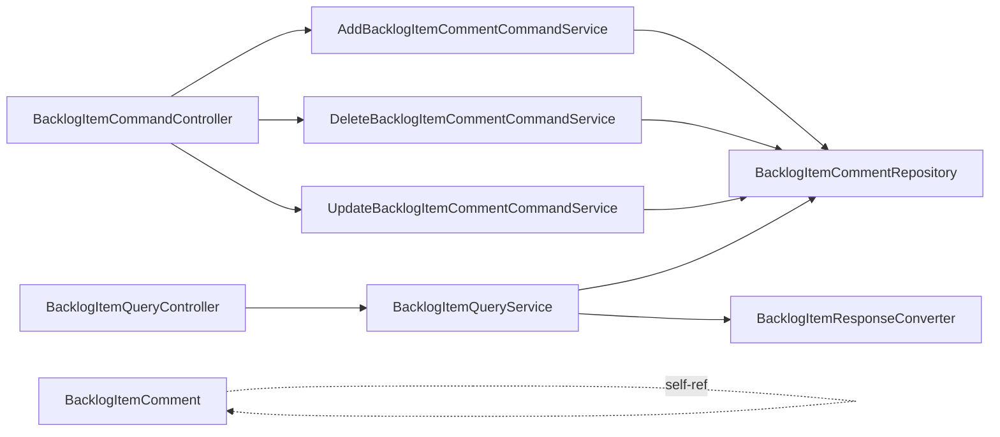

# Requirements

# Issue #510: コメントはスレッド形式で返信できる — 要件

## 目的
バックログアイテムのコメント機能に「親コメントへの返信（スレッド）」を追加する。コメントはthread形式で返信でき、スレッドのネスト深さは制限しない。

## 決定済み事項
| Issue | 決定内容 |
|-------|---------|
| #640 | スレッドのネスト深さは制限しない |
| #641 | 子返信があるコメントは削除できない |
| #669 | コメントの編集は返信がついていない場合のみ許可 |
| #634 | 削除できるのは本人とシステム管理者 |

## 受け入れ基準
1. コメント追加APIで `parentCommentId` を指定して親コメントへの返信ができる
2. コメント一覧APIで返信を含むスレッド構造（`parentId` / `hasReplies` など）が返る
3. 子返信があるコメントは削除できない（`IllegalStateException` / HTTP 409）
4. 子返信があるコメントは編集できない（`IllegalStateException` / HTTP 409）
5. コメントの編集は本人とシステム管理者のみ可能
6. Frontendでコメントをスレッド（インデント）表示
7. Frontendで返信入力UIを提供
8. Frontendで編集・削除ボタンの表示/非表示を返信の有無で制御

## スコープ

### In Scope
- Backend: `parent_comment_id` 列の追加（Flywayマイグレーション）
- Backend: コメントエンティティに `parentComment` 参照
- Backend: コメント追加APIに `parentCommentId` パラメータ
- Backend: コメント編集コマンドサービス（`UpdateBacklogItemCommentCommandService`）
- Backend: コメント削除の「子返信あり」チェック
- Backend: コメント一覧APIのレスポンスに `parentId` / `hasReplies` を追加
- Frontend: コメントのスレッド（インデント）表示
- Frontend: 返信入力UI
- Frontend: 編集・削除ボタンの表示制御

### Out of Scope
- 削除・編集時の通知（#633 未決定のため）
- コメントのページネーション

# Technical Design

# Technical Design

## 現在の実装

### 既存のコメント関連コード
| ファイル | 役割 |
|---------|------|
| `spi/BacklogItemComment.java` | コメントエンティティ（spi、public）。`id`, `backlogItem`, `authorEmployeeId`, `authorName`, `body`, `createdAt` |
| `internal/AddBacklogItemCommentCommand*.java` | コメント追加（コマンド・リクエスト・サービス） |
| `internal/DeleteBacklogItemCommentCommand*.java` | コメント削除（コマンド・リクエスト・サービス） |
| `internal/BacklogItemCommentRepository.java` | リポジトリ（`findByBacklogItemIdOrderByCreatedAtAsc` あり） |
| `internal/BacklogItemCommentResponse.java` | レスポンスDTO |
| `internal/BacklogItemResponseConverter.java` | エンティティ→レスポンス変換 |
| `internal/BacklogItemCommandController.java` | コメント追加・削除API |
| `internal/BacklogItemQueryController.java` | コメント一覧API |
| `internal/BacklogItemQueryService.java` | コメント一覧取得 |
| `internal/BacklogItemExceptionHandler.java` | 例外→HTTPステータス変換（403/409/400） |
| `internal/BacklogItemPermissionDeniedException.java` | 権限なし例外 |
| `internal/AdminEmployeeSubset*` | ADMIN判定基盤（#673 で実装済み） |

### Frontend
| ファイル | 役割 |
|---------|------|
| `services/backlogItemService.ts` | コメントAPI通信（`getComments`, `addComment`） |
| `pages/products/BacklogItemDetail.tsx` | コメント一覧表示・追加UI |
| `pages/products/BacklogItemDetail.test.tsx` | コメント関連テスト |

## 設計方針

### データモデル変更

#### `BacklogItemComment` エンティティへの追加
- `parentComment` — 親コメントへの `@ManyToOne` 自己参照（`@Nullable`）
- DB: `parent_comment_id BIGINT NULL` + FK 制約（同じテーブル内）

#### Flywayマイグレーション
- `V20261119200000__add_parent_comment_id_to_backlog_item_comments.sql`
- `parent_comment_id` 列追加 + FK 制約 + インデックス

### コメント追加APIの変更
- `AddBacklogItemCommentRequest` に `parentCommentId`（`@Nullable SnowflakeId`）を追加
- `AddBacklogItemCommentCommand` に `parentCommentId` を追加
- `AddBacklogItemCommentCommandService` で親コメントの存在チェック + 親コメントが同じ `backlogItemId` に属するかの検証

### コメント編集コマンド（新規）
- `UpdateBacklogItemCommentCommand` — `commentId`, `body`, `actorEmployeeId`
- `UpdateBacklogItemCommentCommandService` — 本人またはADMINのみ、子返信なしのみ
- `UpdateBacklogItemCommentRequest` — `actorEmployeeId`, `body`
- コントローラー: `PATCH /api/v1/backlog-items/{backlogItemId}/comments/{commentId}`

### コメント削除の変更
- `DeleteBacklogItemCommentCommandService` に「子返信があるか」チェックを追加
- `BacklogItemCommentRepository` に `findByParentCommentId(SnowflakeId)` を追加
- 子返信あり → `IllegalStateException`（HTTP 409）

### コメント一覧APIのレスポンス変更
- `BacklogItemCommentResponse` に `parentId`（`@Nullable SnowflakeId`）と `hasReplies`（`boolean`）を追加
- `BacklogItemQueryService.findComments()` で各コメントの子返信有無を判定
- `BacklogItemResponseConverter.toCommentResponse()` で新フィールドをマッピング

### Frontend
- `BacklogItemComment` インターフェースに `parentId` / `hasReplies` を追加
- `BacklogItemDetail.tsx` でコメントを再帰的（インデント）表示
- 各コメントに「返信」ボタン → 返信入力フィールド表示
- 各コメントに「編集」「削除」ボタン（`hasReplies` が false の場合のみ表示）
- `backlogItemService.ts` に `updateComment` / `deleteComment` を追加

## アーキテクチャ図

## 変更対象ファイル

### 新規作成
| ファイル | パッケージ | 説明 |
|---------|-----------|------|
| `UpdateBacklogItemCommentCommand.java` | `requirementBacklog.internal` | 編集コマンド |
| `UpdateBacklogItemCommentCommandService.java` | `requirementBacklog.internal` | 編集コマンドサービス |
| `UpdateBacklogItemCommentRequest.java` | `requirementBacklog.internal` | 編集リクエストDTO |
| `V20261119200000__add_parent_comment_id_to_backlog_item_comments.sql` | `db/migration/ag/` | Flywayマイグレーション |
| `AddBacklogItemCommentCommandServiceTest.java` | `test/...internal/` | 追加コマンドの単体テスト（新規） |
| `UpdateBacklogItemCommentCommandServiceTest.java` | `test/...internal/` | 編集コマンドの単体テスト |

### 修正
| ファイル | 変更内容 |
|---------|---------|
| `spi/BacklogItemComment.java` | `parentComment` 自己参照追加 |
| `internal/AddBacklogItemCommentCommand.java` | `parentCommentId` フィールド追加 |
| `internal/AddBacklogItemCommentRequest.java` | `parentCommentId` フィールド追加 |
| `internal/AddBacklogItemCommentCommandService.java` | 親コメント検証ロジック追加 |
| `internal/DeleteBacklogItemCommentCommandService.java` | 子返信チェック追加 |
| `internal/BacklogItemCommentRepository.java` | `findByParentCommentId` 追加 |
| `internal/BacklogItemCommentResponse.java` | `parentId`, `hasReplies` 追加 |
| `internal/BacklogItemQueryService.java` | 子返信有無の判定追加 |
| `internal/BacklogItemResponseConverter.java` | 新フィールドのマッピング追加 |
| `internal/BacklogItemCommandController.java` | 編集APIエンドポイント追加 |
| `internal/BacklogItemExceptionHandler.java` | javadoc更新 |
| `internal/DeleteBacklogItemCommentCommandServiceTest.java` | 子返信ありのテストケース追加 |
| `frontend/src/services/backlogItemService.ts` | `parentId`/`hasReplies`追加, `updateComment`/`deleteComment`追加 |
| `frontend/src/pages/products/BacklogItemDetail.tsx` | スレッド表示・返信UI・編集削除ボタン |
| `frontend/src/pages/products/BacklogItemDetail.test.tsx` | 新機能のテスト追加 |

## リスク
| リスク | 対応 |
|-------|------|
| 既存コメントの `parent_comment_id` は NULL | マイグレーションで `NULL` 許容。既存データはルートコメントとして扱われる |
| 自己参照FKの循環 | 親→子の方向のみ。循環参照はビジネスロジックで防止（親IDが自身と等しい場合はエラー） |
| 深いネストのパフォーマンス | ネスト深さに制限なし（#640）だが、再帰表示はFrontendのレンダリング負荷に注意 |

## テストリスト

### BacklogItemCommentRepository
- コメントを追加したとき、IDで取得できる
- 親コメントIDで検索したとき、子コメントが返る
- 親コメントIDで検索して子がないとき、空リストが返る
- backlogItemIdで取得したとき、createdAt昇順でソートされる

### AddBacklogItemCommentCommandService
- 親なしでコメントを追加したとき、親なしのコメントが保存される
- 親コメントIDを指定してコメントを追加したとき、親参照付きのコメントが保存される
- 存在しない親コメントIDを指定したとき、IllegalArgumentExceptionがスローされる
- 異なるbacklogItemのコメントを親としたとき、IllegalArgumentExceptionがスローされる
- 自身を親としたとき、IllegalArgumentExceptionがスローされる
- 本文が空のとき、IllegalArgumentExceptionがスローされる
- 投稿者名が空のとき、IllegalArgumentExceptionがスローされる
- バックログアイテムが存在しないとき、IllegalArgumentExceptionがスローされる

### UpdateBacklogItemCommentCommandService
- 本人がコメントを編集したとき、本文が更新される
- ADMIN保持者がコメントを編集したとき、本文が更新される
- 第三者がコメントを編集しようとすると、BacklogItemPermissionDeniedExceptionがスローされる
- 子返信があるコメントを編集しようとすると、IllegalStateExceptionがスローされる
- 存在しないコメントを編集しようとすると、IllegalArgumentExceptionがスローされる
- 本文が空で編集しようとすると、IllegalArgumentExceptionがスローされる
- actorEmployeeIdがnullのとき、IllegalArgumentExceptionがスローされる

### DeleteBacklogItemCommentCommandService
- 本人がコメントを削除したとき、コメントが削除される
- ADMIN保持者がコメントを削除したとき、コメントが削除される
- 第三者がコメントを削除しようとすると、BacklogItemPermissionDeniedExceptionがスローされる
- 子返信があるコメントを削除しようとすると、IllegalStateExceptionがスローされる
- 存在しないコメントを削除しようとすると、IllegalArgumentExceptionがスローされる
- actorEmployeeIdがnullのとき、IllegalArgumentExceptionがスローされる
- コメントがコマンドのbacklogItemIdに属さないとき、IllegalArgumentExceptionがスローされる

### BacklogItemQueryService
- コメント一覧を取得したとき、createdAt昇順で返る
- 親なしコメントの一覧を取得したとき、parentIdがnullでhasRepliesが適切に返る
- 子返信があるコメントを取得したとき、hasRepliesがtrueになる
- 子返信がないコメントを取得したとき、hasRepliesがfalseになる
- コメントがないbacklogItemの一覧を取得したとき、空リストが返る

### BacklogItemCommandController
- コメント追加APIに親コメントIDを指定してPOSTしたとき、親参照付きのコメントが作成される
- コメント編集APIにPATCHしたとき、本文が更新される
- コメント削除APIにDELETEしたとき、コメントが削除される

### Frontend - BacklogItemDetail
- コメント一覧を表示したとき、コメントがリスト表示される
- 親コメントと子コメントがあるとき、子コメントがインデント表示される
- 3段以上のネストがあるとき、すべての段がインデント表示される
- 返信ボタンをクリックしたとき、返信入力フィールドが表示される
- 返信を入力して送信したとき、親コメントに子コメントとして追加される
- 子返信がないコメントの編集ボタンをクリックしたとき、編集モードになる
- 編集モードで本文を変更して保存したとき、コメントが更新される
- 子返信がないコメントの削除ボタンをクリックしたとき、コメントが削除される
- 子返信があるコメントを表示したとき、編集・削除ボタンが表示されない
- コメントがないとき、「コメントはまだありません」が表示される

# Delivery Steps

###   Step 1: Stage 1: DBマイグレーションとエンティティ変更
`parent_comment_id` 列を `backlog_item_comments` に追加し、エンティティに自己参照を追加。
- Flywayマイグレーション `V20261119200000__add_parent_comment_id_to_backlog_item_comments.sql` を `db/migration/ag/` に新規作成（`parent_comment_id BIGINT NULL` + 自己参照FK + インデックス）
- `BacklogItemComment.java`（spi）に `parentComment` フィールドを追加（`@ManyToOne` 自己参照、`@JoinColumn(name = "parent_comment_id")`、`@Nullable`）
- `BacklogItemCommentRepository.java` に `findByParentCommentId(SnowflakeId)` メソッドを追加
- `./gradlew :backend:compileJava` でビルド検証

###   Step 2: Stage 2: コメント追加APIに親参照を追加
コメント追加時に `parentCommentId` を指定できるようにし、親コメントの検証ロジックを追加。
- `AddBacklogItemCommentRequest.java` に `parentCommentId`（`@Nullable SnowflakeId`）を追加
- `AddBacklogItemCommentCommand.java` に `parentCommentId` を追加
- `AddBacklogItemCommentCommandService.java` に親コメントの存在チェック + 同じ `backlogItemId` 所属チェック + 自身との等価チェックを追加
- `AddBacklogItemCommentCommandServiceTest.java`（smallタグ）を新規作成。親なし追加、親あり追加、存在しない親ID、異なるbacklogItemの親ID、自身を親とする、の各シナリオを網羅
- `./gradlew :backend:test --tests "*AddBacklogItemCommentCommandServiceTest"` でテスト検証

###   Step 3: Stage 3: コメント編集コマンドサービスとAPI
コメント編集のビジネスロジック（本人/ADMINチェック、子返信なしチェック）とREST APIを追加。
- `UpdateBacklogItemCommentCommand.java` を新規作成（フィールド: `commentId`, `body`, `actorEmployeeId`）
- `UpdateBacklogItemCommentRequest.java` を新規作成（`actorEmployeeId`, `body`）
- `UpdateBacklogItemCommentCommandService.java` を新規作成。本人またはADMINの権限チェック、子返信ありの場合は `IllegalStateException`、本文の空チェック
- `BacklogItemCommandController.java` に `PATCH /api/v1/backlog-items/{backlogItemId}/comments/{commentId}` エンドポイントを新規追加
- `UpdateBacklogItemCommentCommandServiceTest.java`（smallタグ）を新規作成。本人編集、ADMIN編集、第三者拒否、子返信あり拒否、不存在エラー、空本文エラーの各シナリオを網羅
- `BacklogItemExceptionHandler.java` のjavadocを更新（コメント編集の403/409も対象と明記）

###   Step 4: Stage 4: コメント削除に子返信チェックを追加
既存の削除コマンドサービスに子返信チェックを追加し、テストを更新。
- `DeleteBacklogItemCommentCommandService.java` に `findByParentCommentId` を通じた子返信チェックを追加。子返信あり → `IllegalStateException`（HTTP 409）
- `DeleteBacklogItemCommentCommandServiceTest.java` に「子返信ありコメント削除」のテストケースを追加（`IllegalStateException` がスローされることを検証）
- `./gradlew :backend:test --tests "*DeleteBacklogItemCommentCommandServiceTest"` でテスト検証

###   Step 5: Stage 5: コメント一覧APIのレスポンスにスレッド情報を追加
コメント一覧APIのレスポンスに `parentId` と `hasReplies` を追加。
- `BacklogItemCommentResponse.java` に `parentId`（`@Nullable SnowflakeId`）と `hasReplies`（`boolean`）を追加
- `BacklogItemQueryService.findComments()` で各コメントの子返信有無を判定（`findByParentCommentId` で子コメントが存在するか確認）
- `BacklogItemResponseConverter.toCommentResponse()` で `parentId` と `hasReplies` をマッピング
- `BacklogItemQueryServiceTest.java` にコメント関連のテストケースを追加（親なしコメント、親ありコメント、子返信ありコメントのレスポンス検証）

###   Step 6: Stage 6: Frontend — スレッド表示・返信UI・編集削除ボタン
Frontendでコメントのスレッド表示、返信入力、編集・削除UIを実装。
- `backlogItemService.ts` の `BacklogItemComment` インターフェースに `parentId` / `hasReplies` を追加
- `backlogItemService.ts` に `updateComment()` / `deleteComment()` を追加
- `BacklogItemDetail.tsx` でコメントを再帰的（インデント）表示 — `parentId` に応じてネスト
- 各コメントに「返信」ボタン → 返信入力フィールド（`parentCommentId` を指定して `addComment`）
- 各コメントに「編集」「削除」ボタン（`hasReplies` が false の場合のみ表示）
- 編集ボタン → 編集モード切替 → `updateComment` 呼び出し
- 削除ボタン → `deleteComment` 呼び出し
- `BacklogItemDetail.test.tsx` にスレッド表示・返信・編集・削除のテストケースを追加
- `npm test -- --testPathPattern=BacklogItemDetail` でテスト検証

###   Step 7: Stage 7: 全テスト実行とモジュール検証
全テストの実行とモジュール境界の検証。
- `./gradlew :backend:test`（smallテスト）を実行して全件成功を確認
- `./gradlew :backend:mediumTest`（統合テスト）を実行して全件成功を確認
- `ApplicationModules.of(ModulithDemoApplication.class).verify()` が通るか確認
- `npm test` でFrontend全テストを確認