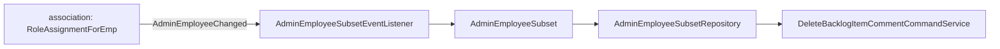

# Requirements

# Issue #673: コメント削除のbackend側実装 — 要件

## 目的
バックログアイテムのコメント削除機能（backend側）を実装する。

## 受け入れ基準
1. コメント削除API（`DELETE /api/v1/backlog-items/{backlogItemId}/comments/{commentId}`）を追加
2. 削除できるのは**コメントした本人**と**システム管理者（ADMINロール保持者）**のみ（#634/#671 決定）
3. 返信がついたコメントは削除できない（#634 決定）
4. 削除時の通知は**スコープ外**（#633 未決定のため）

## スレッド返信の扱い
- スレッド返信（親コメント参照機能、#510）は**未実装**のため、現時点では返信データは存在しない
- 仕様として「返信（子コメント）が存在するコメントは削除できない」ルールを実装
- 将来スレッド返信が実装された際に、`parent_comment_id` 列で親コメントを参照する前提
- 現時点では同じ `backlog_item_id` のコメント数が > 1 の場合、削除不可とする簡易判定

## 範囲外
- コメント編集機能（#669 未決定）
- 削除時の通知（#633 未決定）
- Frontend実装

# Technical Design

# Technical Design

## 現在の実装状況

### 既存のコメント関連コード
| ファイル | 役割 |
|---------|------|
| `spi/BacklogItemComment.java` | コメントエンティティ（spi、public）。`id`, `backlogItem`, `authorEmployeeId`, `authorName`, `body`, `createdAt` |
| `internal/AddBacklogItemCommentCommandService.java` | コメント追加コマンドサービス |
| `internal/BacklogItemCommandController.java` | コメント追加API（`POST /api/v1/backlog-items/{backlogItemId}/comments`） |
| `internal/BacklogItemCommentRepository.java` | コメントリポジトリ（`findByBacklogItemIdOrderByCreatedAtAsc` あり） |
| `internal/BacklogItemExceptionHandler.java` | 例外ハンドラー（403/409/400） |
| `internal/BacklogItemPermissionDeniedException.java` | 権限なし例外 |

### 認証済み従業員IDの取得
- 既存APIでは**リクエストボディで `authorEmployeeId` / `actorEmployeeId` をクライアントから受け取る**方式
- AuthContext（#614）は `employeeId` のみを保持。ロール情報は持たない

## 設計方針

### ADMINロール保持者の判定
`ScrumTeamSubset` と同じパターンで、**`AdminEmployeeChanged` イベント**（association 領域spi）と **`AdminEmployeeSubset`**（requirementBacklog 内部サブセット）を導入。

#### 構成要素
1. **`AdminEmployeeChanged`**（`association.relationshipMgmt.partyRole.spi.role`）: 従業員IDとADMINロールの付与/剥離を伝えるイベント（record）。フィールド: `employeeId`, `isAdmin`
2. **`AdminEmployeeSubset`**（`requirementBacklog.internal`）: ADMIN保持者の従業員IDを保持。テーブル: `undecided_ag.admin_employee_subsets`
3. **`AdminEmployeeSubsetRepository`**: `existsByEmployeeId(SnowflakeId)` でADMIN判定
4. **`AdminEmployeeSubsetEventListener`**: `@ApplicationModuleListener` でイベント受信

### コメント削除のビジネスルール
1. **権限チェック**: 操作者 == コメントの `authorEmployeeId` **または** 操作者がADMIN保持者
2. **返信チェック**: 同じ `backlog_item_id` のコメント数 > 1 の場合は削除不可
3. 権限なし → `BacklogItemPermissionDeniedException`（HTTP 403）
4. 返信あり → `IllegalStateException`（HTTP 409）
5. コメント不存在 → `IllegalArgumentException`（HTTP 400）

## 変更対象ファイル

### 新規作成
| ファイル | パッケージ | 説明 |
|---------|-----------|------|
| `DeleteBacklogItemCommentCommand.java` | `requirementBacklog.internal` | 削除コマンド |
| `DeleteBacklogItemCommentCommandService.java` | `requirementBacklog.internal` | 削除コマンドサービス |
| `AdminEmployeeSubset.java` | `requirementBacklog.internal` | ADMINサブセットエンティティ |
| `AdminEmployeeSubsetRepository.java` | `requirementBacklog.internal` | サブセットリポジトリ |
| `AdminEmployeeSubsetEventListener.java` | `requirementBacklog.internal` | イベントリスナー |
| `AdminEmployeeChanged.java` | `association.relationshipMgmt.partyRole.spi.role` | ドメインイベント |
| `V20261118200000__add_admin_employee_subsets.sql` | `db/migration/ag/` | Flywayマイグレーション |
| `DeleteBacklogItemCommentCommandServiceTest.java` | `test/...internal/` | 単体テスト |
| `AdminEmployeeSubsetEventListenerTest.java` | `test/...internal/` | リスナーテスト |

### 修正
| ファイル | 変更内容 |
|---------|---------|
| `BacklogItemCommandController.java` | 削除エンドポイント追加 |
| `BacklogItemCommentRepository.java` | `countByBacklogItemId(SnowflakeId)` 追加 |
| `BacklogItemExceptionHandler.java` | javadoc更新 |
| `RoleAssignmentsForEmpApi.java` | イベント発行追加 |

## テスト観点

### DeleteBacklogItemCommentCommandService
| シナリオ | 期待結果 |
|---------|---------|
| 本人が削除 | 成功 |
| ADMIN保持者が削除 | 成功 |
| 第三者が削除 | `BacklogItemPermissionDeniedException`（403） |
| 返信ありコメント削除 | `IllegalStateException`（409） |
| 不存在コメント削除 | `IllegalArgumentException`（400） |
| 操作者IDがnull | `IllegalArgumentException`（400） |

### AdminEmployeeSubsetEventListener
| シナリオ | 期待結果 |
|---------|---------|
| isAdmin=true | サブセット作成/更新 |
| isAdmin=false | サブセット削除 |

## リスク
| リスク | 対応 |
|-------|------|
| association 側イベント発行未実装 | Stage 1で実装。初期データ登録も検討 |
| 返信チェックの簡易判定 | 将来 `parent_comment_id` に移行 |
| 既存ADMIN保持者の反映 | マイグレーションまたはバッチで初期投入 |
| モジュール境界違反 | association→requirementBacklog 一方向依存のみ。spi recordは公開型 |

# Delivery Steps

###   Step 1: AdminEmployeeChangedイベントとAdminEmployeeSubset基盤
Adminロール保持者の判定基盤として、イベント連携によるサブセット（射影）の仕組みを作成。
- `AdminEmployeeChanged` record を `undecided.association.relationshipMgmt.partyRole.spi.role` に新規作成（フィールド: `employeeId: SnowflakeId`, `isAdmin: boolean`）
- `AdminEmployeeSubset` エンティティを `requirementBacklog.internal` に新規作成（パッケージプライベート。フィールド: `employeeId`（PK）, `updatedAt`。テーブル: `undecided_ag.admin_employee_subsets`）
- `AdminEmployeeSubsetRepository` を新規作成（`CrudRepository` 継承。`existsByEmployeeId(SnowflakeId)` メソッド）
- `AdminEmployeeSubsetEventListener` を新規作成（`@ApplicationModuleListener` で `AdminEmployeeChanged` を受信。isAdmin=true で保存、false で削除）
- Flywayマイグレーション `V20261118200000__add_admin_employee_subsets.sql` を `db/migration/ag/` に新規作成
- association 側のロール管理API（`RoleAssignmentsForEmpApi.java`）に `AdminEmployeeChanged` イベント発行を追加
- `AdminEmployeeSubsetEventListenerTest`（smallタグ）とマイグレーション統合テスト（mediumタグ）を作成

###   Step 2: コメント削除コマンドサービスとAPIエンドポイント
コメント削除のビジネスロジック（権限チェック・返信チェック・削除）とREST APIを追加。
- `DeleteBacklogItemCommentCommand` を `requirementBacklog.internal` に新規作成（フィールド: `backlogItemId`, `commentId`, `actorEmployeeId`）
- `DeleteBacklogItemCommentCommandService` を新規作成。権限チェック（本人またはADMIN保持者）、返信チェック（同じbacklogItemIdのコメント数 > 1 なら不可）、削除処理を実装
- `BacklogItemCommandController` に `DELETE /api/v1/backlog-items/{backlogItemId}/comments/{commentId}` エンドポイントを新規追加
- `BacklogItemCommentRepository` に `countByBacklogItemId(SnowflakeId)` メソッドを追加
- `BacklogItemExceptionHandler` のjavadocを更新（コメント削除の403/409も対象と明記）
- `DeleteBacklogItemCommentCommandServiceTest`（smallタグ）を作成。本人削除、ADMIN削除、第三者拒否、返信あり拒否、不存在エラー、actorEmployeeId=null の各シナリオを網羅

###   Step 3: 統合テストとモジュール検証
全テストの実行とモジュール境界の検証。
- `BacklogItemMigrationMediumTest` に新マイグレーション（`V20261118200000`）のスクリプト検証テストを追加
- `ApplicationModules.of(ModulithDemoApplication.class).verify()` が通るか確認（association→requirementBacklog の一方向依存が適切か）
- `./gradlew :backend:test`（smallテスト）を実行して全件成功を確認
- `./gradlew :backend:mediumTest`（統合テスト）を実行して全件成功を確認