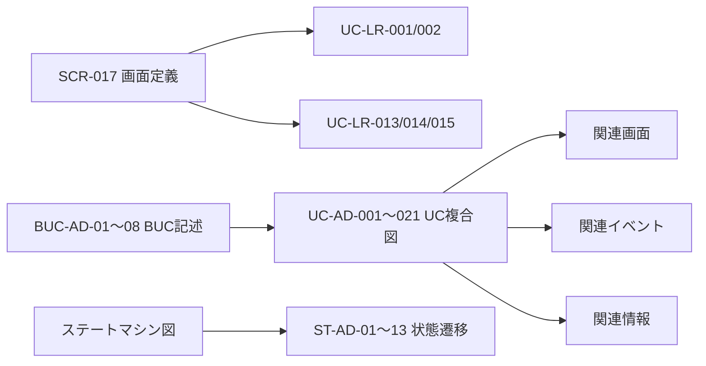

# Requirements

### Overview & Goals

AG-06 成果適応業務領域の要件定義で残っている4つの未修正エラー（check-error.tsv）を補完します。

### Scope

**In Scope:**
- ERR-006: SCR-017画面定義の作成
- ERR-012: UC-AD-001〜021のUC複合図21件の作成
- ERR-013: BUC-AD-01〜08のBUC記述ファイル8件の作成
- ERR-014: ST-AD-01〜13のステートマシン図への追加

**Out of Scope:**
- 新しいユースケースの作成
- 新しい画面の追加（SCR-017のみ）

### Current Status

| エラーID | 内容 | 対象数 | 修正状況 |
|----------|------|--------|----------|
| ERR-006 | SCR-017画面定義不足 | 1件 | 未修正 |
| ERR-012 | UC-AD複合図不足 | 21件 | 未修正 |
| ERR-013 | BUC-AD記述不足 | 8件 | 未修正 |
| ERR-014 | ST-ADステートマシン図不足 | 13件 | 未修正 |

合計: **43ファイル**の作成・修正が必要です。

# Technical Design

### Current Implementation

- **UC-LR/UC-SRのUC複合図**: 35件すべて作成済み。`UC-LR-003 Sprint Retrospectiveを記録する/UC複合図.md` がテンプレートとして参照可能。
- **BUC-LRのBUC記述**: BUC-LR-01〜07の7件が作成済み。`BUC-LR-01 Sprint Reviewの実施・記録.md` がテンプレートとして参照可能。
- **ステートマシン図**: 英語版・日本語版の両方にST-LRおよびST-SRの状態遷移が含まれている。ST-AD-01〜13の状態遷移が不足。
- **画面定義**: SCR-001, SCR-022〜028, SR-01〜05の画面定義が存在。SCR-017のみ不足。

### Key Decisions

1. **UC複合図のテンプレート**: 既存の`UC-LR-003`のUC複合図構造をUC-ADシリーズに適用
2. **BUC記述のテンプレート**: 既存の`BUC-LR-01`のBUC記述構造をBUC-ADシリーズに適用
3. **ステートマシン図**: 既存の英語版・日本語版の両方にST-ADの状態遷移を追加
4. **SCR-017画面定義**: UC-LR-001, UC-LR-002, UC-LR-013〜015が参照するSprint Review関連画面として定義

### Proposed Changes

#### Stage 1: SCR-017画面定義の作成
- `SCR-017 Sprint Review記録_画面定義.md` を作成
- 画面属性一覧も同時に作成
- UC-LR-001, UC-LR-002, UC-LR-013〜015との関連を記載

#### Stage 2: UC-AD-001〜021のUC複合図作成
- 各UC-ADに対してUC複合図ディレクトリを作成
- PlantUML図（英語版・日本語版）を含むUC複合図.mdを21件作成
- 関連画面、イベント、情報との関連を記載

#### Stage 3: BUC-AD-01〜08のBUC記述作成
- BUC-AD-01: リリース計画の管理
- BUC-AD-02: リリースノートの管理
- BUC-AD-03: デプロイの管理
- BUC-AD-04: 利用状況の把握
- BUC-AD-05: 成功指標の管理
- BUC-AD-06: 仮説検証の管理
- BUC-AD-07: フィードバックの収集
- BUC-AD-08: レトロスペクティブの管理

#### Stage 4: ステートマシン図へのST-AD追加
- 英語版・日本語版の両方にST-AD-01〜13の状態遷移を追加
- 状態一覧・遷移一覧にST-AD関連の項目を追加

### Architecture Diagram

# Testing

### Validation Approach

各ステージ完了後に以下の検証を行います:

1. **ファイル存在確認**: 作成したファイルが正しく配置されているか確認
2. **整合性チェック**: 関連する一覧ファイル（ユースケース一覧.tsv、BUC一覧.tsv、ステート一覧.tsv）との整合性を確認
3. **PlantUML構文チェック**: UC複合図とステートマシン図のPlantUML構文が正しいか確認

### Key Scenarios

- SCR-017画面定義がUC-LR-001, UC-LR-002, UC-LR-013〜015から正しく参照される
- UC-AD-001〜021のUC複合図がすべて存在し、関連情報が正しい
- BUC-AD-01〜08のBUC記述がBUC一覧.tsvと整合している
- ステートマシン図にST-AD-01〜13の状態遷移が含まれている

### Edge Cases

- UC-ADの一部が複数のBUC-ADにまたがる場合の関連付け
- ステートマシン図で状態名が重複する場合の区別（例: "完了"状態が複数存在）

# Delivery Steps

### ✓ Step 1: SCR-017画面定義の作成
UC-LR-001, UC-LR-002, UC-LR-013〜015が参照するSCR-017の画面定義と画面属性一覧を作成します。

- `SCR-017 Sprint Review記録_画面定義.md` を作成（画面概要、機能、関連ユースケースなど）
- `SCR-017 Sprint Review記録_画面属性一覧.md` を作成（属性名、型、必須/任意など）
- 画面一覧.tsv・画面一覧.mdとの整合性を確認
- check-error.tsvのERR-006を修正済みに更新

### ✓ Step 2: UC-AD-001〜021のUC複合図作成
UC-AD-001〜021の21件すべてに対してUC複合図ディレクトリとUC複合図.mdを作成します。

- 各UC-ADに対して `UC-AD-XXX .../UC複合図.md` ディレクトリを作成
- PlantUML図（英語版・日本語版）を含むUC複合図.mdを21件作成
- 関連画面、イベント、情報との関連を各UC複合図に記載
- check-error.tsvのERR-012を修正済みに更新

### ✓ Step 3: BUC-AD-01〜08のBUC記述作成
BUC-AD-01〜08の8件すべてに対してBUC記述ファイルを作成します。

- BUC-AD-01: リリース計画の管理
- BUC-AD-02: リリースノートの管理
- BUC-AD-03: デプロイの管理
- BUC-AD-04: 利用状況の把握
- BUC-AD-05: 成功指標の管理
- BUC-AD-06: 仮説検証の管理
- BUC-AD-07: フィードバックの収集
- BUC-AD-08: レトロスペクティブの管理
- 各BUC記述には概要、アクター、アクティビティ、関連情報、関連状態、関連ユースケース、制約事項を記載
- check-error.tsvのERR-013を修正済みに更新

### ✓ Step 4: ステートマシン図へのST-AD追加
ステートマシン図（英語版・日本語版）にST-AD-01〜13の状態遷移を追加します。

- 英語版にST-ADの状態（Planned, Preparing, Prepared, InProgress, Completed, Draft, Published, Deploying, Success, Failed, Rollback, Verifying, Verified）を追加
- 日本語版にST-ADの状態（計画中、準備中、準備完了、実施中、完了、ドラフト、公開、デプロイ中、成功、失敗、ロールバック、検証中、検証完了）を追加
- 状態一覧・遷移一覧にST-AD関連の項目を追加
- check-error.tsvのERR-014を修正済みに更新