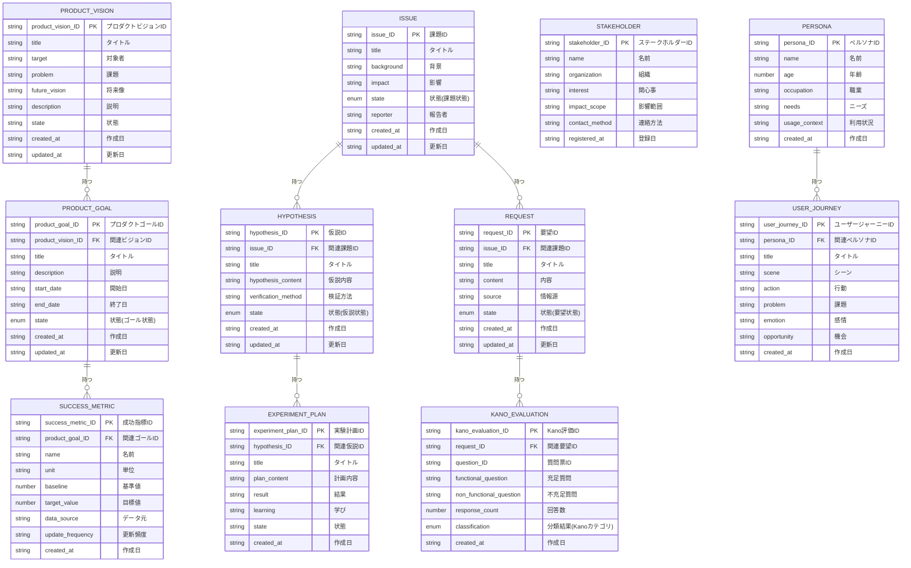

# 論理データモデル

## 概要

AG-01 プロダクトディスカバリー業務領域の論理データモデルをMermaid ER図で表現します。

## ER図

## 論理データ一覧

### プロダクトビジョン (PRODUCT_VISION)

| データ名 | 項目名 | タイプ | isKey | 説明 |
|----------|--------|--------|-------|------|
| PRODUCT_VISION | product_vision_ID | string | true | プロダクトビジョンID |
| PRODUCT_VISION | title | string | false | タイトル |
| PRODUCT_VISION | target | string | false | 対象者 |
| PRODUCT_VISION | problem | string | false | 課題 |
| PRODUCT_VISION | future_vision | string | false | 将来像 |
| PRODUCT_VISION | description | string | false | 説明 |
| PRODUCT_VISION | state | enum | false | 状態(プロダクトビジョン) |
| PRODUCT_VISION | created_at | string | false | 作成日 |
| PRODUCT_VISION | updated_at | string | false | 更新日 |

### プロダクトゴール (PRODUCT_GOAL)

| データ名 | 項目名 | タイプ | isKey | 説明 |
|----------|--------|--------|-------|------|
| PRODUCT_GOAL | product_goal_ID | string | true | プロダクトゴールID |
| PRODUCT_GOAL | product_vision_ID | string | false | 関連ビジョンID |
| PRODUCT_GOAL | title | string | false | タイトル |
| PRODUCT_GOAL | description | string | false | 説明 |
| PRODUCT_GOAL | start_date | string | false | 開始日 |
| PRODUCT_GOAL | end_date | string | false | 終了日 |
| PRODUCT_GOAL | state | enum | false | 状態(ゴール状態) |
| PRODUCT_GOAL | created_at | string | false | 作成日 |
| PRODUCT_GOAL | updated_at | string | false | 更新日 |

### 成功指標 (SUCCESS_METRIC)

| データ名 | 項目名 | タイプ | isKey | 説明 |
|----------|--------|--------|-------|------|
| SUCCESS_METRIC | success_metric_ID | string | true | 成功指標ID |
| SUCCESS_METRIC | product_goal_ID | string | false | 関連ゴールID |
| SUCCESS_METRIC | name | string | false | 名前 |
| SUCCESS_METRIC | unit | string | false | 単位 |
| SUCCESS_METRIC | baseline | number | false | 基準値 |
| SUCCESS_METRIC | target_value | number | false | 目標値 |
| SUCCESS_METRIC | data_source | string | false | データ元 |
| SUCCESS_METRIC | update_frequency | string | false | 更新頻度 |
| SUCCESS_METRIC | created_at | string | false | 作成日 |

### 課題 (ISSUE)

| データ名 | 項目名 | タイプ | isKey | 説明 |
|----------|--------|--------|-------|------|
| ISSUE | issue_ID | string | true | 課題ID |
| ISSUE | title | string | false | タイトル |
| ISSUE | background | string | false | 背景 |
| ISSUE | impact | string | false | 影響 |
| ISSUE | state | enum | false | 状態(課題状態) |
| ISSUE | reporter | string | false | 報告者 |
| ISSUE | created_at | string | false | 作成日 |
| ISSUE | updated_at | string | false | 更新日 |

### 仮説 (HYPOTHESIS)

| データ名 | 項目名 | タイプ | isKey | 説明 |
|----------|--------|--------|-------|------|
| HYPOTHESIS | hypothesis_ID | string | true | 仮説ID |
| HYPOTHESIS | issue_ID | string | false | 関連課題ID |
| HYPOTHESIS | title | string | false | タイトル |
| HYPOTHESIS | hypothesis_content | string | false | 仮説内容 |
| HYPOTHESIS | verification_method | string | false | 検証方法 |
| HYPOTHESIS | state | enum | false | 状態(仮説状態) |
| HYPOTHESIS | created_at | string | false | 作成日 |
| HYPOTHESIS | updated_at | string | false | 更新日 |

### 実験計画 (EXPERIMENT_PLAN)

| データ名 | 項目名 | タイプ | isKey | 説明 |
|----------|--------|--------|-------|------|
| EXPERIMENT_PLAN | experiment_plan_ID | string | true | 実験計画ID |
| EXPERIMENT_PLAN | hypothesis_ID | string | false | 関連仮説ID |
| EXPERIMENT_PLAN | title | string | false | タイトル |
| EXPERIMENT_PLAN | plan_content | string | false | 計画内容 |
| EXPERIMENT_PLAN | result | string | false | 結果 |
| EXPERIMENT_PLAN | learning | string | false | 学び |
| EXPERIMENT_PLAN | state | string | false | 状態 |
| EXPERIMENT_PLAN | created_at | string | false | 作成日 |

### 要望 (REQUEST)

| データ名 | 項目名 | タイプ | isKey | 説明 |
|----------|--------|--------|-------|------|
| REQUEST | request_ID | string | true | 要望ID |
| REQUEST | issue_ID | string | false | 関連課題ID |
| REQUEST | title | string | false | タイトル |
| REQUEST | content | string | false | 内容 |
| REQUEST | source | string | false | 情報源 |
| REQUEST | state | enum | false | 状態(要望状態) |
| REQUEST | created_at | string | false | 作成日 |
| REQUEST | updated_at | string | false | 更新日 |

### Kano評価 (KANO_EVALUATION)

| データ名 | 項目名 | タイプ | isKey | 説明 |
|----------|--------|--------|-------|------|
| KANO_EVALUATION | kano_evaluation_ID | string | true | Kano評価ID |
| KANO_EVALUATION | request_ID | string | false | 関連要望ID |
| KANO_EVALUATION | question_ID | string | false | 質問票ID |
| KANO_EVALUATION | functional_question | string | false | 充足質問 |
| KANO_EVALUATION | non_functional_question | string | false | 不充足質問 |
| KANO_EVALUATION | response_count | number | false | 回答数 |
| KANO_EVALUATION | classification | enum | false | 分類結果(Kanoカテゴリ) |
| KANO_EVALUATION | created_at | string | false | 作成日 |

### ステークホルダー (STAKEHOLDER)

| データ名 | 項目名 | タイプ | isKey | 説明 |
|----------|--------|--------|-------|------|
| STAKEHOLDER | stakeholder_ID | string | true | ステークホルダーID |
| STAKEHOLDER | name | string | false | 名前 |
| STAKEHOLDER | organization | string | false | 組織 |
| STAKEHOLDER | interest | string | false | 関心事 |
| STAKEHOLDER | impact_scope | string | false | 影響範囲 |
| STAKEHOLDER | contact_method | string | false | 連絡方法 |
| STAKEHOLDER | registered_at | string | false | 登録日 |

### ペルソナ (PERSONA)

| データ名 | 項目名 | タイプ | isKey | 説明 |
|----------|--------|--------|-------|------|
| PERSONA | persona_ID | string | true | ペルソナID |
| PERSONA | name | string | false | 名前 |
| PERSONA | age | number | false | 年齢 |
| PERSONA | occupation | string | false | 職業 |
| PERSONA | needs | string | false | ニーズ |
| PERSONA | usage_context | string | false | 利用状況 |
| PERSONA | created_at | string | false | 作成日 |

### ユーザージャーニー (USER_JOURNEY)

| データ名 | 項目名 | タイプ | isKey | 説明 |
|----------|--------|--------|-------|------|
| USER_JOURNEY | user_journey_ID | string | true | ユーザージャーニーID |
| USER_JOURNEY | persona_ID | string | false | 関連ペルソナID |
| USER_JOURNEY | title | string | false | タイトル |
| USER_JOURNEY | scene | string | false | シーン |
| USER_JOURNEY | action | string | false | 行動 |
| USER_JOURNEY | problem | string | false | 課題 |
| USER_JOURNEY | emotion | string | false | 感情 |
| USER_JOURNEY | opportunity | string | false | 機会 |
| USER_JOURNEY | created_at | string | false | 作成日 |

## 関連付け一覧

| 親エンティティ | 子エンティティ | 関係 |
|----------------|----------------|------|
| PRODUCT_VISION | PRODUCT_GOAL | 1:N |
| PRODUCT_GOAL | SUCCESS_METRIC | 1:N |
| ISSUE | HYPOTHESIS | 1:N |
| ISSUE | REQUEST | 1:N |
| HYPOTHESIS | EXPERIMENT_PLAN | 1:N |
| REQUEST | KANO_EVALUATION | 1:N |
| PERSONA | USER_JOURNEY | 1:N |
