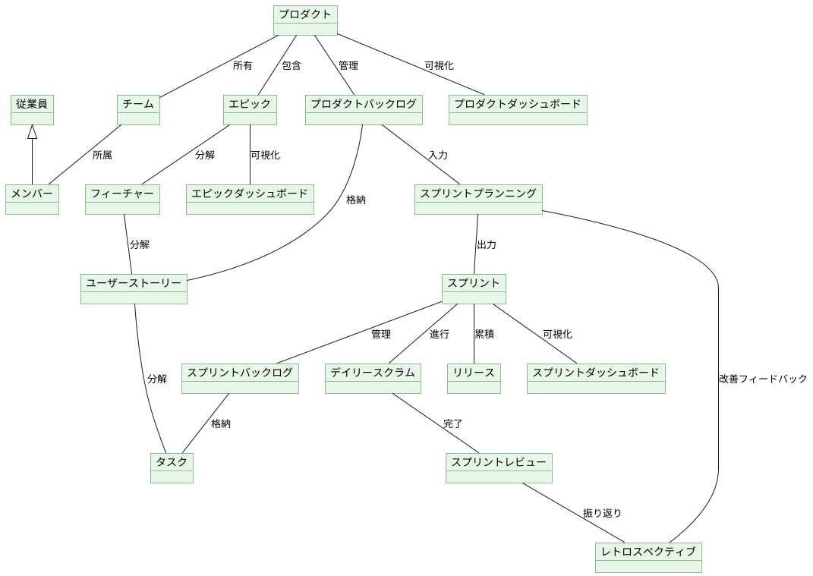
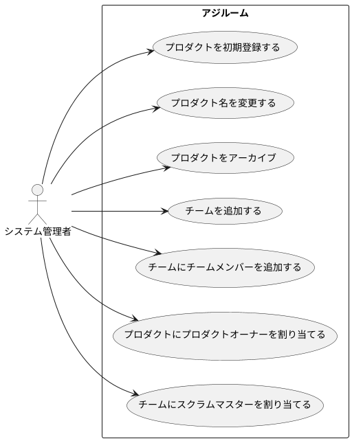

# overview

アジルーム（Agiloom）は、Scrumに基づくアジャイルソフトウェア開発プロジェクトを管理するシステムです。
本システムは、プロダクトの定義からチーム編成、ユーザーストーリーの管理、スプリント計画・実行・レビュー・レトロスペクティブまでのScrumフルサイクルをサポートします。また、エピックやフィーチャーによる大規模な機能の階層管理、リリース管理、および各レベルのダッシュボードによる可視化機能を提供します。

