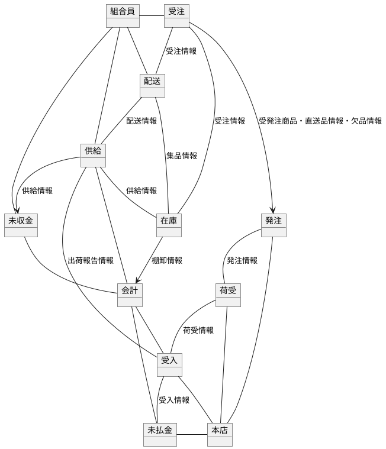

# overview

購買事業とは、JAが農家や組合員に対して農業に必要な肥料や農薬などの資材を供給する事業です。
本システムは、資材の受注・発注・在庫の管理、請求書の発行等を行います。また、バーコード対応、受発注連動や総額表記対応等、より業務の効率化を強化した機能を搭載しています。また、ハンディ端末やＰＯＳ端末との連携など、オープンプラットフォームを生かした情報連携、情報活用の柔軟性を実現します。

