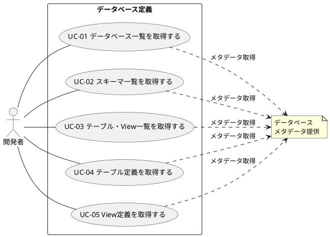

# ユースケース図

データベース定義のユースケース図を定義します。

## ユースケース図

## ユースケース一覧

| ユースケースID | ユースケース名               | 説明                           |
|----------------|------------------------------|--------------------------------|
| UC-01          | データベース一覧を取得する   | データベースの一覧を取得する   |
| UC-02          | スキーマ一覧を取得する       | スキーマの一覧を取得する       |
| UC-03          | テーブル・View一覧を取得する | テーブルとViewの一覧を取得する |
| UC-04          | テーブル定義を取得する       | テーブルの定義情報を取得する   |
| UC-05          | View定義を取得する           | Viewの定義情報を取得する       |

## 関連情報

- アクター: 開発者
- 外部システム: データベース
- ユースケース数: 5
