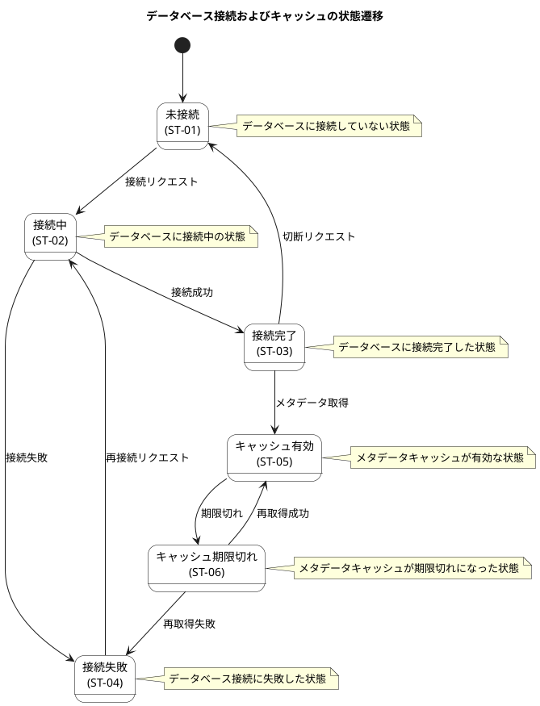

# ステートマシン図

データベース接続およびキャッシュの状態遷移を定義します。

## ステート遷移図

## ステート一覧

| ステートID | ステート名         | 説明                                       |
|------------|--------------------|--------------------------------------------|
| ST-01      | 未接続             | データベースに接続していない状態           |
| ST-02      | 接続中             | データベースに接続中の状態                 |
| ST-03      | 接続完了           | データベースに接続完了した状態             |
| ST-04      | 接続失敗           | データベース接続に失敗した状態             |
| ST-05      | キャッシュ有効     | メタデータキャッシュが有効な状態           |
| ST-06      | キャッシュ期限切れ | メタデータキャッシュが期限切れになった状態 |
