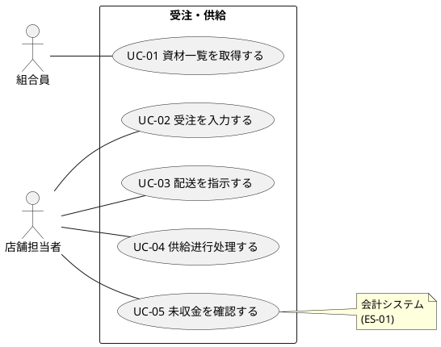

# ユースケース図

受注・供給フローのユースケース図を定義します。

## ユースケース図

## ユースケース一覧

| ユースケースID | ユースケース名     | 説明                       |
|----------------|--------------------|----------------------------|
| UC-01          | 資材一覧を取得する | 注文可能な資材の一覧を取得 |
| UC-02          | 受注を入力する     | 組合員の注文を入力         |
| UC-03          | 配送を指示する     | 資材の配送を指示           |
| UC-04          | 供給进行处理する   | 組合員への供給进行处理     |
| UC-05          | 未収金を確認する   | 供給に対する未収金を確認   |

## 関連情報

- アクター: 組合員、店舗担当者
- 外部システム: 会計システム
- ユースケース数: 5
