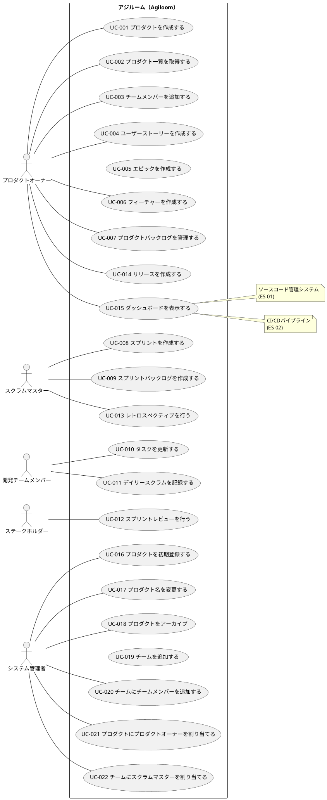

# ユースケース図

アジルーム（Agiloom）のユースケース図を定義します。

## ユースケース図

## ユースケース一覧

| ユースケースID | ユースケース名                             | 説明                                           |
|----------------|--------------------------------------------|------------------------------------------------|
| UC-001         | プロダクトを作成する                       | 新規プロダクトを登録                           |
| UC-002         | プロダクト一覧を取得する                   | 登録済みプロダクトの一覧を取得                 |
| UC-003         | チームメンバーを追加する                   | プロダクトにチームメンバーを追加               |
| UC-004         | ユーザーストーリーを作成する               | ユーザーストーリーを登録                       |
| UC-005         | エピックを作成する                         | 大規模な機能単位のエピックを登録               |
| UC-006         | フィーチャーを作成する                     | エピックを分解したフィーチャーを登録           |
| UC-007         | プロダクトバックログを管理する             | バックログの優先順位を整理                     |
| UC-008         | スプリントを作成する                       | 新規スプリントを計画・開始                     |
| UC-009         | スプリントバックログを作成する             | スプリントで実施するタスクを決定               |
| UC-010         | タスクを更新する                           | タスクの進捗・状態を更新                       |
| UC-011         | デイリースクラムを記録する                 | 進捗状況を記録                                 |
| UC-012         | スプリントレビューを行う                   | 完成した機能をレビュー                         |
| UC-013         | レトロスペクティブを行う                   | スプリントの振り返りを記録                     |
| UC-014         | リリースを作成する                         | スプリントの成果をリリース                     |
| UC-015         | ダッシュボードを表示する                   | 各レベルのダッシュボードを表示                 |
| UC-016         | プロダクトを初期登録する                   | 新規プロダクトを初期登録し、基本情報を設定する |
| UC-017         | プロダクト名を変更する                     | 既存のプロダクトの名前を変更する               |
| UC-018         | プロダクトをアーカイブ                     | 完了したプロダクトをアーカイブする             |
| UC-019         | チームを追加する                           | プロダクトに新しいチームを追加する             |
| UC-020         | チームにチームメンバーを追加する           | チームに開発メンバーを追加する                 |
| UC-021         | プロダクトにプロダクトオーナーを割り当てる | プロダクトにプロダクトオーナーを割り当てる     |
| UC-022         | チームにスクラムマスターを割り当てる       | チームにスクラムマスターを割り当てる           |

## 関連情報

- アクター: プロダクトオーナー、スクラムマスター、開発チームメンバー、ステークホルダー、システム管理者
- 外部システム: ソースコード管理システム、CI/CDパイプライン
- ユースケース数: 22
