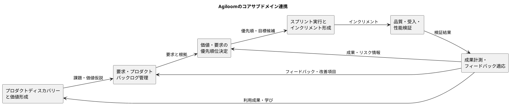

# Agiloom：コアサブドメイン一覧

## 1. 目的

本書では、Agiloomのドメインをドメイン駆動設計（DDD）の観点で整理し、プロダクトの競争力や顧客価値を直接生み出す
**コアサブドメイン**を一覧化します。

Agiloomを「スクラムチームが、ユーザー価値の発見から計画、開発、検証、学習までをつなぎ、継続的に価値を届けるためのシステム」と捉えます。サブドメインの境界は初期仮説であり、実際の利用者、業務ルール、導入先の課題を通じて見直します。

## 2. コアサブドメインの一覧

| ID      | コアサブドメイン                   | 主な価値                                                 | 主な責任ロール                   | 優先度 |
|---------|------------------------------------|----------------------------------------------------------|----------------------------------|--------|
| CORE-01 | プロダクトディスカバリーと価値形成 | ユーザー課題を理解し、価値ある機会・目標・仮説を定める   | PO、従業員、ステークホルダー     | 中核   |
| CORE-02 | 要求・プロダクトバックログ管理     | 課題や仮説を実行可能な項目に変換し、価値順に管理する     | PO、開発者                       | 中核   |
| CORE-03 | 価値・要求の優先順位決定           | 価値、Kano品質、リスク、コストを踏まえて投資順を決める   | PO                               | 中核   |
| CORE-04 | スプリント実行とインクリメント形成 | チームの計画と協働を通じて、利用可能な成果を継続的に作る | 開発者、SM、PO                   | 中核   |
| CORE-05 | プロダクト品質・受入・性能検証     | 期待価値と品質を検証し、安全に利用できる成果を届ける     | 開発者、PO、従業員               | 中核   |
| CORE-06 | 成果計測・フィードバックによる適応 | 利用結果と学びを目標・バックログ・戦略へ戻す             | PO、開発者、SM、トラッキング担当 | 中核   |

## 3. サブドメインの詳細

### CORE-01：プロダクトディスカバリーと価値形成

ユーザーや従業員の課題、利用状況、事業機会を理解し、プロダクトが生み出すべき成果を明確にします。

| 項目     | 内容                                                                                              |
|----------|---------------------------------------------------------------------------------------------------|
| 主な業務 | 課題発見、ユーザー理解、ステークホルダー調査、仮説作成、Product Vision／Goal設定                  |
| 主な概念 | User、Stakeholder、Problem、Opportunity、Hypothesis、Product Vision、Product Goal、Success Metric |
| 主な成果 | 検証可能な課題・価値仮説、明確なプロダクト目標                                                    |
| 関連機能 | 課題・要望受付、Persona、User Journey、Story Mapping、目標・指標管理                              |
| 境界     | 調査データの保存自体ではなく、得られた情報から価値仮説と方向性を形成することが中心                |

### CORE-02：要求・プロダクトバックログ管理

課題や仮説を、チームが検討・開発・検証できる要求へ変換し、プロダクト目標とのつながりを保ちます。

| 項目     | 内容                                                                        |
|----------|-----------------------------------------------------------------------------|
| 主な業務 | 要求の構造化、Epic／Feature／Story化、分割、受入条件の明確化、関連付け      |
| 主な概念 | Product Backlog、Epic、Feature、User Story、Acceptance Criteria、Dependency |
| 主な成果 | 理解可能で追跡可能なバックログ項目                                          |
| 関連機能 | Backlog、Story Mapping、Refinement、変更履歴、要求・テスト追跡              |
| 境界     | タスクの進捗管理だけではなく、価値の根拠と実現項目のつながりを保つ          |

### CORE-03：価値・要求の優先順位決定

限られた開発リソースを、価値、ユーザー満足、リスク、費用、学習効果に応じて配分します。

| 項目     | 内容                                                                                                                                                                                     |
|----------|------------------------------------------------------------------------------------------------------------------------------------------------------------------------------------------|
| 主な業務 | 要求比較、優先順位付け、Kano分類、コスト・リスク・依存関係との調整                                                                                                                       |
| 主な概念 | Priority、Kano Category、Value、Cost、Risk、Urgency、Dependency                                                                                                                          |
| 主な成果 | 判断理由を説明できるバックログ順序と投資判断                                                                                                                                             |
| 関連機能 | Kano質問票、充足・不充足評価、優先順位、判断ログ                                                                                                                                         |
| 基本方針 | Kano評価では当たり前品質を必須要件として満たし、一元品質を競争力につながる範囲で強化し、その後に魅力品質を検討する。無関心品質は原則対象外、逆品質は原因を確認して回避・簡素化を検討する |
| 境界     | Kano分類だけで自動順位を決めず、Product Goal、法令・セキュリティ、事業価値、コスト、リスクを含めてPOが判断する                                                                           |

### CORE-04：スプリント実行とインクリメント形成

チームがスプリント目標を共有し、作業計画を日々適応させながら、完成の定義を満たすインクリメントを形成します。

| 項目       | 内容                                                                                                 |
|------------|------------------------------------------------------------------------------------------------------|
| 主な業務   | Sprint Goal設定、Sprint Backlog作成、設計・実装・統合、日々の計画適応、障害解消                      |
| 主な概念   | Sprint、Sprint Goal、Sprint Backlog、Increment、Definition of Done、Impediment                       |
| 主な成果   | 完成の定義を満たし、検査可能・利用可能なインクリメント                                               |
| 関連機能   | Sprint Planning、ボード、作業状態、障害・依存管理、イベント記録                                      |
| 責任の分担 | POは価値とバックログ順序、開発者はSprint Backlogと実現方法、SMはスクラムの有効性と障害解消を支援する |
| 境界       | 個人のタスク監視ではなく、チーム目標と価値あるインクリメントの形成を中心にする                       |

### CORE-05：プロダクト品質・受入・性能検証

開発成果が要求・受入条件・品質基準を満たし、ユーザーにとって安全で有用かを検証します。

| 項目     | 内容                                                                                         |
|----------|----------------------------------------------------------------------------------------------|
| 主な業務 | テスト計画、受入確認、シナリオ検証、欠陥管理、性能・信頼性確認                               |
| 主な概念 | Acceptance Test、Test Scenario、Defect、Quality Attribute、Performance Requirement、Test Run |
| 主な成果 | 要求と関連づいた検証結果、品質リスク、改善項目                                               |
| 関連機能 | テストケース、受入テスト、シナリオテスト、性能テスト、Gatling連携、欠陥管理                  |
| 境界     | テスト実行記録の保管にとどまらず、プロダクト価値と品質要件を検証し、結果を判断へつなげる     |

### CORE-06：成果計測・フィードバックによる適応

リリースや利用から得られた結果を評価し、Product Goal、要求、優先順位、戦略を更新します。

| 項目     | 内容                                                                                       |
|----------|--------------------------------------------------------------------------------------------|
| 主な業務 | 利用者フィードバック収集、成果指標確認、Sprint Review、振り返り、仮説・計画の更新          |
| 主な概念 | Feedback、Outcome、Metric、Review、Retrospective、Learning、Adaptation                     |
| 主な成果 | 検証された学び、更新された目標・バックログ・改善策                                         |
| 関連機能 | Review記録、Insights、成果指標、フィードバック管理、改善アクション                         |
| 境界     | 作業量やベロシティの報告だけでなく、ユーザー・事業成果とチームの学習を次の判断へ結びつける |

## 4. コアサブドメイン間の関係

## 5. コアと支援・汎用サブドメインの区別

Agiloomの差別化は、単なるアカウント管理やタスク一覧ではなく、価値発見、バックログ判断、スプリント実行、品質検証、成果からの適応を一つの流れとして支援する点にあります。

| 区分             | Agiloomにおける例                                                                   | 位置づけ                                                          |
|------------------|-------------------------------------------------------------------------------------|-------------------------------------------------------------------|
| コアサブドメイン | Discovery、要求・バックログ、Kano等の優先順位、Sprint実行、品質・性能検証、成果適応 | Agiloom固有の価値と競争力を作る。プロダクト知識を反映して設計する |
| 支援サブドメイン | 組織別ワークフロー、通知、プロジェクトテンプレート、レポート出力                    | コア業務を使いやすくするが、主な差別化要因ではない                |
| 汎用サブドメイン | 認証、ユーザー管理、監査ログ、バックアップ、ファイル保管                            | 標準技術や既存サービスの活用を検討できる                          |

区分は固定ではありません。利用者が特に価値を感じ、Agiloomの競争力に直結する領域は、運用や市場の学びに応じてコアへ移す可能性があります。

## 6. 実装・設計への示唆

- コアサブドメインごとに用語集と業務ルールを定義する。
- コアごとに責務を明確にし、更新の理由と履歴を追跡可能にする。
- プロダクト目標、バックログ、Sprint、テスト、成果指標の関連を保つ。
- 認証・通知・監査などの汎用機能を、コアの業務ルールへ過度に混在させない。
- Kano分類やInsightsは判断を支援するが、優先順位や戦略を自動決定しない。
- ユーザーデータと利用者フィードバックは、目的と権限を明確にして扱う。

## 7. 結論

Agiloomのコアサブドメインは、
**プロダクトディスカバリーと価値形成、要求・バックログ管理、価値の優先順位決定、スプリント実行、品質・受入・性能検証、成果計測とフィードバックによる適応**
の6領域です。

これらを分断された管理機能としてではなく、課題から価値を届け、結果から学ぶ循環として設計することがAgiloomの中心価値になります。ユーザーとチームの実際の業務を観察しながら、コアの境界と投資先を継続的に見直します。
