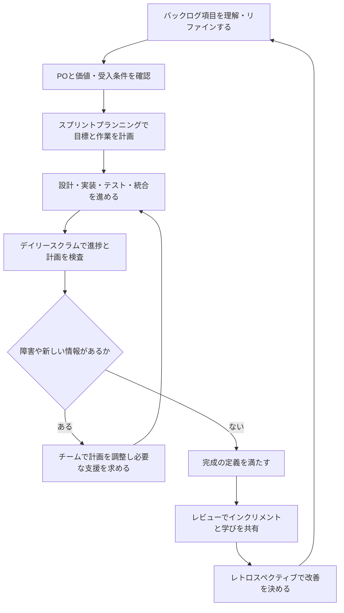

# Agiloom：開発者の業務一覧

## はじめに

スクラムにおける開発者（Developers）は、各スプリントで利用可能なインクリメントを作成することにコミットする人々です。職種や専門分野が異なっても、開発者はチームとして品質を作り込み、スプリント目標に向けて日々計画を調整し、互いに説明責任を持ちます。

開発者には、実装だけでなく、計画、設計、テスト、品質確保、協働、学習など、価値あるインクリメントを届けるために必要な幅広い業務があります。作業の進め方やSprint
Backlogの計画は、開発者自身が決定します。

## 1. 業務全体像

| No. | 業務領域                               | 主な目的                                       | 主な成果                             |
|----:|----------------------------------------|------------------------------------------------|--------------------------------------|
|   1 | スプリント目標の達成に向けて計画する   | チームとしてスプリントの目的と進め方を共有する | Sprint Goal、Sprint Backlog          |
|   2 | プロダクトバックログ項目を具体化する   | 作業内容と価値を理解し、実行可能な単位にする   | 明確なStory、受入条件、分割案        |
|   3 | 解決策を設計・実装する                 | ユーザーや事業に価値を届ける                   | 動作するプロダクト機能               |
|   4 | 品質を作り込む                         | 完成の定義を満たすインクリメントを作成する     | テスト済みで統合されたインクリメント |
|   5 | 日々の計画を調整する                   | 進捗や新しい情報に基づき実行計画を更新する     | 最新のSprint Backlog、共有された状況 |
|   6 | チームで協働する                       | 専門性を組み合わせ、チーム全体で成果を出す     | 相互支援、共有された知識と判断       |
|   7 | 成果を確認し、フィードバックを反映する | インクリメントとユーザー価値を検査する         | レビュー結果、改善されたバックログ   |
|   8 | 技術・チームの改善を続ける             | 継続的に価値を届けられる能力を高める           | 改善施策、技術的負債への対応         |

## 2. 業務領域ごとの詳細

### 2.1 スプリント目標の達成に向けて計画する

スプリントプランニングでPOと協働し、スプリントの価値と目標を理解したうえで、どのバックログ項目に取り組むか、どう作業を進めるかを計画します。

| 業務           | 具体的な活動                                       | 成果物・判断              |
|----------------|----------------------------------------------------|---------------------------|
| 目標の理解     | Product Goalや優先事項とのつながりを確認する       | 共通理解されたSprint Goal |
| 作業候補の選定 | 優先順位、準備状況、能力、依存関係を考慮する       | スプリントで扱う項目      |
| 作業計画       | 必要な設計・実装・テスト・統合の作業を見通す       | Sprint Backlog、実行計画  |
| リスクの確認   | 不確実性、外部依存、環境、データ上の懸念を洗い出す | リスクと対応方針          |
| 予測の共有     | 実績や状況を踏まえ、無理のない計画を作る           | チームの予測              |

Sprint Backlogは開発者が作成・管理します。POは価値や優先順位を説明し、開発者は実現可能な計画を立てます。

### 2.2 プロダクトバックログ項目を具体化する

開発者はリファインメントなどでPOと協働し、項目の理解、分割、見積もり、リスク確認を進めます。

| 業務                     | 具体的な活動                                       | 成果物・判断           |
|--------------------------|----------------------------------------------------|------------------------|
| 目的の確認               | 利用者、課題、期待する成果、優先理由を確認する     | 項目の共通理解         |
| 受入条件の確認           | 期待される振る舞いや境界条件を明確にする           | Acceptance Criteria    |
| 分割の提案               | 大きな項目を小さく検証可能な価値単位に分ける       | 分割されたStory        |
| 技術的な検討             | 技術選択、依存関係、移行、セキュリティなどを調べる | 技術的な選択肢と懸念   |
| 見積もり・不確実性の共有 | 相対的な規模、難しさ、未知の要素をチームで検討する | 見積もり、追加調査項目 |

リファインメントは、すべての詳細を先に決める場ではありません。実行に必要な理解を深めつつ、チームが学習と適応を続けられる余地を残します。

### 2.3 解決策を設計・実装する

ユーザー価値と技術的な制約の両方を考え、チームとして適切な解決策を作ります。

| 業務               | 具体的な活動                                                       |
|--------------------|--------------------------------------------------------------------|
| 設計               | アーキテクチャ、データ、API、画面、運用などを検討する              |
| 実装               | 保守性、安全性、性能、アクセシビリティを考慮してコードや設定を作る |
| 統合               | 変更を継続的に統合し、他の機能との整合を保つ                       |
| 技術的リスク対応   | 技術検証や小さな実験で不確実性を減らす                             |
| 技術的負債への対処 | 品質や変更速度を損なう問題を可視化し、対処する                     |

特定の担当者だけが知識や責任を抱えないよう、設計判断や重要な知識をチームで共有します。

### 2.4 品質を作り込む

完成の定義（Definition of Done）を満たすインクリメントを、スプリントごとに作成します。

| 業務             | 具体的な活動                                           | 成果物・確認事項         |
|------------------|--------------------------------------------------------|--------------------------|
| テスト設計・実行 | 単体、統合、シナリオ、受入など必要なテストを行う       | テスト結果、欠陥情報     |
| コードレビュー   | 変更の正しさ、可読性、安全性を相互に確認する           | レビュー済みの変更       |
| セキュリティ確認 | 権限、入力検証、機密情報、脆弱性を確認する             | セキュリティ上の対応     |
| 性能・信頼性確認 | 性能要件、負荷、障害時の動作を検証する                 | 測定値、改善項目         |
| 統合・動作確認   | 変更をプロダクトに統合し、全体で動作することを確かめる | 利用可能なインクリメント |
| 完成の定義の適用 | チームで合意した品質基準を一貫して満たす               | Doneの項目               |

完成の定義を満たさない作業は、完成したインクリメントとして扱いません。品質を後工程に先送りせず、開発の中で作り込みます。

### 2.5 日々の計画を調整する

デイリースクラムなどを通じてSprint Goalへの進捗を確認し、状況に応じて作業計画を更新します。

| 業務           | 具体的な活動                                              |
|----------------|-----------------------------------------------------------|
| 進捗の検査     | Sprint Goalに向けて何が進み、何が妨げになっているかを見る |
| 計画の更新     | 新しい情報や優先事項に応じて、残作業の進め方を決める      |
| 阻害要因の共有 | 解決が必要な技術・環境・組織上の問題を早期に知らせる      |
| POとの確認     | 要求の解釈やトレードオフに判断が必要な場合に対話する      |
| 透明性の維持   | 作業状態やリスクを正確に共有する                          |

デイリースクラムは上司への報告会ではなく、開発者がSprint Goalに向けた計画を適応させる機会です。

### 2.6 チームで協働する

専門分野や担当範囲を越えて協力し、個々の作業完了ではなくチーム全体の目標達成を重視します。

| 業務       | 具体的な活動                                           |
|------------|--------------------------------------------------------|
| 相互支援   | レビュー、ペア作業、相談、障害対応を通して助け合う     |
| 知識共有   | 設計、運用、業務知識、トラブル対応を共有する           |
| 意見の調整 | 技術的な意見の違いを根拠と実験に基づいて解決する       |
| 集中の維持 | 不要な割り込みや並行作業を減らし、完成に向けて協力する |
| チーム責任 | 成果物の品質とSprint Goalにチームとして責任を持つ      |

個人の作業量や完了件数を競うのではなく、チームとして価値を届けることを大切にします。

### 2.7 成果を確認し、フィードバックを反映する

スプリントレビューなどでインクリメントをPOやステークホルダーと確認し、得られたフィードバックを次の作業に活用します。

| 業務                 | 具体的な活動                                           |
|----------------------|--------------------------------------------------------|
| インクリメントの提示 | 動作する成果を示し、変更点や制約を説明する             |
| フィードバックの確認 | ユーザーや関係者の反応、利用場面、未解決課題を確認する |
| 技術情報の共有       | 性能、品質、運用準備、既知の制約を透明にする           |
| バックログへの反映   | 学びや追加要求をPOと整理し、必要に応じて項目化する     |
| 次の改善の検討       | プロダクトと開発プロセスの両方の改善機会を探す         |

スプリントレビューは完成報告だけの場ではなく、成果を検査し、今後の方向性を適応させる機会です。

### 2.8 技術・チームの改善を続ける

レトロスペクティブや日々の協働を通じ、価値提供の速度と品質を高める改善を実行します。

| 業務             | 具体的な活動                                     |
|------------------|--------------------------------------------------|
| 振り返り         | うまくいったこと、課題、根本原因、学びを話し合う |
| 改善施策の実行   | 改善案を実行可能な小さな行動にする               |
| 効果の検査       | 改善が役立ったかを次のスプリントで確認する       |
| 技術的負債の管理 | 将来の変更や品質に影響する問題を見えるようにする |
| 能力の向上       | 新しい技術、テスト、運用、業務知識を学び共有する |

改善は会話だけで終わらせず、担当や確認時期を決め、実際に効果があったかを確かめます。

## 3. 開発者業務の時系列フロー

## 4. Agiloom機能との対応表

| 開発者業務               | Agiloomの支援機能                                  | 主な情報・成果                       |
|--------------------------|----------------------------------------------------|--------------------------------------|
| スプリント計画           | Sprint Planning、Sprint Goal、Sprint Backlog       | 目標、選択項目、実行計画             |
| バックログの具体化       | Story Mapping、Refinement、Acceptance Criteria     | 明確な項目、分割、見積もり、依存関係 |
| 設計・実装               | タスク管理、設計資料、変更・判断履歴               | 実装状況、技術判断、関連成果物       |
| 品質確保                 | テストケース、受入テスト、シナリオテスト、欠陥管理 | テスト結果、品質状況、欠陥           |
| 日々の計画調整           | Sprint Board、Daily、阻害要因管理                  | 作業状況、課題、計画変更             |
| チーム協働               | コメント、レビュー記録、知識・判断の共有           | 議論、レビュー、チーム内の合意       |
| 性能検証                 | Performance Test支援、Gatling連携                  | 性能要件、負荷シナリオ、測定結果     |
| レビュー・フィードバック | Sprint Review、フィードバック管理                  | インクリメント、意見、次の項目       |
| 継続的改善               | Retrospective、改善アクション、Insights            | 改善策、担当、効果の確認             |

Agiloomは作業と情報の追跡を助けますが、技術的な判断、チーム内の協働、品質への責任を自動で代行するものではありません。

## 5. 開発者ダッシュボード

| 表示領域       | 主な表示内容                                | 開発者が確認すること                       |
|----------------|---------------------------------------------|--------------------------------------------|
| Sprint Goal    | 目標、関連する項目、残りの作業              | 日々の作業が目標に貢献しているか           |
| Sprint Backlog | 未着手・進行中・完了の作業、担当や依存関係  | 次にチームで進める作業は何か               |
| 品質と完成状況 | テスト、レビュー、統合、Done基準            | インクリメントとして完成しているか         |
| 障害・リスク   | 阻害要因、依存先、対応状況、判断待ち        | チーム内外に支援を求める必要があるか       |
| 受入条件・要求 | Storyの目的、受入条件、関連する設計・テスト | 期待される価値と振る舞いを理解できているか |
| 技術・性能     | 性能要件、テスト結果、技術的負債            | 品質や運用に関する問題がないか             |
| チームの改善   | 振り返りアクション、担当、進捗、効果        | 決めた改善が実行され、効果が出ているか     |

ダッシュボードは個人を監視・評価するためではなく、チームが作業と障害を共有し、計画を調整するために使います。

## 6. 責任範囲と役割分担

| 領域           | 開発者の責任                                 | PO・スクラムマスターとの協働                                 |
|----------------|----------------------------------------------|--------------------------------------------------------------|
| Sprint Goal    | 目標達成に向けてチームの計画を作り、適応する | POは価値と目的を説明し、SMは計画づくりを支援する             |
| Sprint Backlog | 内容と実行計画を作成・更新する               | POと項目の理解を確認し、SMに障害解消の支援を求める           |
| 技術的な実現   | 設計、実装、テスト、統合の方法を決める       | POに価値や制約を確認し、SMと協働上の障害を扱う               |
| 品質           | 完成の定義を満たすインクリメントを作る       | POと受入条件を確認し、SMに品質を妨げる組織課題の支援を求める |
| 進捗・リスク   | 状況を透明にし、計画を調整する               | POに判断が必要な変更を相談し、SMと障害を共有する             |
| 改善           | 技術・チームの改善を選び、実行する           | POはプロダクト面の学びを反映し、SMは改善を促進する           |

開発者は、個人の担当作業を完了するだけでなく、チームとしてスプリント目標に向けて成果を届ける責任を持ちます。スクラムマスターが作業を割り当てたり、POが実装方法を指示したりするのではなく、それぞれの責任を尊重して協働します。

## 7. Agiloomの段階的な実装順序

| 段階                        | 実装対象                                          | ねらい・完了の目安                           |
|-----------------------------|---------------------------------------------------|----------------------------------------------|
| 1. Sprintと目標             | Sprint Goal、期間、参加チーム、目標に関連する項目 | チームがスプリントの目的を共有できる         |
| 2. Sprint Backlogと作業状況 | 項目、タスク、状態、依存関係                      | チームが計画と進捗を自分たちで更新できる     |
| 3. 項目の明確化             | Story、受入条件、分割、関連資料                   | 開発者が目的と期待される振る舞いを理解できる |
| 4. 品質・テスト管理         | 完成の定義、テストケース、実行結果、欠陥          | 品質を作り込み、完成状況を確認できる         |
| 5. 協働と阻害要因           | コメント、判断履歴、質問、障害・リスク            | チームが必要な対話と支援を追跡できる         |
| 6. 性能・運用検証           | 性能要件、負荷シナリオ、Gatling実行結果           | 非機能要件と運用上のリスクを確認できる       |
| 7. Reviewとフィードバック   | インクリメント、レビュー記録、フィードバック      | 学びをバックログに戻せる                     |
| 8. RetrospectiveとInsights  | 改善アクション、効果、品質・作業の傾向            | 改善が継続し、チームの判断に役立つ           |

まず目標、バックログ、作業状況、品質の基本を支援し、実際の開発チームのフィードバックをもとに協働・分析機能を広げます。作業件数ではなく、価値あるインクリメントの完成、品質、計画の適応、チームの学習に役立っているかで機能を評価します。

## 8. 結論

開発者の仕事は、コードを書くことに限りません。プロダクトバックログ項目を理解し、スプリント目標に向けて計画し、解決策を設計・実装し、品質を作り込んだインクリメントを届けることが中心です。そのために、開発者はチームとして日々計画を調整し、互いに協働し、成果と進め方の両方から学びます。

Agiloomは、Sprint
Goal、バックログ、テスト、障害、性能、フィードバック、改善をつなぎ、開発者が状況を共有して適応することを支援します。最終的な判断と成果への責任はチームが持ち、ツールは価値あるプロダクトを継続して届けるための共通の作業基盤として活用します。
