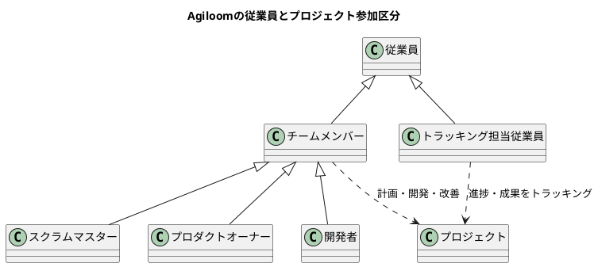
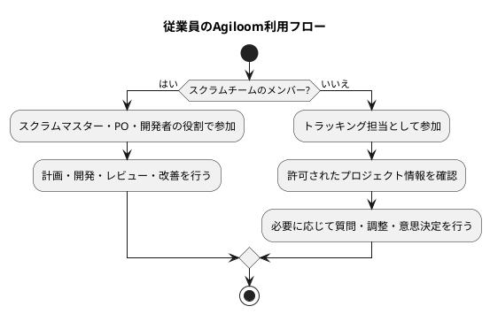
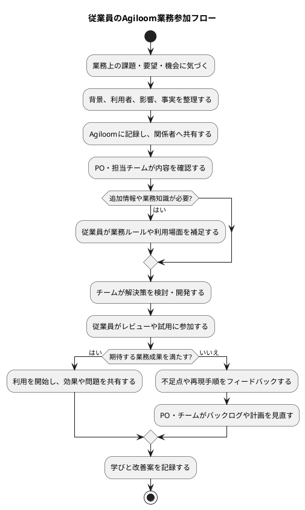

# Agiloom：従業員の業務領域一覧

## はじめに

従業員はAgiloomを利用する人の基本区分です。チームメンバーも従業員であり、スクラムマスター、プロダクトオーナー（PO）、開発者もそれぞれ従業員です。スクラムチームに所属しない従業員は、プロジェクトをトラッキングし、進捗や成果を確認する立場としてAgiloomを利用します。

Agiloomでは、従業員の中に「チームメンバー」と「チーム外のトラッキング担当者」という利用区分があります。チームメンバーにはスクラム上の役割（スクラムマスター、PO、開発者）が割り当てられます。チーム外の従業員は、許可された範囲でプロジェクトを閲覧・追跡します。現実の組織では一人が複数の役割を担うこともあるため、所属、役割、閲覧権限は必要に応じて分けて設定します。

## 1. 業務全体像

| No. | 業務領域                               | 主な目的                                        | 主な成果                           |
|----:|----------------------------------------|-------------------------------------------------|------------------------------------|
|   1 | 業務課題・ニーズを共有する             | 現場で起きている課題や機会を伝える              | 課題、背景、影響、要望             |
|   2 | 要求・改善案に協力する                 | 実際の業務に合う解決策を検討する                | 要求の補足、業務ルール、改善案     |
|   3 | プロダクトの確認・フィードバックを行う | 開発成果が実際のニーズに合うか確かめる          | レビュー結果、利用者の意見         |
|   4 | 自分の作業・依頼を管理する             | Agiloom上の情報を正確に更新し、協働を円滑にする | 最新の作業状況、質問、依頼         |
|   5 | 知識・情報を共有する                   | チームや組織の学習と継続性を高める              | 手順、判断根拠、業務知識           |
|   6 | 品質・リスク・セキュリティに協力する   | 問題の早期発見と安全な利用を支える              | 不具合・リスク報告、適切な情報管理 |
|   7 | チーム・組織の改善に参加する           | 業務の進め方や利用体験を良くする                | 改善提案、振り返りの学び           |
|   8 | Agiloomを適切に利用する                | 情報を正しく、安全に扱う                        | 適切なアクセスと記録               |

### 従業員の利用区分

| 利用区分               | 対象                                             | Agiloomでの主な関わり                            |
|------------------------|--------------------------------------------------|--------------------------------------------------|
| チームメンバー         | スクラムマスター、PO、開発者                     | 役割に応じて、プロダクトの計画・開発・改善を行う |
| トラッキング担当従業員 | チームメンバー以外でプロジェクトを追跡する従業員 | 許可された範囲で進捗、成果、リスクを確認する     |

トラッキング担当者はプロジェクトの状況を把握し、必要な調整や意思決定を行うために情報を確認します。チームのSprint
Backlogや作業計画を直接変更する場合は、チームとの合意と権限が必要です。

## 2. 業務領域ごとの詳細

### 2.1 業務課題・ニーズを共有する

従業員は、日々の業務で見つけた不便、重複作業、ユーザーからの要望、事業上の機会などを、背景とともに共有します。

| 業務             | 具体的な活動                                                       | 共有する情報               |
|------------------|--------------------------------------------------------------------|----------------------------|
| 課題の報告       | 業務上の困りごとや繰り返し発生する問題を記録する                   | 発生状況、頻度、影響       |
| 要望の共有       | 顧客や利用者から受けた意見を伝える                                 | 誰の要望か、利用場面、期待 |
| 機会の提示       | 効率化、新しいサービス、リスク低減の可能性を提案する               | 期待する成果、根拠         |
| 事実と意見の区別 | 観察した事実、推測、希望を分けて記載する                           | 情報の確度、確認が必要な点 |
| 緊急度の連絡     | 業務停止や安全上の問題など、緊急性の高い事象を適切な経路で報告する | 影響範囲、緊急度、連絡先   |

要望を記録する際は、解決策だけでなく、誰がどの状況で何に困っているのかを説明します。優先順位の決定はPOなど所定の意思決定者が行います。

### 2.2 要求・改善案に協力する

業務知識を持つ従業員は、要求の明確化や解決策の検討に参加し、実際の業務ルールや例外を伝えます。

| 業務                 | 具体的な活動                                       |
|----------------------|----------------------------------------------------|
| 業務ルールの説明     | 通常手順、例外処理、権限、締め処理などを説明する   |
| 利用者・関係者の特定 | 誰が操作し、誰が結果の影響を受けるかを整理する     |
| 受入条件の確認       | 期待する動作、入力、出力、エラー時の扱いを確認する |
| 解決策の検討         | 現場で実行可能か、運用負荷や教育が必要かを検討する |
| 不明点の明示         | 仮定、未決事項、確認先を共有する                   |

従業員は業務上の正確な情報を提供し、POや開発チームが判断できるよう協力します。要求の優先順位や技術的な実現方法を独断で確定しないようにします。

### 2.3 プロダクトの確認・フィードバックを行う

レビューや試用に参加し、開発成果が利用者の目的を満たしているか、業務上問題がないかを確認します。

| 業務                 | 具体的な活動                                                   | 成果                 |
|----------------------|----------------------------------------------------------------|----------------------|
| 成果の確認           | 実際の操作や業務シナリオに沿って動作を確認する                 | 確認結果、未解決事項 |
| 使いやすさの評価     | 分かりにくい表現、操作負荷、アクセシビリティ上の課題を報告する | 具体的な改善意見     |
| 業務適合性の確認     | 業務ルールや例外に対応しているか確認する                       | 適合状況、例外ケース |
| 不具合の報告         | 再現手順、期待結果、実際の結果を記録する                       | 再現可能な不具合情報 |
| フィードバックの提供 | 何が役立つか、どのような影響があったかを伝える                 | 利用者の学び         |

フィードバックは、「使いにくい」だけでなく、どの画面・操作・状況で何が起きたかを添えると、改善につながりやすくなります。

### 2.4 自分の作業・依頼を管理する

Agiloom上で担当する作業や依頼がある場合は、状態、進捗、期限、質問を適切に更新します。

| 業務                 | 具体的な活動                                       |
|----------------------|----------------------------------------------------|
| 状況の更新           | 作業状態や完了状況を実態に合わせて更新する         |
| 期限・依存関係の共有 | 遅延のおそれや他者の対応待ちを早めに知らせる       |
| 質問・相談           | 判断が必要な点や不明点を、関係する担当者に確認する |
| 完了条件の確認       | 依頼内容や合意した確認条件を満たしたか確認する     |
| 引継ぎ               | 担当交代時に、背景、現状、次の手順を残す           |

進捗情報は評価のための見せ方ではなく、関係者が計画を調整し、支援を行うための情報として正確に共有します。

### 2.5 知識・情報を共有する

個人だけが知っている業務知識を減らし、チームや組織が継続して業務を行えるよう、必要な知識を記録・共有します。

| 業務           | 具体的な活動                                             |
|----------------|----------------------------------------------------------|
| 手順の記録     | 繰り返し行う作業、判断基準、問い合わせ先を文書化する     |
| 判断根拠の共有 | 重要な決定の背景や前提を記録する                         |
| 知識の更新     | 古くなった説明や手順を見直す                             |
| 問い合わせ対応 | 自分の知識範囲で質問に答え、必要なら適切な担当者につなぐ |
| 学びの共有     | 問題対応や新しい機能の利用から得た知識を共有する         |

情報の正確さ、更新日、対象読者を明確にし、機密情報や個人情報を不用意に記載しないようにします。

### 2.6 品質・リスク・セキュリティに協力する

問題やリスクを早めに共有し、適切な情報管理と安全なシステム利用に協力します。

| 業務                     | 具体的な活動                                                   |
|--------------------------|----------------------------------------------------------------|
| 品質上の問題報告         | 不具合、誤表示、データ不整合などを報告する                     |
| 業務リスクの共有         | 誤処理、手作業の負担、運用上の抜け漏れを伝える                 |
| セキュリティ事象の報告   | 不審なアクセス、誤送信、情報漏えいの疑いを所定の窓口へ連絡する |
| 安全な利用               | 自分に付与された権限の範囲で利用し、認証情報を適切に保護する   |
| 個人情報・機密情報の保護 | 必要最小限の情報だけを扱い、共有先と保存先を確認する           |

セキュリティや業務停止に関わる重大な事象は、通常のバックログ登録だけで済ませず、組織で定めた緊急連絡手順を使います。

### 2.7 チーム・組織の改善に参加する

振り返り、レビュー、業務改善の場に参加し、問題の原因や改善案を建設的に話し合います。

| 業務             | 具体的な活動                                     |
|------------------|--------------------------------------------------|
| 振り返りへの参加 | うまくいったこと、難しかったこと、学びを共有する |
| 改善案の提案     | 問題の原因に対応する実行可能な案を提案する       |
| 改善施策の実行   | 合意した担当や期限に沿って改善を試す             |
| 効果の確認       | 改善によって業務や利用者に変化があったか確認する |
| 相互尊重         | 個人を責めず、仕組みや状況に目を向けて対話する   |

改善は提案するだけでなく、実施後の効果を確認し、続けるか見直すかをチームで判断します。

### 2.8 Agiloomを適切に利用する

従業員は利用者として、アカウント、情報、通知、記録を適切に扱います。

| 業務               | 具体的な活動                                               |
|--------------------|------------------------------------------------------------|
| アカウント保護     | パスワードや多要素認証情報を安全に管理する                 |
| アクセス範囲の遵守 | 必要な業務目的の範囲で情報を閲覧・更新する                 |
| 正確な記録         | 課題、コメント、作業状態を事実に基づいて記載する           |
| 適切な共有         | 閲覧権限と対象者を確認して情報を共有する                   |
| 不要情報の抑制     | 重複記録や不要な個人情報・機密情報の登録を避ける           |
| 問題の連絡         | 操作上の問題、誤った権限、疑わしい事象を管理窓口へ報告する |

## 3. 従業員のAgiloom利用フロー

### チームメンバーの業務参加フロー

## 4. Agiloom機能との対応表

| 従業員業務       | Agiloomの支援機能                       | 主な情報・成果                         |
|------------------|-----------------------------------------|----------------------------------------|
| 課題・要望の共有 | 要求・フィードバック受付、課題管理      | 背景、利用者、影響、要望               |
| 要求の具体化     | User Journey、Story Mapping、コメント   | 業務ルール、利用場面、受入条件への入力 |
| プロダクト確認   | Review、Acceptance Test、Scenario Test  | 確認結果、不具合、利用者の意見         |
| 作業・依頼の管理 | タスク、依頼、通知、状態更新            | 進捗、期限、担当、依存関係             |
| 知識共有         | ドキュメント、コメント、意思決定履歴    | 手順、FAQ、判断根拠                    |
| 品質・リスク報告 | 欠陥、リスク、障害管理                  | 再現手順、影響、緊急度                 |
| 改善参加         | Retrospective、改善アクション、Insights | 改善提案、担当、効果                   |
| 安全な利用       | ユーザー設定、権限、監査、サポート窓口  | 適切なアクセス、問い合わせ、記録       |

## 5. 従業員向けダッシュボード

| 表示領域           | 主な表示内容                   | 従業員が確認すること         |
|--------------------|--------------------------------|------------------------------|
| 自分の作業・依頼   | 担当項目、状態、期限、確認待ち | 次に行う作業と期限           |
| 提出した課題・要望 | 対応状況、担当、コメント、判断 | 内容の確認や追加情報が必要か |
| 参加中のレビュー   | 試用対象、シナリオ、回答期限   | どの観点を確認するか         |
| 質問・通知         | メンション、質問、変更連絡     | 回答や対応が必要な事項       |
| 関連する知識       | 業務手順、FAQ、決定事項        | 最新の手順や合意内容         |
| 改善アクション     | 自分が関わる改善、担当、期限   | 実行状況と効果確認           |
| お知らせ           | 保守、利用変更、既知の問題     | 業務への影響や必要な対応     |

## 6. 責任範囲と役割分担

| 領域           | 従業員                                     | PO                             | スクラムマスター           | 開発者                             | システム管理者                   |
|----------------|--------------------------------------------|--------------------------------|----------------------------|------------------------------------|----------------------------------|
| 課題・ニーズ   | 現場の事実や利用者の声を共有する           | 価値と優先順位を判断する       | 関係者との対話を促す       | 解決策と技術的影響を検討する       | 受付・権限・システム運用を支える |
| 要求の具体化   | 業務ルールや例外を説明する                 | Product Backlogを管理する      | 協働と透明性を支援する     | 実現可能性や分割を検討する         | 共通設定とデータ管理を行う       |
| 開発成果の確認 | 利用者視点で試用・意見提供する             | 成果と価値を評価する           | Reviewの有効性を支援する   | Doneのインクリメントを作る         | 稼働環境とアクセスを維持する     |
| 作業管理       | 自分の依頼や作業を正確に更新する           | プロダクトの優先順位を管理する | チームの自己管理を支援する | Sprint Backlogと実行計画を管理する | アカウントや権限を管理する       |
| セキュリティ   | 情報と認証情報を適切に扱い、事象を報告する | プロダクト上のリスクを考慮する | 安全な協働と問題提起を促す | 安全な設計・実装・テストを行う     | 認証、権限、監査、保護を運用する |

従業員は、提供した要望が必ず採用されることを前提にせず、判断に必要な情報を提供します。優先順位やプロダクト判断はPOなどの責任者が行い、技術的な実現方法は開発者が検討します。

## 7. Agiloomの段階的な実装順序

| 段階                | 実装対象                                       | ねらい・完了の目安                         |
|---------------------|------------------------------------------------|--------------------------------------------|
| 1. 利用者と権限     | 従業員アカウント、所属、利用範囲、アクセス申請 | 必要な情報へ安全にアクセスできる           |
| 2. 課題・要望受付   | 入力フォーム、分類、背景・影響、受付状態       | 現場の声を構造化して記録できる             |
| 3. 対話と追加情報   | コメント、質問、メンション、判断履歴           | 要求の背景や業務ルールを補足できる         |
| 4. レビュー・試用   | シナリオ、テスト参加、フィードバック、欠陥報告 | 利用者が成果を確かめ、具体的な意見を返せる |
| 5. 自分の作業と通知 | 担当依頼、期限、状態、通知設定                 | 従業員が自分の対応を把握できる             |
| 6. 知識共有         | FAQ、業務手順、意思決定・変更履歴              | 知識を再利用し、引継ぎしやすくする         |
| 7. 改善への参加     | 改善提案、アクション、効果確認                 | 課題を継続的な改善につなげる               |
| 8. 利用状況の分析   | フィードバックの傾向、対応状況、利用体験       | 利用上の摩擦や改善機会を把握する           |

まず従業員が課題を簡単に共有し、対応状況を確認できる仕組みを整えます。その後、要求の具体化、成果確認、知識共有、改善参加へ広げます。従業員の利用状況を監視・評価するためではなく、参加のしやすさと業務上の成果を改善するためにデータを使います。

## 8. 結論

従業員の重要な役割は、現場の課題やユーザーの声を具体的に伝え、業務知識を共有し、開発成果を確認してフィードバックすることです。また、Agiloom上の作業や情報を正確かつ安全に扱い、チームや組織の改善に参加します。

Agiloomは、従業員の声を要求・開発・検証・改善へつなぎ、対応状況を見えるようにすることで、現場と開発チームの協働を支援します。従業員が安心して課題を共有でき、判断の理由と結果を確認できる環境が、継続的なプロダクト改善につながります。
