# Agiloom：情報構造ERD

## 1. 目的と前提

本書は、Agiloomの主要な業務情報とエンティティ間の関係を示す論理ERDです。データベース製品や物理テーブル構成を確定するものではありません。認証情報や外部サービスの内部データなど、Agiloomが業務上所有しないデータは省略しています。

設計上の前提：

- Agiloomの利用者は従業員（Employee）である。
- PO、スクラムマスター、開発者はチームメンバーに割り当てるプロジェクト内ロールである。
- トラッキング担当も従業員であり、チームメンバーとは別のプロジェクト参加区分を持つ。
- システム管理者は従業員に付与される管理ロールであり、スクラムロールとは独立している。
- ロールと所属は、従業員の基本情報に固定せず、組織・プロジェクト・チーム単位の割り当てとして管理する。
- Kano調査では、要望ごとに充足・不充足の質問への回答を記録し、回答組み合わせから品質カテゴリを判定する。

## 2. PlantUML ERD

```plantuml
@startuml
title Agiloom 論理ERD
hide circle
skinparam linetype ortho
skinparam shadowing false
skinparam entity {
  BackgroundColor #F8FAFC
  BorderColor #475569
  FontColor #0F172A
}
skinparam packageStyle rectangle

package "組織・利用者・権限" #F1F5F9 {
  entity "Organization" as Organization {
    * organization_id : UUID <<PK>>
    --
    name : string
    status : enum
    created_at : datetime
  }

  entity "Employee" as Employee {
    * employee_id : UUID <<PK>>
    --
    organization_id : UUID <<FK>>
    display_name : string
    email : string
    status : enum
  }

  entity "Workspace" as Workspace {
    * workspace_id : UUID <<PK>>
    --
    organization_id : UUID <<FK>>
    name : string
    timezone : string
  }

  entity "Project" as Project {
    * project_id : UUID <<PK>>
    --
    workspace_id : UUID <<FK>>
    name : string
    status : enum
    start_date : date
    target_date : date
  }

  entity "Team" as Team {
    * team_id : UUID <<PK>>
    --
    project_id : UUID <<FK>>
    name : string
    status : enum
  }

  entity "ProjectMembership" as ProjectMembership {
    * project_membership_id : UUID <<PK>>
    --
    project_id : UUID <<FK>>
    employee_id : UUID <<FK>>
    participation_type : enum
    status : enum
    joined_at : datetime
  }

  entity "TeamMembership" as TeamMembership {
    * team_membership_id : UUID <<PK>>
    --
    team_id : UUID <<FK>>
    employee_id : UUID <<FK>>
    active_from : date
    active_to : date
  }

  entity "RoleAssignment" as RoleAssignment #FFFFE0 {
    * role_assignment_id : UUID <<PK>>
    --
    employee_id : UUID <<FK>>
    scope_type : enum
    scope_id : UUID
    role_code : enum
    granted_by : UUID <<FK Employee>>
    granted_at : datetime
    expires_at : datetime
  }
}

package "戦略・Discovery・バックログ" #EFF6FF {
  entity "ProductGoal" as ProductGoal {
    * product_goal_id : UUID <<PK>>
    --
    project_id : UUID <<FK>>
    title : string
    description : text
    status : enum
    target_date : date
  }

  entity "SuccessMetric" as SuccessMetric {
    * metric_id : UUID <<PK>>
    --
    product_goal_id : UUID <<FK>>
    name : string
    unit : string
    baseline_value : decimal
    target_value : decimal
  }

  entity "UserProblem" as UserProblem {
    * problem_id : UUID <<PK>>
    --
    project_id : UUID <<FK>>
    reported_by : UUID <<FK Employee>>
    title : string
    context : text
    impact : text
    status : enum
  }

  entity "Feedback" as Feedback {
    * feedback_id : UUID <<PK>>
    --
    project_id : UUID <<FK>>
    submitted_by : UUID <<FK Employee>>
    problem_id : UUID <<FK nullable>>
    content : text
    received_at : datetime
    status : enum
  }

  entity "BacklogItem" as BacklogItem {
    * backlog_item_id : UUID <<PK>>
    --
    project_id : UUID <<FK>>
    product_goal_id : UUID <<FK nullable>>
    parent_item_id : UUID <<FK nullable>>
    item_type : enum
    title : string
    description : text
    priority_order : integer
    status : enum
    acceptance_criteria : text
  }

  entity "KanoSurvey" as KanoSurvey {
    * kano_survey_id : UUID <<PK>>
    --
    backlog_item_id : UUID <<FK>>
    created_by : UUID <<FK Employee>>
    status : enum
    opened_at : datetime
    closed_at : datetime
  }

  entity "KanoResponse" as KanoResponse {
    * kano_response_id : UUID <<PK>>
    --
    kano_survey_id : UUID <<FK>>
    respondent_id : UUID <<FK Employee nullable>>
    respondent_segment : string
    functional_answer : enum
    dysfunctional_answer : enum
    category : enum
    submitted_at : datetime
  }

  entity "DecisionRecord" as DecisionRecord {
    * decision_id : UUID <<PK>>
    --
    project_id : UUID <<FK>>
    backlog_item_id : UUID <<FK nullable>>
    decided_by : UUID <<FK Employee>>
    decision : text
    rationale : text
    decided_at : datetime
  }
}

package "スプリント・開発・品質" #F0FDF4 {
  entity "Sprint" as Sprint {
    * sprint_id : UUID <<PK>>
    --
    team_id : UUID <<FK>>
    name : string
    goal : text
    start_at : datetime
    end_at : datetime
    status : enum
  }

  entity "SprintBacklogItem" as SprintBacklogItem {
    * sprint_backlog_item_id : UUID <<PK>>
    --
    sprint_id : UUID <<FK>>
    backlog_item_id : UUID <<FK>>
    added_at : datetime
    outcome : enum
  }

  entity "Task" as Task {
    * task_id : UUID <<PK>>
    --
    sprint_backlog_item_id : UUID <<FK>>
    title : string
    status : enum
    estimate : decimal
  }

  entity "TaskAssignment" as TaskAssignment {
    * task_assignment_id : UUID <<PK>>
    --
    task_id : UUID <<FK>>
    employee_id : UUID <<FK>>
    assigned_at : datetime
  }

  entity "DefinitionOfDone" as DefinitionOfDone {
    * definition_id : UUID <<PK>>
    --
    team_id : UUID <<FK>>
    version : integer
    criteria : text
    effective_from : date
    active : boolean
  }

  entity "TestCase" as TestCase {
    * test_case_id : UUID <<PK>>
    --
    backlog_item_id : UUID <<FK nullable>>
    title : string
    scenario : text
    expected_result : text
    test_type : enum
  }

  entity "TestRun" as TestRun {
    * test_run_id : UUID <<PK>>
    --
    test_case_id : UUID <<FK>>
    sprint_id : UUID <<FK nullable>>
    executed_by : UUID <<FK Employee>>
    result : enum
    executed_at : datetime
    evidence_uri : string
  }

  entity "Defect" as Defect {
    * defect_id : UUID <<PK>>
    --
    backlog_item_id : UUID <<FK nullable>>
    test_run_id : UUID <<FK nullable>>
    title : string
    severity : enum
    status : enum
    reproduction_steps : text
  }

  entity "PerformanceTestRun" as PerformanceTestRun {
    * performance_run_id : UUID <<PK>>
    --
    project_id : UUID <<FK>>
    backlog_item_id : UUID <<FK nullable>>
    sprint_id : UUID <<FK nullable>>
    tool_name : string
    scenario : text
    result_uri : string
    executed_at : datetime
  }
}

package "レビュー・改善・運用記録" #FFF7ED {
  entity "Review" as Review {
    * review_id : UUID <<PK>>
    --
    sprint_id : UUID <<FK>>
    held_at : datetime
    summary : text
  }

  entity "ReviewFeedback" as ReviewFeedback {
    * review_feedback_id : UUID <<PK>>
    --
    review_id : UUID <<FK>>
    employee_id : UUID <<FK>>
    content : text
    created_at : datetime
  }

  entity "Retrospective" as Retrospective {
    * retrospective_id : UUID <<PK>>
    --
    sprint_id : UUID <<FK>>
    held_at : datetime
    summary : text
  }

  entity "ImprovementAction" as ImprovementAction {
    * action_id : UUID <<PK>>
    --
    retrospective_id : UUID <<FK nullable>>
    project_id : UUID <<FK>>
    title : string
    owner_id : UUID <<FK Employee nullable>>
    due_date : date
    status : enum
    outcome : text
  }

  entity "Risk" as Risk {
    * risk_id : UUID <<PK>>
    --
    project_id : UUID <<FK>>
    backlog_item_id : UUID <<FK nullable>>
    owner_id : UUID <<FK Employee nullable>>
    description : text
    impact : enum
    status : enum
  }

  entity "Notification" as Notification {
    * notification_id : UUID <<PK>>
    --
    recipient_id : UUID <<FK Employee>>
    project_id : UUID <<FK nullable>>
    event_type : string
    read_at : datetime
    created_at : datetime
  }

  entity "AuditEvent" as AuditEvent #FFB6C1 {
    * audit_event_id : UUID <<PK>>
    --
    actor_id : UUID <<FK Employee nullable>>
    organization_id : UUID <<FK>>
    action : string
    target_type : string
    target_id : UUID
    occurred_at : datetime
  }
}

' Organization and access relationships
Organization ||--o{ Employee : employs
Organization ||--o{ Workspace : owns
Workspace ||--o{ Project : contains
Project ||--o{ Team : has
Project ||--o{ ProjectMembership : grants access
Employee ||--o{ ProjectMembership : participates
Team ||--o{ TeamMembership : includes
Employee ||--o{ TeamMembership : joins
Employee ||--o{ RoleAssignment : receives
Employee ||--o{ RoleAssignment : grants

' Discovery and backlog relationships
Project ||--o{ ProductGoal : defines
ProductGoal ||--o{ SuccessMetric : measures
Project ||--o{ UserProblem : records
Employee ||--o{ UserProblem : reports
Project ||--o{ Feedback : receives
Employee ||--o{ Feedback : submits
UserProblem ||--o{ Feedback : informs
Project ||--o{ BacklogItem : owns
ProductGoal ||--o{ BacklogItem : supports
BacklogItem ||--o{ BacklogItem : decomposes
BacklogItem ||--o{ KanoSurvey : evaluates
Employee ||--o{ KanoSurvey : creates
KanoSurvey ||--o{ KanoResponse : collects
Employee ||--o{ KanoResponse : responds
Project ||--o{ DecisionRecord : records
BacklogItem ||--o{ DecisionRecord : concerns
Employee ||--o{ DecisionRecord : decides

' Sprint, development, and quality relationships
Team ||--o{ Sprint : runs
Sprint ||--o{ SprintBacklogItem : plans
BacklogItem ||--o{ SprintBacklogItem : selected for
SprintBacklogItem ||--o{ Task : decomposes
Task ||--o{ TaskAssignment : assigned through
Employee ||--o{ TaskAssignment : works on
Team ||--o{ DefinitionOfDone : defines
BacklogItem ||--o{ TestCase : verified by
TestCase ||--o{ TestRun : executed as
Sprint ||--o{ TestRun : includes
Employee ||--o{ TestRun : executes
TestRun ||--o{ Defect : may reveal
BacklogItem ||--o{ Defect : relates to
Project ||--o{ PerformanceTestRun : measures
BacklogItem ||--o{ PerformanceTestRun : verifies
Sprint ||--o{ PerformanceTestRun : schedules

' Feedback, improvement, and operation relationships
Sprint ||--o{ Review : reviewed in
Review ||--o{ ReviewFeedback : gathers
Employee ||--o{ ReviewFeedback : provides
Sprint ||--o{ Retrospective : reflects on
Retrospective ||--o{ ImprovementAction : creates
Project ||--o{ ImprovementAction : tracks
Employee ||--o{ ImprovementAction : owns
Project ||--o{ Risk : tracks
BacklogItem ||--o{ Risk : may have
Employee ||--o{ Risk : owns
Employee ||--o{ Notification : receives
Project ||--o{ Notification : concerns
Employee ||--o{ AuditEvent : performs
Organization ||--o{ AuditEvent : logs

@enduml
```

## 3. 主要な関係

- **Organization → Workspace → Project → Team**：組織の利用単位と開発チームを表します。
- **Employee → Membership／RoleAssignment**
  ：従業員、プロジェクト参加、チーム所属、役割割り当てを分離します。トラッキング担当はプロジェクト参加区分として表し、チームメンバーはTeamMembershipで表します。
- **ProductGoal → BacklogItem → SprintBacklogItem → Task**：目標から実行作業までを追跡します。
- **BacklogItem → KanoSurvey → KanoResponse**：要望に対する充足・不充足質問と回答、分類結果を保持します。
- **BacklogItem → TestCase → TestRun → Defect**：要求と検証・不具合の関係を追跡します。
- **Sprint → Review／Retrospective**：成果の検査とチームの改善を分けて記録します。
- **Retrospective → ImprovementAction**：振り返りの学びを実行可能なアクションにつなげます。

## 4. 主要エンティティの補足

| エンティティ      | 役割                                                                                        |
|-------------------|---------------------------------------------------------------------------------------------|
| Employee          | Agiloomを利用する従業員の共通アカウント。スクラムロールや管理者権限は別の割り当てで表現する |
| ProjectMembership | 従業員がプロジェクトに参加する区分や状態を管理する。トラッキング担当などを表現する          |
| TeamMembership    | 従業員がチームに所属する期間を管理する                                                      |
| RoleAssignment    | PO、SM、開発者、システム管理者などの役割と適用範囲を管理する                                |
| BacklogItem       | Epic、Feature、Story、Task候補、欠陥などのプロダクト作業項目を階層化する                    |
| SprintBacklogItem | あるスプリントで選択されたバックログ項目と結果を表す                                        |
| KanoResponse      | 機能がある場合・ない場合の回答と評価カテゴリを保持する                                      |
| DefinitionOfDone  | チームが合意した完成基準を版管理する                                                        |

## 5. データ設計上の注意

1. **ロール割り当ての範囲**：`RoleAssignment.scope_type`と`scope_id`
   は概念上の多態的参照です。実装では、組織・プロジェクト・チームの各割り当てテーブルに分割する方法も検討します。
2. **重複制約**：同じ従業員に同一スコープ・同一ロールを重複付与しない一意制約を設けます。
3. **複数ロール**：一人がPOとシステム管理者などを兼ねられる設計にします。ただし、チームの役割分担と権限ポリシーは明示します。
4. **履歴管理**：優先順位、役割、権限、Definition of Done、Product Goalなど変更の影響が大きい情報は履歴または版を保持します。
5. **Kano評価**：回答とカテゴリ判定を保存し、分類ロジックの版や再評価履歴を必要に応じて追加します。個人識別が不要な調査では匿名回答を許容します。
6. **テスト証跡**：大きなレポートや添付をDBに直接格納するか、オブジェクトストレージに保存してURIを保持するかを要件に応じて決めます。
7. **監査と業務履歴の分離**：AuditEventはセキュリティ・管理上の操作記録、DecisionRecordはプロダクトや業務上の意思決定を表します。
8. **参照整合性**：組織・プロジェクトの削除時は、監査、保持、アーカイブ方針を考慮し、物理削除より無効化・アーカイブを優先します。

## 6. 範囲外・今後追加を検討する情報

以下は初期ERDでは省略しています。機能要件が固まった時点で追加します。

- 認証プロバイダー、外部アカウント連携、セッション情報
- 添付ファイルの実体、保持ルール、ウイルススキャン結果
- API連携先、Webhook、同期ジョブ、外部Issue／Build／Test Runの対応
- 詳細なRelease、Deployment、環境、承認情報
- ペルソナ、ユーザージャーニー、実験計画、調査サンプル
- 通知設定、配信試行、配信エラー
- インポート・エクスポートジョブ、バックアップ実行、復元テスト
- 成功指標の時系列測定値や外部分析データ

## 7. 結論

このERDは、従業員とロール、プロジェクト、プロダクト目標、バックログ、Kano評価、スプリント、テスト、レビュー、改善、リスク、監査を一つの情報構造として関連づけています。

特に、 **従業員・所属・ロールの分離**と、 **Product
Goalからバックログ、スプリント、テスト、成果・学びまでの追跡性**
をデータモデルの中心に置いています。実装前に用語、削除・保持方針、ロール適用範囲、テスト証跡の保存方式を関係者と確定してください。
