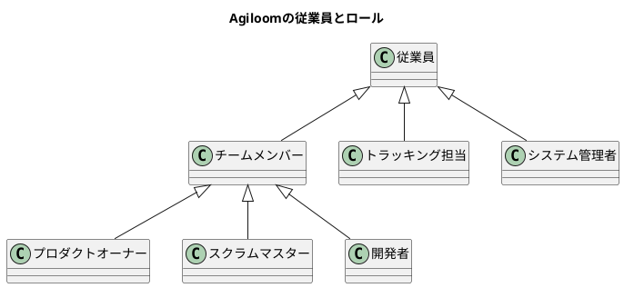

# Agiloom：ロール別の業務領域一覧

## 1. この資料の対象

Agiloomでは、従業員が基本の利用者区分です。従業員のうち、スクラムチームに所属する人はチームメンバーとなり、プロダクトオーナー（PO）、スクラムマスター（SM）、開発者（Developers）の役割を担います。チームメンバー以外の従業員は、プロジェクトをトラッキングする利用者として参加できます。システム管理者も従業員であり、Agiloomの管理権限を担います。

一人の従業員が複数の役割を兼ねる場合があります。所属、業務上の役割、システム権限は区別して設定します。

## 2. ロール別業務領域一覧

### 2.1 従業員（共通）

従業員はAgiloomを利用するすべての人に共通する区分です。チームメンバー、トラッキング担当、システム管理者にも共通する基本的な責任があります。

| 項目         | 内容                                                                       |
|--------------|----------------------------------------------------------------------------|
| 目的         | 業務情報を正確かつ安全に扱い、担当する仕事やプロジェクトに必要な協働を行う |
| 主な業務     | アカウント保護、事実に基づく記録、適切な情報共有、問題や不審な事象の報告   |
| 成果物       | 正確な作業情報、課題報告、適切に管理された業務情報                         |
| 権限上の境界 | 自分に付与された範囲でのみ情報を閲覧・更新する                             |

### 2.2 チームメンバー（共通）

チームメンバーはスクラムチームに所属する従業員です。PO、SM、開発者の役割を通じ、チームとして価値あるインクリメントを届けます。

| 項目         | 内容                                                             |
|--------------|------------------------------------------------------------------|
| 目的         | スプリント目標に向けて協働し、品質の高い成果を届ける             |
| 主な業務     | スプリント計画への参加、チーム内の協働、成果と進め方の検査、改善 |
| 成果物       | スプリント目標に向けた成果、透明な作業状況、改善アクション       |
| 権限上の境界 | チームの作業計画はチームが管理し、役割に応じて各自が判断する     |

### 2.3 プロダクトオーナー（PO）

POはプロダクト価値を最大化し、プロダクトバックログを効果的に管理します。

| 業務領域             | 主な業務                                                         | 主な成果・判断                 |
|----------------------|------------------------------------------------------------------|--------------------------------|
| プロダクト戦略       | ビジョン、Product Goal、成功指標を定め、学びに応じて見直す       | 目標、戦略、成功指標           |
| ステークホルダー管理 | ユーザーや関係者のニーズを把握し、期待を調整する                 | 要求、合意、意思決定記録       |
| ユーザー理解         | 課題、利用状況、機会、仮説を整理・検証する                       | ペルソナ、ジャーニー、検証結果 |
| バックログ管理       | 項目を明確化・分割し、価値順に並べ、透明性を保つ                 | Product Backlog、受入条件      |
| 計画・優先順位       | 価値、リスク、依存関係、制約を踏まえて順序づける                 | Epic／Release計画、優先順位    |
| チームとの協働       | 開発者の質問に答え、目的や業務上の判断を伝える                   | 共通理解、判断、更新された項目 |
| 成果評価             | インクリメントや利用者フィードバックを確認し、次の判断に反映する | 受入・追加対応判断、学び       |
| 継続的改善           | 成果と環境変化に応じて目標やバックログを更新する                 | 改訂された戦略・バックログ     |

POは価値と優先順位に責任を持ちます。開発者の作業を割り当てたり、技術的な実現方法を一方的に決めたりしません。

### 2.4 スクラムマスター（SM）

SMはスクラムの理解と実践を支援し、チームと組織の有効性を高めます。

| 業務領域       | 主な業務                                                   | 主な成果・判断                   |
|----------------|------------------------------------------------------------|----------------------------------|
| スクラムの実践 | スクラムの目的、役割、イベント、経験主義への理解を支援する | 共通理解、実践上の改善           |
| 自己管理・協働 | チームの自律性、対話、相互支援を促す                       | 自己管理するチーム               |
| イベント支援   | 各イベントが目的を果たし、検査と適応につながるよう支援する | イベントの成果、決定、アクション |
| 障害解消       | チームの進行を妨げる障害を可視化し、解消を助ける           | 障害の解消、再発防止             |
| PO支援         | 目標設定、バックログ管理、関係者との協働を助ける           | 明確で透明なバックログ           |
| 組織支援       | 組織や関係者がスクラムチームと協働できるよう促す           | 組織的な障害の改善               |
| 継続的改善     | 振り返りと改善アクションの実行を支援する                   | 実施・効果確認された改善         |
| 透明性・健全性 | 状況やリスクを正確に可視化し、健全な働き方を支える         | 信頼できる状況共有               |

SMはチームの上司、タスク割当担当者、POの代行者ではありません。コーチング、ファシリテーション、教育、障害解消を通じて支援します。

### 2.5 開発者（Developers）

開発者は各スプリントで利用可能なインクリメントを作り、Sprint Goalに向けて計画と実行を調整します。

| 業務領域         | 主な業務                                                           | 主な成果・判断                     |
|------------------|--------------------------------------------------------------------|------------------------------------|
| スプリント計画   | POと目標・項目を確認し、Sprint Backlogと実行計画を作る             | Sprint Goal、Sprint Backlog        |
| バックログ具体化 | 項目の目的、受入条件、依存関係、技術的不確実性を確認する           | 明確化・分割された項目             |
| 設計・実装       | 解決策を設計し、実装・統合する                                     | 動作するプロダクト機能             |
| 品質確保         | テスト、レビュー、セキュリティ・性能確認を行い、完成の定義を満たす | Doneのインクリメント               |
| 日々の適応       | 進捗や新情報を検査し、残作業の計画を調整する                       | 更新されたSprint Backlog           |
| チーム協働       | 知識共有、相互支援、技術判断の共有を行う                           | チーム全体の成果と共有知識         |
| レビュー         | インクリメントを示し、フィードバックを次の作業に反映する           | レビュー結果、学び                 |
| 改善             | 技術・プロセス上の改善を実行し、効果を確かめる                     | 改善アクション、技術的負債への対応 |

開発者は技術的な実現方法とSprint Backlogを管理します。チームとして完成の定義を満たし、個人ではなくチーム全体で成果に責任を持ちます。

### 2.6 トラッキング担当従業員

トラッキング担当はチームメンバー以外の従業員で、プロジェクトの進捗、成果、リスクを追跡します。

| 業務領域         | 主な業務                                 | 主な成果・判断           |
|------------------|------------------------------------------|--------------------------|
| 進捗確認         | マイルストーン、目標、進行状況を確認する | 状況理解、必要なフォロー |
| 成果確認         | レビュー結果や成果指標を確認する         | 事業・組織上の判断材料   |
| リスク追跡       | 依存関係、課題、遅延リスクを把握する     | 調整・意思決定の必要性   |
| 関係者調整       | 必要に応じて部門間の調整や意思決定を行う | 調整事項、決定、支援     |
| 質問・懸念の伝達 | チームの窓口を通じて確認や懸念を伝える   | 回答、対応方針           |

基本権限は参照中心です。チームのSprint Backlogや作業計画を直接変更せず、追加の編集権限が必要な場合は、目的と範囲を明確にして設定します。

### 2.7 システム管理者

システム管理者は従業員が担う管理権限ロールで、Agiloomの利用基盤を安全かつ安定して運用します。

| 業務領域           | 主な業務                                               | 主な成果・判断         |
|--------------------|--------------------------------------------------------|------------------------|
| ユーザー・組織管理 | アカウント、組織、チーム、ワークスペースを管理する     | 最新の利用者・組織情報 |
| 認証・権限         | 認証方式、ロール、アクセス範囲を管理し、棚卸しする     | 最小権限、権限変更記録 |
| 設定管理           | プロジェクト共通設定、テンプレート、保持設定を管理する | 一貫した利用設定       |
| セキュリティ・監査 | 重要操作を記録し、異常やインシデントに対応する         | 監査証跡、対応記録     |
| 運用・可用性       | 稼働、容量、保守、障害対応を管理する                   | 安定稼働、復旧記録     |
| データ保護         | バックアップ、保持、復元テストを運用する               | 復旧可能性             |
| 外部連携           | 連携先、資格情報、同期状況を管理する                   | 安全で継続可能な連携   |
| 問い合わせ・変更   | 申請、承認、変更、周知を追跡する                       | 変更履歴、利用者支援   |

管理権限は最小限に付与し、管理操作を記録します。システム管理者は、POの優先順位やチームの作業計画を決める立場ではありません。

## 3. ロール間の連携

| 連携場面                 | 主な連携内容                                                                 |
|--------------------------|------------------------------------------------------------------------------|
| POと開発者               | POが価値・優先順位・業務上の期待を伝え、開発者が実現方法と実行計画を決める   |
| SMとチーム               | SMがスクラムの実践、自己管理、障害解消、改善を支援する                       |
| トラッキング担当とPO     | トラッキング担当が状況や成果を確認し、必要な調整・判断をPOと連携する         |
| トラッキング担当とチーム | 状況確認や質問は定められた窓口を通し、作業計画への直接介入を避ける           |
| システム管理者と全利用者 | 管理者がアカウント、権限、運用を支え、利用者が必要な申請・報告を行う         |
| 従業員とチーム           | 従業員が業務知識や利用者の声を提供し、チームが検討・優先順位づけ・実装を行う |

## 4. ロール別のAgiloom利用画面

| ロール           | 主に確認する情報                                   | 主な操作                                 |
|------------------|----------------------------------------------------|------------------------------------------|
| 従業員（共通）   | 自分の通知、依頼、アクセス可能な情報               | 情報の閲覧、許可された記録・回答         |
| PO               | Product Goal、バックログ、フィードバック、成果指標 | 目標・項目・優先順位の管理、判断記録     |
| SM               | Sprint Goal、障害、イベント、改善アクション        | 支援・調整、障害と改善の追跡             |
| 開発者           | Sprint Backlog、受入条件、テスト、依存関係         | 計画・作業状態・技術情報の更新           |
| トラッキング担当 | プロジェクト進捗、マイルストーン、成果、リスク     | 状況の参照、許可されたレポート出力、質問 |
| システム管理者   | ユーザー、権限、監査、稼働、バックアップ、連携     | システム・組織設定、運用、管理操作       |

画面や操作権限は、ロール名だけで一律に決めず、プロジェクトへの所属、情報の機密性、業務上の必要性も考慮して設定します。

## 5. 権限設計の原則

1. **最小権限**：業務に必要な操作だけを付与する。
2. **役割と所属の分離**：スクラム上の役割、チーム所属、プロジェクト閲覧権限を区別する。
3. **責任の明確化**：POは価値とバックログ、開発者は実現方法とSprint Backlog、SMはスクラムの有効性を担う。
4. **参照と変更の分離**：トラッキング担当は原則参照中心とし、編集権限は必要に応じて追加する。
5. **管理操作の記録**：システム管理者の特権操作と権限変更を監査可能にする。
6. **定期的な見直し**：異動、役割変更、プロジェクト終了時に所属と権限を更新する。

## 6. 結論

Agiloomでは、従業員を共通の利用者区分とし、その中にチームメンバー、チーム外のトラッキング担当、システム管理者があります。チームメンバーはPO、SM、開発者の役割を担い、それぞれ異なる責任を果たしながらチームとして価値を届けます。

ロールごとの業務と権限を明確にすることで、プロダクトの優先順位、スクラムの支援、開発計画、プロジェクト追跡、システム運用の責任が混同されにくくなります。Agiloomでは所属・役割・権限を適切に組み合わせ、各従業員が必要な情報にアクセスして責任を果たせるようにします。
