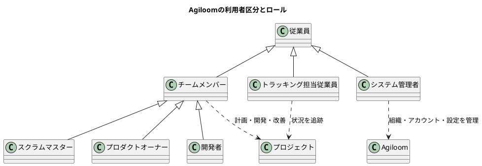

# Agiloom：ロール一覧

## 1. 目的と用語

この資料では、Agiloomを利用する人の区分と、プロジェクト内で担う役割を整理します。

- **従業員**：Agiloomを利用する人の基本区分。
- **チームメンバー**：プロジェクトのスクラムチームに所属する従業員。
- **スクラムロール**：チームメンバーが担うスクラムマスター、プロダクトオーナー、開発者の役割。
- **トラッキング担当従業員**：チームメンバーではなく、プロジェクトの状況を追跡する従業員。
- **システム管理者**：従業員が担う、Agiloomの組織・アカウント・権限・運用を管理する権限ロール。

ロールは役割と権限を表します。一人が複数のプロジェクトで異なるロールを持つ場合があります。所属、業務上の役割、システム権限は必要に応じて分けて設定します。

## 2. ロール構造

図は概念上の区分を示します。システム管理者は必ず従業員であり、スクラムチームの役割とは別の管理権限ロールです。一人の従業員が、システム管理者とチームメンバーまたはトラッキング担当を兼ねることは可能です。

## 3. ロール一覧

| ロール／区分             | 所属・対象                       | 主な責任                                                    | 主な権限の考え方                                                               |
|--------------------------|----------------------------------|-------------------------------------------------------------|--------------------------------------------------------------------------------|
| 従業員                   | Agiloom利用者全体                | 情報を正確かつ安全に扱い、付与された範囲で利用する          | 認証済みアカウントの基本利用。具体的な閲覧・編集範囲は追加ロールで決まる       |
| チームメンバー           | スクラムチームに所属する従業員   | チームとしてプロダクトの価値を届ける                        | 所属プロジェクトのチーム作業に参加する                                         |
| プロダクトオーナー（PO） | チームメンバー                   | プロダクト価値を最大化し、Product Backlogを効果的に管理する | プロダクト目標・バックログ項目・順序を管理する                                 |
| スクラムマスター（SM）   | チームメンバー                   | スクラムの理解と実践、チーム・組織の有効性向上を支援する    | チーム運営を支援し、障害・改善情報を扱う。POの優先順位を代行しない             |
| 開発者（Developers）     | チームメンバー                   | スプリントごとに利用可能なインクリメントを作成する          | Sprint Backlogを作成・更新し、実現方法と日々の計画を決める                     |
| トラッキング担当従業員   | チーム外の従業員                 | プロジェクトの進捗、成果、リスクを追跡し、必要な調整を行う  | 原則として参照中心。チームの計画や項目を変更する権限は必要に応じて個別付与する |
| システム管理者           | 従業員に付与される管理権限ロール | ユーザー、認証、権限、組織設定、監査、運用を管理する        | システム・組織管理の特権。業務上必要な範囲に限定し、管理操作を記録する         |

## 4. ロール別の業務と権限

### 4.1 従業員

従業員はすべてのAgiloom利用者に共通する区分です。特定のプロジェクトやチームへの参加方法は、チームメンバー、トラッキング担当、システム管理者などのロールと権限で定まります。

- 自分のアカウントと認証情報を適切に保護する。
- 許可された情報だけを閲覧・更新する。
- 課題や作業の情報を事実に基づいて記録する。
- 誤った権限やセキュリティ上の懸念を管理窓口に報告する。

### 4.2 チームメンバー

チームメンバーはスクラムチームに所属し、スクラムの役割を担います。チームとしてSprint
Goalに向けて協働し、完成の定義を満たすインクリメントを作成します。

チームメンバーという所属区分そのものが、PO・SM・開発者の個別責任を置き換えるわけではありません。各メンバーにスクラム上の役割を割り当てます。

### 4.3 プロダクトオーナー（PO）

- プロダクト価値を最大化することに責任を持つ。
- Product Goalを作成・伝達する。
- Product Backlog項目を作成・明確化し、順序づける。
- バックログを透明で理解可能な状態に保つ。
- 関係者や開発者と協働し、価値と優先順位の判断を説明する。

POは技術的な実現方法や開発者の作業割当を一方的に決めません。

### 4.4 スクラムマスター（SM）

- スクラムの理解と実践を支援する。
- チームの自己管理と協働を促す。
- スクラムイベントが目的を果たせるよう支援する。
- チームの進行を妨げる障害の解消を助ける。
- PO、開発者、組織が有効に協働できるよう支援する。

SMはチームの上司やタスク管理者ではなく、POや開発者の責任を代行しません。

### 4.5 開発者（Developers）

- スプリントの計画を作り、Sprint Goalに向けて日々適応する。
- Sprint Backlogを作成・更新する。
- 完成の定義を満たす品質を作り込む。
- 技術的な実現方法、設計、実装、テストを決める。
- チームとして説明責任を持ち、相互に協力する。

開発者は特定の職種名を指すとは限らず、インクリメント作成に必要なスキルを持つ人々を指します。

### 4.6 トラッキング担当従業員

トラッキング担当従業員はチームメンバーではなく、プロジェクトの状況を確認する利用者です。たとえば、関係部門の管理者、プロジェクト支援担当、事業責任者などが該当する場合があります。

- プロジェクトの進捗、マイルストーン、成果、リスクを確認する。
- 必要な情報をもとに、関係者間の調整や意思決定を行う。
- 質問や懸念を適切なチーム窓口に伝える。
- チームのSprint Backlogや作業計画を直接変更せず、必要な場合はチームと合意する。

トラッキング担当者の基本権限は参照中心とし、プロジェクトや組織の必要性に応じてコメント、レポート出力などを追加します。

### 4.7 システム管理者

- 従業員アカウント、チーム、組織、ワークスペースを管理する。
- 認証、ロール、アクセス権、監査ログを運用する。
- セキュリティ、バックアップ、可用性、外部連携を管理する。
- 問い合わせ、設定変更、障害対応を追跡可能な手順で行う。

システム管理者は従業員の一人であり、システム管理者権限は特権として最小限に付与します。Agiloomの管理権限はプロダクトの優先順位やチームの作業計画を決める権限を意味しません。

## 5. 基本的な権限マトリクス

凡例： **管理**＝作成・編集・順序変更などを行う、 **更新**＝担当範囲の情報を編集する、 **参照**＝閲覧する、
**限定**＝設定や承認に基づき許可する。

| 対象                       | 従業員（基本）         | PO                   | SM                   | 開発者                     | トラッキング担当   | システム管理者                       |
|----------------------------|------------------------|----------------------|----------------------|----------------------------|--------------------|--------------------------------------|
| プロダクト目標             | 参照（許可範囲）       | 管理                 | 参照・支援           | 参照・協働                 | 参照（許可範囲）   | システム上の管理。内容判断は行わない |
| Product Backlog            | 参照（許可範囲）       | 管理                 | 参照・支援           | 参照・協働、技術情報を更新 | 参照（許可範囲）   | システム上の管理。内容判断は行わない |
| Sprint Backlog・作業計画   | 原則参照不可または限定 | 参照・協働           | 参照・支援           | 管理                       | 参照（許可範囲）   | システム上の管理。計画判断は行わない |
| 実装・テスト情報           | 参照（許可範囲）       | 参照・価値確認       | 参照・支援           | 更新・管理                 | 参照（許可範囲）   | システム運用上のアクセスに限定       |
| プロジェクト状況・レポート | 参照（許可範囲）       | 参照・判断           | 参照・支援           | 更新・共有                 | 参照・トラッキング | 設定・アクセス管理                   |
| ユーザー・権限・認証       | 自分の情報に限定       | 自分の情報に限定     | 自分の情報に限定     | 自分の情報に限定           | 自分の情報に限定   | 管理                                 |
| 組織・ワークスペース設定   | 参照（許可範囲）       | プロダクト設定は限定 | チーム運用情報は限定 | チーム情報は限定           | 参照（許可範囲）   | 管理                                 |

実際の権限は、組織のセキュリティ方針やプロジェクトの機密性に合わせて設定します。表は初期設計の目安であり、Agiloomの機能実装時には操作単位で定義します。

## 6. ロールの割り当て・変更

1. 従業員アカウントを作成し、所属組織を設定する。
2. プロジェクトへの参加区分を選ぶ（チームメンバー、トラッキング担当など）。
3. チームメンバーにはスクラム上の役割を割り当てる。
4. プロジェクトの情報分類と業務上の必要性に応じて権限を付与する。
5. 役割変更・異動・プロジェクト終了時に、所属と権限を見直す。
6. 重要な権限変更を監査ログに記録し、定期的に棚卸しする。

## 7. Agiloomの段階的な実装順序

| 段階                    | 実装対象                                                   | ねらい                                 |
|-------------------------|------------------------------------------------------------|----------------------------------------|
| 1. 従業員アカウント     | 従業員の登録、停止、所属、認証                             | 利用者の基本情報を管理する             |
| 2. プロジェクト参加区分 | チームメンバー、トラッキング担当の区別                     | チーム参加と状況追跡を分ける           |
| 3. スクラムロール       | PO、SM、開発者の割り当て                                   | スクラム上の責任を明確にする           |
| 4. 権限マトリクス       | プロダクト、バックログ、スプリント、レポートごとの操作権限 | 最小権限で安全に利用できるようにする   |
| 5. システム管理者権限   | 組織・認証・監査・運用の管理機能                           | 管理操作を限定し、追跡可能にする       |
| 6. 権限変更・棚卸し     | 申請、承認、変更履歴、定期レビュー                         | 権限の過剰付与や残存を防ぐ             |
| 7. ロール別画面         | ロールに合ったダッシュボードと操作導線                     | 必要な情報と操作を分かりやすく提示する |

## 8. 結論

Agiloomでは、従業員が基本の利用者区分です。その中にスクラムチームのチームメンバー（スクラムマスター、PO、開発者）、チーム外からプロジェクトをトラッキングする従業員、そしてシステム管理者がいます。システム管理者も従業員であり、スクラム上の役割とは別の管理権限ロールとして扱います。

この区分を明確にすると、誰がプロダクトの優先順位を決めるのか、誰が開発計画を作るのか、誰が状況を追跡するのか、誰がシステムを管理するのかを分けられます。Agiloomでは、所属・役割・権限を適切に組み合わせ、各利用者が必要な情報にアクセスして責任を果たせるようにします。
