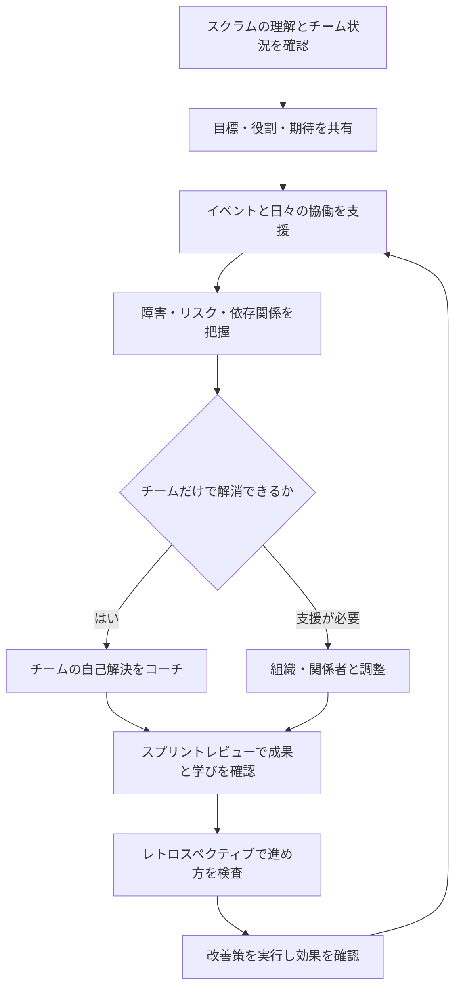

# Agiloom：スクラムマスターの業務一覧

## はじめに

スクラムマスター（Scrum
Master／SM）は、スクラムガイドに沿ってスクラムが理解され、実践されるよう支援する役割です。スクラムチームと組織の有効性を高めるため、チームをコーチし、障害の解消を助け、関係者間の協働を促します。

スクラムマスターはチームの上司や作業管理者ではありません。開発者の自己管理を支え、プロダクトオーナー（PO）がプロダクト価値を高められるよう協力し、組織のスクラム導入を促進します。

## 1. 業務全体像

| No. | 業務領域                         | 主な目的                                           | 主な成果                       |
|----:|----------------------------------|----------------------------------------------------|--------------------------------|
|   1 | スクラムの理解と実践を支援する   | スクラムの考え方とルールへの理解を深める           | 共通理解、実践上の改善         |
|   2 | 開発者の自己管理と協働を促す     | チームが自律的に計画し、価値を届けられるようにする | 自己管理する開発チーム         |
|   3 | スクラムイベントを有効にする     | イベントを目的に沿って活用する                     | 透明性、検査、適応             |
|   4 | 障害を取り除く                   | チームの進行を妨げる問題の解消を支援する           | 解消された障害、改善された環境 |
|   5 | プロダクトオーナーを支援する     | 効果的なプロダクト目標・バックログ管理を促す       | 明確で価値順のバックログ       |
|   6 | 組織とステークホルダーを支援する | スクラムチームとの協働や導入を促進する             | 理解、協働、組織的な改善       |
|   7 | チームの有効性を高める           | チームの進め方を継続的に改善する                   | 改善施策とその効果             |
|   8 | 透明性と健全性を支える           | 状況・リスク・品質を適切に見えるようにする         | 信頼できる情報と対話           |

## 2. 業務領域ごとの詳細

### 2.1 スクラムの理解と実践を支援する

スクラムチームと組織が、スクラムの目的や役割、イベント、成果物、コミットメントを理解し、適切に実践できるようにします。

| 業務           | 具体的な活動                                                 |
|----------------|--------------------------------------------------------------|
| スクラムの説明 | スクラムの価値基準、経験主義、透明性・検査・適応を説明する   |
| 役割の理解促進 | PO、開発者、スクラムマスターの責任と協働を明確にする         |
| 実践の観察     | イベントや日々の協働が目的に沿っているかを確認する           |
| 誤解への対応   | スクラムを単なる会議や進捗管理の仕組みにしないよう支援する   |
| 学習機会の提供 | チームや関係者向けの説明会、ワークショップ、コーチングを行う |

スクラムマスターは、チームに手順を押しつけるのではなく、スクラムの目的を理解したうえでチームが適応できるように支援します。

### 2.2 開発者の自己管理と協働を促す

開発者が自分たちで作業を計画し、進め方を決め、価値あるインクリメントを作れるよう支援します。

| 業務                 | 具体的な活動                                                 |
|----------------------|--------------------------------------------------------------|
| 自己管理の促進       | チームが作業の進め方や担当を自分たちで決められるよう支援する |
| 協働の促進           | 専門性を持ち寄り、チーム全体で目標達成に取り組めるようにする |
| チーム内の対話支援   | 誤解、意見の違い、意思決定の停滞に対話で向き合えるよう促す   |
| 集中できる環境づくり | 不要な割り込みや外部からの作業指示を減らすよう調整する       |
| 能力開発             | チームが自ら問題を発見し、解決できるようコーチする           |

スクラムマスターはタスクを割り当てたり、個人の作業を監視したりするのではなく、チームの自律性を育てます。

### 2.3 スクラムイベントを有効にする

各イベントが目的を果たし、透明性・検査・適応につながるよう支援します。

| イベント                     | スクラムマスターの支援                                                 |
|------------------------------|------------------------------------------------------------------------|
| スプリント                   | スプリントを通して目標への集中と品質を保てるよう支援する               |
| スプリントプランニング       | 目的、作業候補、実行計画についてチームが対話できるよう促す             |
| デイリースクラム             | 開発者が進捗を検査し、計画を調整できるよう支援する                     |
| スプリントレビュー           | インクリメントと成果を確認し、関係者と次の方向性を話し合えるようにする |
| スプリントレトロスペクティブ | チームが進め方を検査し、実行可能な改善を選べるよう支援する             |

スクラムマスターがすべてのイベントで司会をする必要はありません。チームがイベントの目的を理解し、自分たちで有効に運営できる状態を目指します。

### 2.4 障害を取り除く

開発者の進行を妨げる障害を見つけ、チーム自身で解決できない場合に、解消を支援します。

| 業務         | 具体的な活動                                             |
|--------------|----------------------------------------------------------|
| 障害の把握   | チームの停滞、依存関係、承認待ち、環境不備などを確認する |
| 原因の整理   | 表面的な症状だけでなく、組織やプロセス上の原因を調べる   |
| 解消の支援   | 関係部署への調整、必要な意思決定者への働きかけを行う     |
| 再発防止     | 同じ障害が繰り返されないよう、仕組みや関係性を改善する   |
| 状況の可視化 | 障害の影響、担当、次の対応、経過をチームと共有する       |

障害をすべてスクラムマスターが代わりに解決するのではなく、チームが解決力を高められるよう支援します。

### 2.5 プロダクトオーナーを支援する

POが価値を最大化するための目標設定やバックログ管理を行えるよう協力します。

| 業務                 | 具体的な活動                                                     |
|----------------------|------------------------------------------------------------------|
| 目標設定の支援       | プロダクト目標を明確にし、チームや関係者に伝えられるよう支援する |
| バックログ管理の支援 | 項目の明確化、分割、順序づけなどの方法を助言する                 |
| 関係者との協働       | ステークホルダーとの対話や期待調整を促す                         |
| 経験的な計画づくり   | 不確実性を踏まえ、学びに応じて計画を更新できるよう支援する       |
| チームとの連携       | POと開発者の間で必要な対話が継続するよう促す                     |

スクラムマスターはPOの代わりに優先順位を決めたり、プロダクトの意思決定を引き取ったりしません。

### 2.6 組織とステークホルダーを支援する

組織がスクラムを理解し、スクラムチームとの協働を改善できるよう支援します。

| 業務                 | 具体的な活動                                                 |
|----------------------|--------------------------------------------------------------|
| スクラム導入の支援   | 組織がスクラムの考え方を理解し、適用するための支援を行う     |
| 関係者との協働促進   | スプリントレビューなどを通じて、関係者との建設的な対話を促す |
| 組織的な障害の解消   | 承認、予算、部門間依存などの仕組み上の問題を可視化する       |
| マネージャーへの助言 | 自己管理を妨げない支援や、チームに権限を委ねる方法を助言する |
| 組織学習の促進       | チームで得た学びを組織の改善につなげる                       |

組織を一度に変えるのではなく、実際の障害や成果をもとに改善の対話を進めます。

### 2.7 チームの有効性を高める

チームが自分たちの進め方を検査し、改善を継続できるようにします。

| 業務             | 具体的な活動                                 |
|------------------|----------------------------------------------|
| 振り返りの支援   | 安心して事実や課題を話せる場を作る           |
| 改善の具体化     | 改善案を小さく実行可能な行動にする           |
| 効果の確認       | 改善策が実際に役立ったかを次回以降に確認する |
| チーム関係の支援 | 信頼、心理的安全性、建設的な対立を育てる     |
| コーチング       | チームが自ら答えを見つけられる問いかけを行う |

改善を「振り返りで話して終わり」にせず、担当や確認時期を決めて実行につなげます。

### 2.8 透明性と健全性を支える

チームの実際の状況を関係者が理解し、現実に基づく判断ができるよう支援します。

| 業務             | 具体的な活動                                                       |
|------------------|--------------------------------------------------------------------|
| 進捗の透明化     | スプリント目標やインクリメントの状態を正確に共有する               |
| リスクの可視化   | 依存関係、未解決課題、品質上の懸念を早期に共有する                 |
| 指標の適切な利用 | ベロシティなどの数値を個人評価やチーム間競争に使わないよう助言する |
| 完成の定義の支援 | チームが品質基準を明確にし、一貫して適用できるよう促す             |
| 健全性の確認     | 過負荷、長時間労働、継続的な割り込みなどの兆候を扱う               |

透明性は監視のためではなく、早期に問題を発見し、チームと組織が適切に適応するために使います。

## 3. スクラムマスター業務の時系列フロー

## 4. Agiloom機能との対応表

| スクラムマスター業務 | Agiloomの支援機能                                    | 主な情報・成果                   |
|----------------------|------------------------------------------------------|----------------------------------|
| スクラムの理解と実践 | ガイド、役割・イベントの説明、チーム合意             | 共通理解、チームの運用方針       |
| 自己管理と協働       | Sprint Board、目標・作業の可視化、協働スペース       | チームの計画と進行状況           |
| イベントの支援       | Planning、Daily、Review、Retrospectiveの支援         | イベントの成果、決定、アクション |
| 障害の解消           | Impediment／Risk管理、依存関係、エスカレーション記録 | 障害、影響、対応担当、状況       |
| PO支援               | Product Goal、Backlog、Story Mapping、計画機能       | 明確な目標と価値順のバックログ   |
| 組織支援             | ステークホルダー共有、意思決定ログ、組織課題の可視化 | 調整事項、合意、組織的な障害     |
| チーム改善           | Retrospective、改善アクション、効果確認              | 改善施策と結果                   |
| 透明性・健全性       | Insights、品質・リスク・作業状況の可視化             | 現状理解と適応の判断材料         |

Agiloomは進捗や課題を記録・可視化できますが、チームへのコーチング、対話、信頼構築を代替するものではありません。

## 5. スクラムマスターダッシュボード

| 表示領域                 | 主な表示内容                                   | 確認すること                           |
|--------------------------|------------------------------------------------|----------------------------------------|
| スプリント目標           | 目標、達成に向けた状況、変更                   | チームが目標に集中できているか         |
| 障害・依存関係           | 内容、影響、担当、経過日数、次の対応           | 解消に向けた調整や支援が必要か         |
| イベントの成果           | 決定事項、未解決事項、アクション               | イベントが目的と成果につながっているか |
| 改善アクション           | 担当、期限、状況、効果                         | 振り返りの学びが実行されているか       |
| チームの健全性           | 割り込み、過負荷、未完了作業、継続的な阻害要因 | 仕組みや働き方に改善が必要か           |
| 目標・バックログの明確さ | 目標との関連、項目の準備状況、未決事項         | チームが価値と目的を理解できるか       |
| 品質と完成の定義         | テスト状況、欠陥、品質基準の確認               | 品質が後回しになっていないか           |
| 組織課題                 | 部門間の依存、承認待ち、意思決定待ち           | 組織側に働きかける必要があるか         |

ダッシュボードは人やチームを順位づけるためではなく、対話と改善のきっかけに使います。指標の定義や背景を示し、数値だけで原因を決めつけないことが大切です。

## 6. 責任範囲と役割分担

| 領域             | スクラムマスター                       | PO                                       | 開発者                               |
|------------------|----------------------------------------|------------------------------------------|--------------------------------------|
| スクラムの有効性 | スクラムの理解と実践を支援する         | スクラムの一員として協働する             | スクラムの一員として協働する         |
| プロダクト価値   | POが価値を高められるよう支援する       | 価値の最大化とバックログ管理に責任を持つ | 実現方法を検討し、価値ある成果を作る |
| 作業の計画       | チームが計画できるよう促進する         | 目標と優先順位を明確にする               | Sprint Backlogと実行計画を作る       |
| 技術的な実現     | 障害解消や協働を支援する               | 目的・制約・業務判断を伝える             | 設計・実装・テストなどの方法を決める |
| イベント         | 有効性を高め、必要に応じて促進する     | 必要なプロダクト情報を提供する           | イベントに参加し、検査・適応する     |
| 品質             | 品質を下げる組織的障害の解消を支援する | 期待する成果と受入条件を明確にする       | 完成の定義に従い品質を作り込む       |
| チーム改善       | 改善を促し、チームの成長を支える       | プロダクト面の学びを反映する             | 作業方法と技術面を継続改善する       |

スクラムマスターは、チームの上司、プロジェクトマネージャー、タスク割当担当者ではありません。権限で人を動かすのではなく、コーチング、ファシリテーション、教育、障害解消を通じてチームと組織の有効性を高めます。

## 7. Agiloomの段階的な実装順序

| 段階                          | 実装対象                                                 | ねらい                               |
|-------------------------------|----------------------------------------------------------|--------------------------------------|
| 1. チームとスクラムの基本情報 | チーム、役割、イベント、Sprint、目標                     | チームの前提と運用状況を共有する     |
| 2. 障害・リスク管理           | 障害、依存関係、影響、担当、対応履歴                     | 問題の発見から解消までを追跡する     |
| 3. イベント支援               | Planning、Daily、Review、Retrospectiveの記録とアクション | イベントの目的と成果をつなげる       |
| 4. 改善アクション管理         | 振り返りの学び、担当、期限、効果確認                     | 改善を継続的な実践にする             |
| 5. PO・開発者との連携         | 目標、バックログ、未決事項、質問・回答                   | 役割間の情報共有と判断を促す         |
| 6. 組織的な障害の可視化       | 部門間依存、承認待ち、組織課題、エスカレーション         | チーム外の問題を解消しやすくする     |
| 7. Insightsと健全性の確認     | 作業状況、割り込み、品質、改善傾向                       | データをチームの対話と改善に活用する |
| 8. 学習コンテンツとガイド     | スクラムの説明、イベントの目的、コーチング支援           | チームと組織の理解を継続的に深める   |

まず障害と改善アクションの追跡から始め、実際のチーム運営で役立つかを確認してから分析や学習支援を広げます。機能の利用数ではなく、障害解消の速さ、改善の実行、チームの自己管理、成果への影響を見て優先順位を見直します。

## 8. 結論

スクラムマスターの中心的な仕事は、スクラムチームが価値ある成果を継続して届けられる環境を整え、チームと組織が自ら改善できる力を高めることです。

Agiloomは、障害、イベントの成果、改善アクション、依存関係、チームの状況を可視化し、必要な対話と調整を支援できます。ツールの記録や指標だけで改善が進むわけではありません。スクラムマスターが人と組織に働きかけ、チームが透明性を保って検査・適応できる状態を作ることが重要です。
