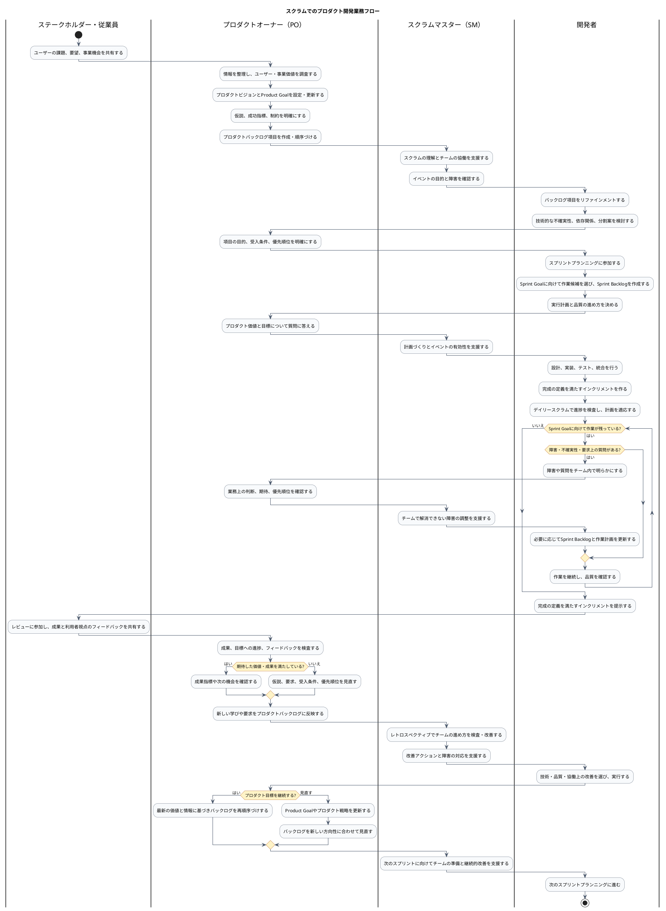

# Agiloom：スクラムでのプロダクト開発業務フロー

## 1. 目的と対象範囲

本書では、プロダクトの方向づけからプロダクトバックログの作成、スプリントでの開発、成果の確認、次の改善までを、役割ごとのスイムレーンを持つアクティビティ図で示します。

スクラムチームはプロダクトオーナー（PO）、スクラムマスター（SM）、開発者で構成します。ステークホルダーやチーム外のトラッキング担当従業員は、情報提供、レビュー、状況確認などで関わります。スクラムチームの作業計画と実現方法はチームが管理し、POはプロダクト価値とバックログの順序に責任を持ちます。

## 2. スイムレーン付きアクティビティ図

## 3. フローの読み方

| 区間                             | 主な活動                                                     | 主な責任                                                                 |
|----------------------------------|--------------------------------------------------------------|--------------------------------------------------------------------------|
| 課題発見・方向づけ               | 課題や機会を共有し、ビジョン・目標・仮説を整理する           | 従業員・ステークホルダーが情報を提供し、POが方向と価値を整理する         |
| バックログ作成・リファインメント | 項目を作成し、目的、受入条件、技術的な不確実性を明らかにする | POが価値と順序を管理し、開発者が実現可能性や分割を検討する               |
| スプリント計画                   | Sprint Goalと作業計画をチームで作る                          | 開発者がSprint Backlogを作成し、POとSMがそれぞれ価値情報と進行を支援する |
| スプリント実行                   | 設計、実装、テスト、統合を行い、日々計画を適応する           | 開発者が実行計画と品質に責任を持つ                                       |
| レビュー                         | インクリメントと成果を確認し、関係者のフィードバックを得る   | 開発者が成果を示し、POと関係者が価値や次の機会を検討する                 |
| 振り返り・適応                   | チームの進め方を検査し、改善を実行する                       | SMが改善を支援し、チームが改善策を選び実施する                           |
| 次のサイクル                     | 学びをバックログや目標に反映して次のスプリントへ進む         | POが価値順を更新し、開発者が次の計画を作る                               |

## 4. 重要な責任分担

- **PO**は、プロダクト価値、Product Goal、プロダクトバックログの内容と順序に責任を持ちます。
- **開発者**は、スプリント目標に向けた計画、Sprint Backlog、技術的な実現方法、インクリメントの品質に責任を持ちます。
- **SM**は、スクラムの有効性、チームの自己管理、障害解消、継続的改善を支援します。
- **ステークホルダー・従業員**は、課題や業務知識を提供し、レビューで成果に対するフィードバックを行います。
- **トラッキング担当従業員**は、許可された範囲で進捗・成果・リスクを確認します。チームの作業計画を変更する場合は、チームと合意します。

## 5. Agiloomで追跡する情報

| フロー上の情報       | Agiloomでの管理例                                                      |
|----------------------|------------------------------------------------------------------------|
| プロダクトの方向     | Product Vision、Product Goal、成功指標、仮説                           |
| 課題・要求           | ユーザー、課題、機会、フィードバック、意思決定                         |
| プロダクトバックログ | Epic、Feature、User Story、優先順位、受入条件、依存関係                |
| スプリント           | Sprint Goal、Sprint Backlog、作業状況、障害                            |
| 品質と成果           | 完成の定義、テスト結果、欠陥、性能結果、インクリメント                 |
| 検査と適応           | Sprint Reviewのフィードバック、Retrospectiveの改善アクション、更新履歴 |
| プロジェクト追跡     | マイルストーン、進捗、リスク、成果指標、レポート                       |

このフローは反復的です。レビューや利用状況から得た学びに応じて、バックログの順序だけでなく、必要であればProduct
Goalや戦略も見直します。
