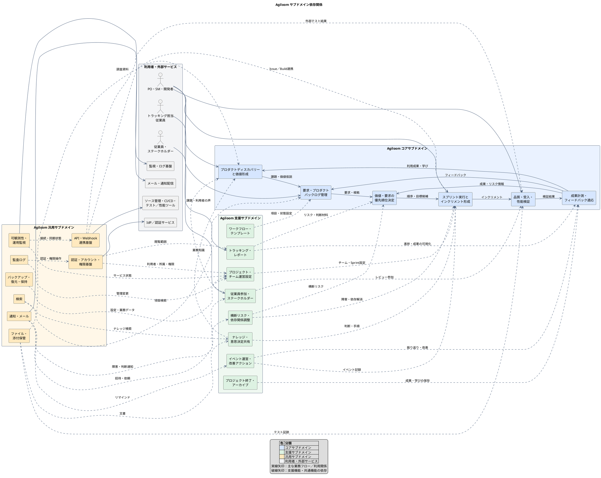

# Agiloom：サブドメイン依存関係コンポーネント図

## 1. 図の目的

本図は、Agiloomのコア・支援・汎用サブドメインと外部サービスの関係を示す論理コンポーネント図です。矢印は主な業務データまたはサービス利用の依存を表します。実際の配置方式や通信プロトコルを固定するものではありません。

## 2. コンポーネント図

## 3. 依存関係の読み方

### コアの価値フロー

1. **プロダクトディスカバリー**がユーザー課題と価値仮説を明らかにする。
2. **バックログ管理**が課題を実行・検証可能な要求にする。
3. **優先順位決定**が価値、Kano分類、リスク、コストを考慮して順序を決める。
4. **スプリント実行**がチームの計画に基づきインクリメントを形成する。
5. **品質・受入・性能検証**が期待値と品質を確認する。
6. **成果計測・フィードバック適応**が結果を次のディスカバリー、バックログ、優先順位に戻す。

### 支援サブドメイン

プロジェクト設定、テンプレート、従業員参加、イベント記録、トラッキング、ナレッジ、横断調整、終了処理が、コアの業務フローを運用しやすくします。支援機能はコアの業務判断を所有せず、コア側の情報を利用して運用・共有・調整を助けます。

### 汎用サブドメイン

認証、通知、ファイル、監査、検索、API接続、バックアップ、監視は複数の業務領域が共通して利用します。可能な範囲で標準技術や既存サービスを活用し、Agiloom固有の役割・業務ルールはコアまたは支援ドメイン側に残します。

## 4. 設計上のルール

- コアサブドメイン間は、業務上の明確な情報やイベントを介して連携させる。
- 汎用サブドメインをコア業務の判断主体にしない。
- 支援サブドメインからバックログ順序やSprint Backlogを直接変更しない。変更は責任ロールと権限に従う。
- 外部サービス連携はアダプター境界を設け、外部サービス固有のデータ形式をコアモデルへ持ち込まない。
- アクセス制御、監査、バックアップは横断機能として提供し、業務領域ごとの機密性と責任を考慮する。
- この図は論理的な依存関係を表す。物理的なサービス分割は、業務境界と運用要件を検証してから決める。

## 5. 結論

Agiloomの依存関係は、コアの価値フローを中心に、支援サブドメインが運用・調整・可視化を補い、汎用サブドメインが共通基盤を提供する形です。外部サービスは汎用サブドメインの境界越しに接続します。

この構造により、Agiloom固有の価値判断やスクラム開発の流れを保ちながら、認証、通知、保存、監視などの共通機能を交換可能な形で利用できます。
