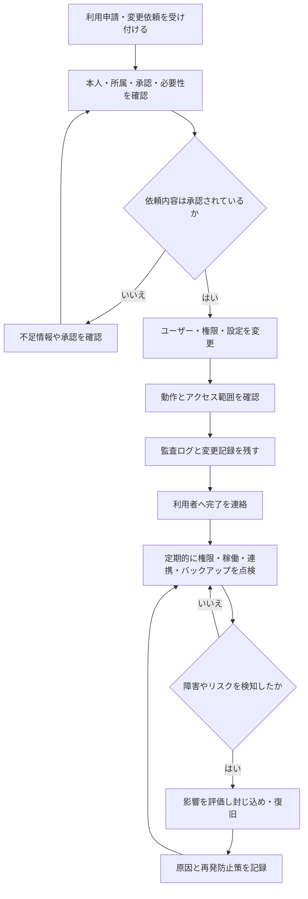

# Agiloom：システム管理者の業務領域一覧

## はじめに

システム管理者（System
Administrator）は、Agiloomを安全かつ安定して利用できる状態に保つ役割です。ユーザーやチームの登録、アクセス権限、設定、監査、バックアップ、障害対応などを管理し、利用者がスクラムの実践とプロダクト開発に集中できる環境を整えます。

システム管理者は、POのプロダクト優先順位や開発者の作業計画を決める役割ではありません。組織のセキュリティ方針と運用ルールに沿って、システムの利用基盤と管理機能を適切に運用します。

## 1. 業務全体像

| No. | 業務領域                         | 主な目的                                       | 主な成果                         |
|----:|----------------------------------|------------------------------------------------|----------------------------------|
|   1 | ユーザー・組織の管理             | 利用者と組織構成を正確に保つ                   | 有効なユーザー、チーム、組織設定 |
|   2 | 認証・アクセス権限の管理         | 必要な人が必要な範囲だけ利用できるようにする   | 適切なロール、権限、認証設定     |
|   3 | プロジェクト・ワークスペース設定 | Agiloomの利用単位と共通設定を整える            | 一貫したプロジェクト設定         |
|   4 | セキュリティ・監査               | 不正利用や情報漏えいを防ぎ、操作の追跡性を保つ | セキュリティ設定、監査記録       |
|   5 | システム運用・可用性             | 安定したサービス提供を維持する                 | 稼働状況、運用手順、対応記録     |
|   6 | データ保護・バックアップ         | データの損失を防ぎ、復旧可能性を確保する       | バックアップ、復旧手順、保持設定 |
|   7 | 外部サービス・連携の管理         | 安全で継続可能な連携を運用する                 | 接続設定、同期状況、連携記録     |
|   8 | 問い合わせ・変更・改善の管理     | 利用者支援と管理変更を適切に進める             | 対応履歴、変更記録、改善計画     |

## 2. 業務領域ごとの詳細

### 2.1 ユーザー・組織を管理する

利用者の登録から異動・退職時の停止まで、ライフサイクルに沿ってアカウントと組織情報を管理します。

| 業務           | 具体的な活動                                         | 成果物・判断             |
|----------------|------------------------------------------------------|--------------------------|
| ユーザー登録   | 招待、アカウント作成、所属チームの設定を行う         | 利用可能なアカウント     |
| ユーザー更新   | 氏名、部署、チーム、連絡先などを更新する             | 最新のユーザー情報       |
| 利用停止・削除 | 退職・契約終了・長期未使用に応じてアクセスを停止する | 無効化記録、データ引継ぎ |
| 組織構造の管理 | 組織、部門、チーム、プロジェクトの関係を保つ         | 一貫した組織階層         |
| 利用状況の確認 | アカウントの利用状況や未使用アカウントを確認する     | 棚卸し結果               |

ユーザーの無効化では、必要な業務データや所有物の引継ぎ方法を組織の方針に沿って決めます。

### 2.2 認証・アクセス権限を管理する

利用者の本人確認と権限を管理し、最小権限の原則に基づいて必要な範囲だけアクセスできるようにします。

| 業務             | 具体的な活動                                                       | 成果物・判断       |
|------------------|--------------------------------------------------------------------|--------------------|
| 認証方式の設定   | パスワード方針、多要素認証、シングルサインオンなどを設定する       | 認証ポリシー       |
| ロール管理       | 管理者、PO、スクラムマスター、開発者、閲覧者などのロールを定義する | ロールと権限の対応 |
| 権限付与・変更   | 業務上の必要性と承認に基づきアクセスを付与・変更する               | 権限変更記録       |
| 定期棚卸し       | 権限の過剰付与、不要アカウント、例外権限を確認する                 | 棚卸しと是正記録   |
| 緊急アクセス管理 | 緊急時の特権アクセスを制限・記録し、事後確認する                   | 緊急利用記録       |

特権権限は必要最小限の人数と期間に限定し、通常利用と管理操作を分けます。

### 2.3 プロジェクト・ワークスペースを設定する

Agiloomの利用単位や共通設定を管理し、各チームが一貫したルールで利用できるようにします。

| 業務               | 具体的な活動                                                       |
|--------------------|--------------------------------------------------------------------|
| ワークスペース作成 | 組織やプロダクトに応じたワークスペースを作成する                   |
| プロジェクト設定   | プロジェクト名、説明、メンバー、既定値を設定する                   |
| ワークフロー設定   | 項目タイプ、状態、優先度、ラベルなどの共通設定を管理する           |
| テンプレート管理   | チームで再利用するプロジェクトやバックログのテンプレートを保守する |
| アーカイブ管理     | 終了プロジェクトの保管、読み取り専用化、保存期間を管理する         |

設定を変更すると利用中のチームや既存データに影響することがあります。影響範囲を確認し、必要に応じて利用者へ事前に知らせます。

### 2.4 セキュリティと監査を管理する

データとアカウントを保護し、重要な管理操作を後から確認できるようにします。

| 業務             | 具体的な活動                                                   | 成果物・判断               |
|------------------|----------------------------------------------------------------|----------------------------|
| セキュリティ設定 | 認証、セッション、データ共有、許可された連携先などを管理する   | セキュリティ設定           |
| 監査ログ管理     | ログイン、権限変更、設定変更、エクスポートなどを記録する       | 監査証跡                   |
| インシデント対応 | 不審なアクセスや情報漏えいの疑いを確認し、封じ込めと報告を行う | インシデント記録、対応結果 |
| 脆弱性・更新対応 | 製品更新やセキュリティ勧告を確認し、適用計画を立てる           | 更新履歴、リスク評価       |
| データ共有の管理 | 外部共有やエクスポートの範囲と承認方法を定める                 | 共有・持ち出しルール       |

監査ログには個人情報や機密情報を必要以上に含めず、アクセス制御と保存期間を設定します。

### 2.5 システム運用と可用性を保つ

Agiloomが安定して利用できるよう、サービス状態、容量、エラー、保守作業を監視・運用します。

| 業務           | 具体的な活動                                            |
|----------------|---------------------------------------------------------|
| 稼働監視       | 可用性、応答時間、エラー率、ジョブ状態を確認する        |
| 容量管理       | データ量、添付ファイル、ユーザー数、API利用量を把握する |
| 保守・更新     | 計画停止や更新を調整し、影響を周知する                  |
| 障害対応       | 影響範囲を特定し、復旧、連絡、原因分析を進める          |
| 運用手順の整備 | 定常作業や障害時の手順、連絡先、判断基準を文書化する    |

運用上の目標（可用性、復旧時間、保守時間など）は、組織のサービス要件に合わせて定義します。

### 2.6 データ保護・バックアップを行う

プロジェクト情報や設定の損失を防ぎ、障害や誤操作から復旧できる状態を保ちます。

| 業務             | 具体的な活動                                             | 成果物・判断         |
|------------------|----------------------------------------------------------|----------------------|
| バックアップ設定 | 対象データ、頻度、暗号化、保存先を定める                 | バックアップ方針     |
| 復旧手順の管理   | データやサービスの復旧手順と責任者を明確にする           | 復旧手順書           |
| 復旧確認         | 定期的に復元テストを行い、実際に戻せることを確かめる     | テスト結果、是正事項 |
| 保持・削除管理   | 保存期間、アーカイブ、削除基準を組織方針に沿って運用する | データ保持設定       |
| エクスポート管理 | 必要なデータの出力と保管を承認・記録する                 | エクスポート記録     |

バックアップの成功通知だけで十分とせず、復元テストを通じて復旧可能性を確認します。

### 2.7 外部サービス・連携を管理する

認証基盤、通知、開発ツール、テストツールなどとの連携を、安全性と継続性を保ちながら管理します。

| 業務           | 具体的な活動                                         |
|----------------|------------------------------------------------------|
| 連携先の審査   | 利用目的、権限、データ共有範囲、提供元を確認する     |
| 接続設定       | 認証情報、Webhook、同期対象、通知条件を設定する      |
| 資格情報の管理 | トークンや秘密情報を安全に保管し、定期的に更新する   |
| 同期監視       | 連携エラー、遅延、重複、データ不整合を確認する       |
| 連携停止・変更 | 不要になった接続を解除し、影響とデータ処理を確認する |

Agiloomでは、たとえばソース管理、CI/CD、テスト管理、Gatlingなどの性能テスト実行との連携が考えられます。実際に導入する連携先と権限は組織の方針に従います。

### 2.8 問い合わせ・変更・改善を管理する

利用者の問い合わせに対応し、設定や運用の変更を追跡可能な手順で実施します。

| 業務           | 具体的な活動                                               |
|----------------|------------------------------------------------------------|
| 問い合わせ対応 | 利用方法、アクセス、エラーなどを受け付け、分類・回答する   |
| 変更管理       | 変更理由、影響範囲、承認、実施日時、切り戻し方法を記録する |
| 障害・問題管理 | 一時対応と根本原因への対応を分けて追跡する                 |
| 利用者への周知 | 変更、停止、既知の問題、回避策を適切な相手に知らせる       |
| 運用改善       | 問い合わせや障害の傾向から手順・設定・教育を改善する       |

## 3. システム管理者業務の時系列フロー

## 4. Agiloom機能との対応表

| 管理者業務         | Agiloomの支援機能                                | 主な情報・成果             |
|--------------------|--------------------------------------------------|----------------------------|
| ユーザー・組織管理 | ユーザー管理、組織・チーム管理、招待             | アカウント、所属、利用状態 |
| 認証・権限管理     | ロールベースアクセス制御、SSO／MFA設定           | ロール、権限、認証設定     |
| ワークスペース設定 | 組織・プロジェクト設定、テンプレート、アーカイブ | 共通設定、プロジェクト構成 |
| セキュリティ・監査 | 監査ログ、共有制御、セキュリティ設定             | 操作履歴、アクセス記録     |
| システム運用       | 稼働状況、エラー、容量、ジョブ監視               | 運用状態、障害情報         |
| データ保護         | バックアップ状態、保持設定、復元記録             | 保護状況、復旧可能性       |
| 外部連携           | 連携設定、同期状態、通知、資格情報の管理         | 接続先、同期結果、エラー   |
| 問い合わせ・変更   | サポート受付、変更履歴、障害管理                 | 対応状況、承認、実施記録   |

## 5. システム管理者ダッシュボード

| 表示領域             | 主な表示内容                             | 管理者が確認すること         |
|----------------------|------------------------------------------|------------------------------|
| サービス状態         | 稼働状況、応答時間、エラー、予定保守     | 利用への影響や対応の必要性   |
| ユーザー・ライセンス | 有効・停止アカウント、招待、利用状況     | 不要アカウントや容量の見直し |
| 権限・認証           | 特権ユーザー、認証方式、期限付きアクセス | 過剰権限や認証上のリスク     |
| 監査・セキュリティ   | 重要操作、不審なログイン、共有・出力     | 調査が必要な操作や異常       |
| バックアップ・復旧   | 最終バックアップ、失敗、復元テスト       | データ保護と復旧可能性       |
| 外部連携             | 接続状態、同期遅延、エラー、資格情報期限 | 連携の停止や不整合           |
| 問い合わせ・変更     | 未対応依頼、承認待ち、予定変更           | 優先対応と周知が必要な事項   |
| 容量・利用傾向       | 保存量、添付容量、利用増加、API使用量    | 拡張や運用見直しの必要性     |

## 6. 責任範囲と役割分担

| 領域             | システム管理者                             | PO・スクラムマスター・開発者との関係                 |
|------------------|--------------------------------------------|------------------------------------------------------|
| アカウントと権限 | 組織方針に基づき登録・変更・停止する       | 各チームは必要なアクセスを申請し、利用状況を確認する |
| 共通設定         | ワークスペースや共通ルールを管理する       | POやチームはプロダクト・チーム固有の内容を管理する   |
| セキュリティ     | 認証、権限、監査、データ保護を運用する     | 利用者は安全な利用と問題の報告に協力する             |
| サービス運用     | 稼働、保守、バックアップ、障害対応を担う   | チームはアプリケーション上の不具合や影響を報告する   |
| 外部連携         | 接続の審査、設定、資格情報、同期監視を行う | 開発者は必要な技術仕様と連携要件を提示する           |
| プロダクト判断   | Agiloomのプロダクト優先順位は決めない      | POが価値と優先順位を決め、開発者が実現方法を検討する |
| スクラム運営     | スクラムイベントやチームの作業を管理しない | スクラムマスターとチームがスクラムを実践する         |

管理者の権限を、プロダクトの優先順位やチームの作業指示に使わないよう境界を明確にします。管理者が日常的に業務データへアクセスする必要がある場合は、目的、範囲、承認、記録を定めます。

## 7. Agiloomの段階的な実装順序

| 段階                    | 実装対象                                     | ねらい・完了の目安                   |
|-------------------------|----------------------------------------------|--------------------------------------|
| 1. 組織・ユーザー管理   | 組織、チーム、招待、アカウントの有効化・停止 | 利用者のライフサイクルを管理できる   |
| 2. ロール・アクセス制御 | 標準ロール、最小権限、プロジェクト単位の権限 | 利用者ごとのアクセス範囲を制御できる |
| 3. 認証と監査           | MFA／SSO対応、ログイン・権限・設定変更ログ   | 重要な操作を保護し、後から追跡できる |
| 4. ワークスペース設定   | プロジェクト、テンプレート、共通ワークフロー | 安全で一貫した利用環境を作れる       |
| 5. 問い合わせ・変更管理 | 申請、承認、変更記録、通知                   | 管理作業を追跡可能な手順で進められる |
| 6. 稼働・連携監視       | サービス状態、同期、エラー、容量             | 問題を早期に検知し、対応できる       |
| 7. バックアップ・復旧   | 保持方針、バックアップ状況、復元テスト       | 障害や誤操作から復旧できる           |
| 8. 高度な運用・分析     | セキュリティアラート、利用傾向、定期棚卸し   | リスクと運用負荷を継続的に改善できる |

最初にアカウント、権限、監査の基盤を整え、その後に運用監視、復旧、分析を拡張します。各段階で組織のセキュリティ方針、データ保持要件、運用責任者を確認します。

## 8. 結論

システム管理者の中心的な仕事は、Agiloomを安全で安定して利用できる環境を維持し、利用者と組織のデータを適切に保護することです。ユーザーと権限の管理、監査、運用、バックアップ、連携、問い合わせ対応を通じて、システムへの信頼性を高めます。

Agiloomは管理操作と運用状態を可視化し、変更や問題への対応を追跡できるよう支援します。適切な権限設計、定期的な確認、復旧訓練、組織方針に沿った運用を組み合わせることで、チームが安心してプロダクト開発に集中できる基盤を作ります。
