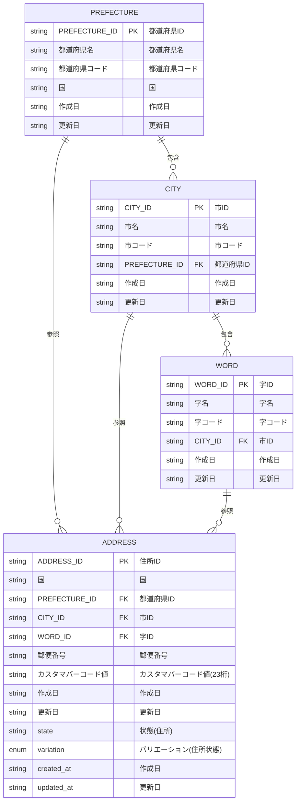

# 論理データモデル

## 概要

AD-01 住所管理業務領域の論理データモデルをMermaid ER図で表現します。

## ER図

## 論理データ一覧

| データ名 | 項目名 | タイプ | isKey | 説明 |
|----------|--------|--------|-------|------|
| 都道府県 | PREFECTURE_ID | string | true | 都道府県ID |
| 市 | CITY_ID | string | true | 市ID |
| 字 | WORD_ID | string | true | 字ID |
| 住所 | ADDRESS_ID | string | true | 住所ID |
