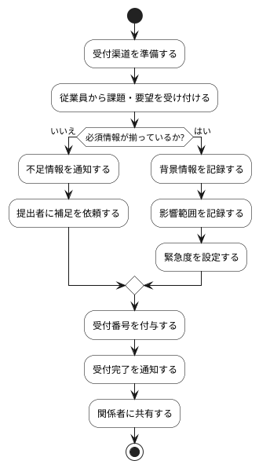

# BUC-BL-01 課題・要望の受付・記録

## 概要

従業員から課題・要望を受け付け、背景・影響とともに記録する。

## アクティビティ図

## アクティビティ一覧

| 番号   | アクティビティ名 | 説明                       | 担当アクター   |
|--------|------------------|----------------------------|----------------|
| ACT-01 | 受付渠道準備     | 受付渠道を準備             | ACT-02         |
| ACT-02 | 課題・要望受付   | 従業員からの入力を受付     | ACT-01, ACT-02 |
| ACT-03 | 必須情報確認     | 必須情報が揃っているか確認 | ACT-02         |
| ACT-04 | 不足情報通知     | 不足情報を通知             | ACT-02         |
| ACT-05 | 補足依頼         | 提出者に補足を依頼         | ACT-02         |
| ACT-06 | 背景情報記録     | 背景情報を記録             | ACT-02         |
| ACT-07 | 影響範囲記録     | 影響範囲を記録             | ACT-02         |
| ACT-08 | 緊急度設定       | 緊急度を設定               | ACT-02         |
| ACT-09 | 受付番号付与     | 受付番号を付与             | ACT-02         |
| ACT-10 | 受付完了通知     | 受付完了を通知             | ACT-02         |
| ACT-11 | 関係者共有       | 関係者に共有               | ACT-02         |
