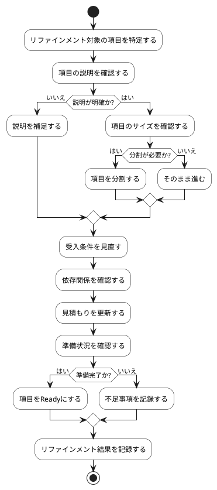

# BUC-BL-03 バックログリファインメント

## 概要

項目の説明・分割・受入条件・依存関係・準備状況を整える。

## アクティビティ図

## アクティビティ一覧

| 番号   | アクティビティ名 | 説明                             | 担当アクター   |
|--------|------------------|----------------------------------|----------------|
| ACT-01 | 対象特定         | リファインメント対象の項目を特定 | ACT-02, ACT-04 |
| ACT-02 | 説明確認         | 項目の説明を確認                 | ACT-02, ACT-04 |
| ACT-03 | 説明補足         | 説明を補足                       | ACT-02, ACT-04 |
| ACT-04 | サイズ確認       | 項目のサイズを確認               | ACT-02, ACT-04 |
| ACT-05 | 項目分割         | 必要に応じて項目を分割           | ACT-02, ACT-04 |
| ACT-06 | 受入条件見直し   | 受入条件を見直す                 | ACT-02, ACT-04 |
| ACT-07 | 依存関係確認     | 依存関係を確認                   | ACT-02, ACT-04 |
| ACT-08 | 見積もり更新     | 見積もりを更新                   | ACT-02, ACT-04 |
| ACT-09 | 準備状況確認     | 準備状況を確認                   | ACT-02, ACT-04 |
| ACT-10 | Ready設定        | 準備完了の項目をReadyにする      | ACT-02, ACT-04 |
| ACT-11 | 不足事項記録     | 不足事項を記録                   | ACT-02, ACT-04 |
| ACT-12 | 結果記録         | リファインメント結果を記録       | ACT-02, ACT-04 |
