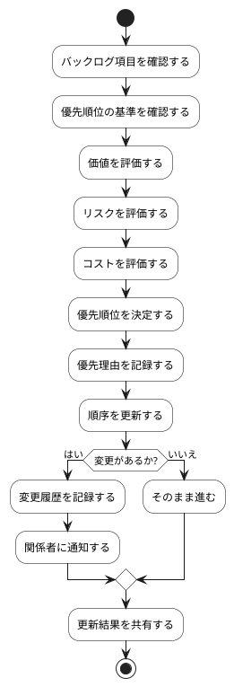

# BUC-BL-04 バックログの優先順位管理

## 概要

項目の順序・優先理由を管理し、変更履歴を追跡する。

## アクティビティ図

## アクティビティ一覧

| 番号   | アクティビティ名 | 説明                 | 担当アクター |
|--------|------------------|----------------------|--------------|
| ACT-01 | 項目確認         | バックログ項目を確認 | ACT-02       |
| ACT-02 | 基準確認         | 優先順位の基準を確認 | ACT-02       |
| ACT-03 | 価値評価         | 価値を評価           | ACT-02       |
| ACT-04 | リスク評価       | リスクを評価         | ACT-02       |
| ACT-05 | コスト評価       | コストを評価         | ACT-02       |
| ACT-06 | 優先順位決定     | 優先順位を決定       | ACT-02       |
| ACT-07 | 優先理由記録     | 優先理由を記録       | ACT-02       |
| ACT-08 | 順序更新         | 順序を更新           | ACT-02       |
| ACT-09 | 変更履歴記録     | 変更履歴を記録       | ACT-02       |
| ACT-10 | 関係者通知       | 関係者に通知         | ACT-02       |
| ACT-11 | 結果共有         | 更新結果を共有       | ACT-02       |
