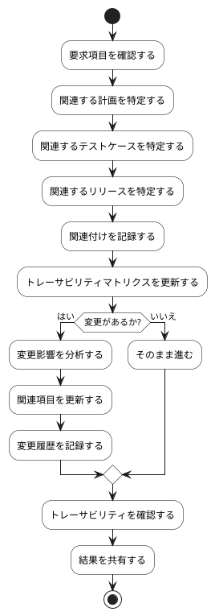

# BUC-BL-06 要求の関連付け・トレーサビリティ

## 概要

要求・計画・テスト・リリースの関連と変更経緯を追跡する。

## アクティビティ図

## アクティビティ一覧

| 番号   | アクティビティ名     | 説明                             | 担当アクター   |
|--------|----------------------|----------------------------------|----------------|
| ACT-01 | 要求項目確認         | 要求項目を確認                   | ACT-02, ACT-04 |
| ACT-02 | 計画特定             | 関連する計画を特定               | ACT-02, ACT-04 |
| ACT-03 | テストケース特定     | 関連するテストケースを特定       | ACT-02, ACT-04 |
| ACT-04 | リリース特定         | 関連するリリースを特定           | ACT-02, ACT-04 |
| ACT-05 | 関連付け記録         | 関連付けを記録                   | ACT-02, ACT-04 |
| ACT-06 | マトリクス更新       | トレーサビリティマトリクスを更新 | ACT-02, ACT-04 |
| ACT-07 | 変更影響分析         | 変更影響を分析                   | ACT-02, ACT-04 |
| ACT-08 | 関連項目更新         | 関連項目を更新                   | ACT-02, ACT-04 |
| ACT-09 | 変更履歴記録         | 変更履歴を記録                   | ACT-02, ACT-04 |
| ACT-10 | トレーサビリティ確認 | トレーサビリティを確認           | ACT-02, ACT-04 |
| ACT-11 | 結果共有             | 結果を共有                       | ACT-02, ACT-04 |
