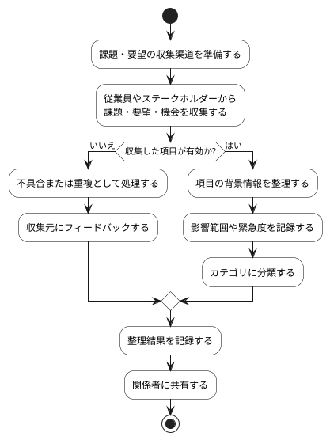

# BUC-DIS-01 課題・要望の収集・整理

## 概要

従業員やステークホルダーから課題・要望・機会を収集し、背景とともに整理する。

## アクティビティ図

## アクティビティ一覧

| 番号   | アクティビティ名 | 説明                                           | 担当アクター   |
|--------|------------------|------------------------------------------------|----------------|
| ACT-01 | 収集渠道準備     | 課題・要望を収集するためのフォームや窓口を準備 | ACT-02         |
| ACT-02 | 課題・要望収集   | 従業員やステークホルダーからの入力を収集       | ACT-01, ACT-02 |
| ACT-03 | 有効性判断       | 収集した項目が有効かどうかを判断               | ACT-02         |
| ACT-04 | 不具合処理       | 不具合または重複項目を処理                     | ACT-02         |
| ACT-05 | 背景情報整理     | 項目の背景情報を整理・補足                     | ACT-02         |
| ACT-06 | 影響度記録       | 影響範囲や緊急度を記録                         | ACT-02         |
| ACT-07 | カテゴリ分類     | 項目を適切なカテゴリに分類                     | ACT-02         |
| ACT-08 | 結果記録         | 整理結果をシステムに記録                       | ACT-02         |
| ACT-09 | 関係者共有       | 整理結果を関係者に共有                         | ACT-02         |
